# Inventory command contract

The inventory core records physical possession separately from scientific
identity. A registered scientific record can have no physical stock or several
stocks. Storage locations hold named positions, vessels occupy positions, and
stock links a vessel to a scientific record. An empty vessel is valid.

The browser-safe domain owner is
`packages/core/domain-services/src/inventory.ts`. The native SQLite owner is
`apps/desktop/src/main/inventory-owner.ts`. Request parsing lives in
`apps/desktop/src/shared/inventory-command.ts`; the authenticated native command
server and desktop IPC invoke the same inventory owner.

The Inventory workspace and authenticated agent tool consume this same owner.
Layouts distinguish named positions, grids, removable-tube boxes, permanent-well
plates and ordered stacks. This version supports one stock per vessel and exact
dimensioned amount accounting. Lots, internal preparations, amount transfers,
pooling, tracked dilution, exact concentration facts and known container limits
use the same command owner. Quantity and item reservations and physical custody
use that owner too. Physical types, equipment recipes, installed arrangements
and scoped fit evidence use that owner. Team synchronization remains separate
work.

Permanent wells have stable identity and remain attached to their plate. A plate
moves with all its wells. Whole-plate disposal retains historical stock and
disposes every well. Stack order is derived from child placement alone. Explicit
push and pop commands enforce capacity and removal from the top.
`removal: 'top-only'` governs retrieval order; recording quantity does not prove
physical access to a buried plate.

Canonical state is v27. v1/v2/v3 composition facts upcast to explicit unknown
values. v1–v4 snapshots gain an empty reservation map and recorded clock floor
without a revision change. Reading v1 upcasts named layouts and movable vessels;
v1/v2 stocks receive distinct unattributed roots and unknown container limits.
Reads do not write or increment revision. Historical command shapes and request
digests stay unchanged for retry and replay. v1–v6 snapshots gain empty type,
recipe and fit-evidence maps and explicit untyped item configurations. The
original request and receipt bytes remain unchanged. v1–v7 published type and
recipe versions gain explicit available selection state without changing their
content, installed pins, revision or clock. v1–v8 snapshots gain an empty
item-code map through state-only upcast; existing retired catalog selections
remain intact. v1–v9 snapshots gain empty temperature-claim, reported-setpoint
and storage-requirement maps without changing historical request or receipt
bytes, physical pins, recorded clock or inventory revision. v1–v10 snapshots
gain an empty explicit thermal-relationship map. Legacy v10 qualification pins
gain an unrecorded relationship value; they do not acquire new scope or
applicability through migration. v1–v11 snapshots gain native inventory origin
without changing recorded facts. v12 separates imported recorded attribution
from principals that can execute commands. Native invocation and receipt
contexts retain strict native actors. v1–v12 snapshots gain an empty lifetime
table-binding map. v12 imported origins and recorded actors retain their exact
attribution during this upcast. v1–v13 snapshots gain an empty observation map;
existing table bindings, origins and imported attribution remain intact. v1–v14
source bindings gain an empty accepted-source revision list. Legacy receive-v1
plan hashes retain their original binding representation. v1–v15 snapshots gain
an empty hierarchy-binding map without changing source revisions or imported
attribution. Reading never writes the upgraded snapshot.

## Independent states

These machines describe independent facts. They are not combined into a single
status field.

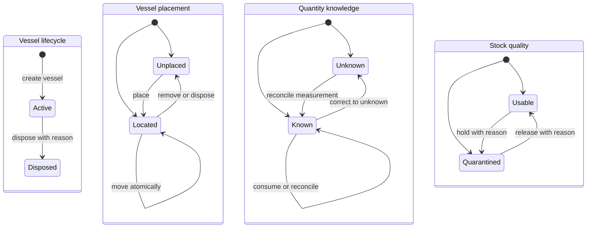

Disposal removes the vessel's current placement, retains its stock record and
last quantity, and prevents further use, movement, or quality changes. Known
zero does not dispose a vessel. Numerical consumption from unknown or
quarantined stock is refused.

Storage placement is either an explicit root or an immediate parent and named
slot. Vessel placement is explicitly unplaced or located. Each position is
exclusive across storage and vessels. Containment is acyclic. Moving a parent
changes its immediate placement and preserves descendant identities and local
positions.

Stock quantities use non-negative decimal strings with an explicit measurement
basis. Volume, mass, amount of substance and whole-item counts normalize exactly
to `uL`, `ng`, `nmol` and `item`. Supported decimal prefixes convert only within
the same dimension. Counts must be whole; decimal arithmetic never passes
through JavaScript numbers. Unsupported units, negative values, exponential
notation and unrepresentable results are refused. Enzyme activity labels need a
shared assay definition and are not interchangeable generic amounts.

From v18 onward, canonical state retains the unit for both known and unknown
amounts. A known zero still has its basis and identified stock. Ordinary
measurement, reconciliation, withdrawal and reservation cannot change a stock's
dimension. A different-basis observation can remain unapplied evidence. Native
mutations refuse applying it as an inferred conversion. Package counts are
distinct from measured contents.

Old request bodies remain byte-compatible: a unitless unknown quantity retains
the earlier volume meaning. New unknown amounts declare their unit. Request
parsing does not insert defaults into accepted history; mutation and persisted
state upcast establish the canonical unit. Older volume states gain their
already-defined `uL` basis without an invented amount, event, actor or
timestamp. Source receive-v1/stocktake-v1 and Benchling source-volume choices
retain their volume contracts and saved commands, raw fields and digests.

Consumption requires a positive amount. Reconciliation, quality changes,
consumption and disposal require a reason.

## Reservations and trusted time

Reservations record planned allocation independently of physical quantity and
placement. Each hold belongs to a stable local profile or verified agent. A
local profile represents an installation profile, not a verified person.

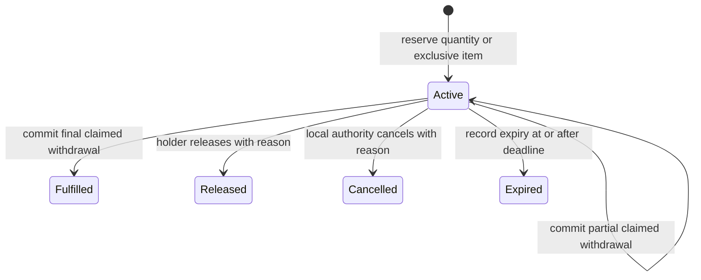

All terminal states are final. The clock passing a deadline changes eligibility
for fulfillment; it does not mutate the hold. An overdue hold remains allocated
until explicitly released, cancelled or expired. No timer owns business state.

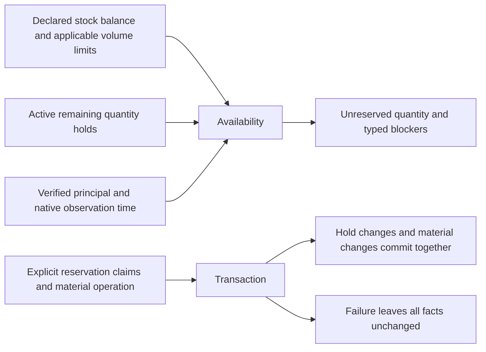

Availability is derived, never stored as another status. Unknown quantity,
quarantine, disposed containers, conflicting item holds and allocation
shortfalls are explicit blockers. Reconciliation can reveal that promises exceed
stock; it retains both the truthful measurement and holds. An overdue hold does
not prevent using the unreserved remainder.

Ordinary withdrawals protect held quantity. Reserved withdrawals explicitly bind
claims to source debits through `fulfill-reservations`. Item holds respect
ancestor and descendant containment, including permanent wells. Movement cannot
introduce overlapping holds belonging to different principals.

The native owner derives the principal and samples time inside the same SQLite
transaction as the accepted state, receipt and journal. Accepted time is at
least the previous recorded floor. Exact operation retries return the original
receipt before sampling a new clock. New receipts carry versioned context
separately from the existing actor string. Replay uses saved context and time;
historical receipt bytes and request digests remain unchanged. This is a local
monotonic clock guarantee; shared authority belongs to team synchronization.

## Lot quality, recalls and inherited restrictions

Lot assessment and stock quarantine are independent. `create-lot` retains its
historical untracked policy. A new controlled lot uses `create-lot` followed by
`manage-lot` in one batch; it begins unassessed. The guided forms compose these
commands for received and prepared lots, including pooled and diluted outputs.
Physical receipt does not establish local release.

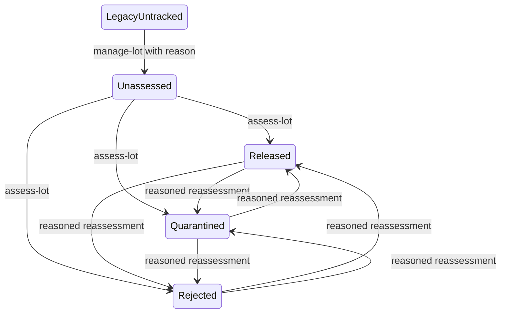

Every assessment records native time, actor and reason. The journal retains
previous decisions. No action resets management to untracked or unassessed.
Imported release remains attributed evidence and yields
`LOT_ASSESSMENT_IMPORTED` until an explicit local reassessment. Other unreleased
assessments yield `LOT_NOT_RELEASED`. Local reassessment cannot clear a stock
quarantine or an active recall.

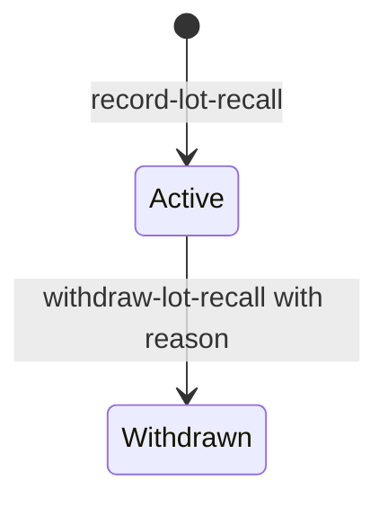

Recalls retain independent identities, optional source references, observed time
or unknown time, and native recording facts. Several active recalls can apply;
withdrawing one does not withdraw another. `LOT_RECALLED` identifies the lot and
active recall IDs. Receipt, physical quantity, custody, observations, movement
and disposal remain independent facts. Held stock remains physically on hand.

Each stock and lot stores a sorted set of lot constraint owners and explicit
`recorded` or `legacy-partial` ancestry knowledge. New derivations copy owner
sets at the time of transfer or preparation; existing destinations union their
owners with incoming owners. Reassociation adds owners. Later changes to the
original stock do not rewrite earlier aliquots, and pouring an aliquot back
cannot create a parent-reference cycle or erase restrictions. Current assessment
and recalls of each retained lot owner determine eligibility. Availability and
withdrawal, reservation and fulfillment guards use the same projection.

Older snapshots can prove only their current source and immutable lot-origin
snapshots. v1–v18 state upcasts derive those known owners as `legacy-partial`,
initialize legacy lot controls and an empty recall map, without inventing erased
associations, events or dates. Reading never persists this upcast.

Historical transition semantics are explicit in the existing receipt context:
missing or version 1 context forms a legacy prefix; version 2 introduces
cumulative lot restrictions. After each legacy prefix entry only, replay applies
the same owner projection as legacy snapshot upcast. Version 2 uses cumulative
owner propagation. A version 1 or missing-context entry after version 2 refuses,
as do new lot controls in an old-context entry. Native and nested archive
history use the same replay adapter. Original requests, receipt shapes and
digests remain unchanged; parsing never inserts a new context version into
historical receipts.

## Opening and expiry

Opening describes the first opening of a stock's material-container episode.
Opening an empty vessel, freezer or plate carrier does not open its contents.
`record-stock-opening` records an initial sealed/opened observation or the first
opening after a sealed observation. `correct-stock-opening` names the current
observation and either corrects the first-opening time or explicitly admits that
opening status is unobserved. Unknown status differs from
opened-at-unknown-time. Every prior fact remains, and the current stock points
to the exact chain head. Ordinary resealing or resetting is refused.

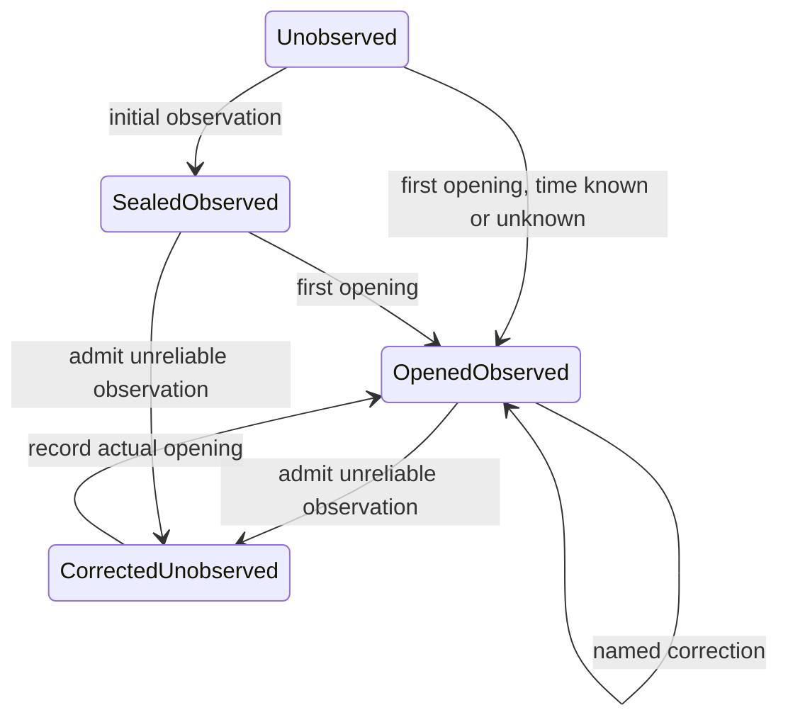

`record-validity-decision` explicitly starts tracking with an initial rule, or
adds an independent family. `correct-validity-decision` names the exact current
head and preserves its root and owner. Families have one root, one chain and one
current head; missing predecessors, forks, cycles and owner changes refuse.
Rules are unresolved, not-required, an explicit absolute cutoff, or an exact
elapsed limit after the original stock's opening. Lot-wide after-opening rules
refuse; each actual stock binds its own original opening owner.

Printed source text and precision stay separate from the chosen interpretation.
A printed month/date is not an instant; no UTC midnight, end-of-month, fixed
month/year length or opening time is inferred. Elapsed durations are positive
safe-integer milliseconds. Unsupported or overflowing interpretation stays
unresolved. A not-required decision affects only its own family and cannot
cancel another owner's restriction.

All source-stock family IDs copy when material is derived, including unresolved,
absolute and not-required families. Physical copies retain the earliest native
derivation bound regardless of the family's current rule. A later correction can
therefore change interpretation without inventing evidence for a later opening.
Prepared-lot provenance copies refs; actual output receipt binds its physical
time. Existing destinations retain their own families and incoming families even
at known zero. Later unrelated parent families leave earlier siblings unchanged.
Lot-wide absolute cutoffs follow retained lot owners.

A corrected source opening later than an already-recorded derivation remains
visible evidence and yields a chronology conflict for affected descendants; it
does not extend their usable life. A destination's own opening cannot restart an
inherited rule. Corrected-unobserved retains the same references and bounds.

The shared projection uses native `asOf`, reports every family/head/original
opening owner, the earliest effective deadline and `nextBoundaryAt`. At exactly
the cutoff it is expired. Availability exposes tagged `.actions.reserve` and
`.actions.withdraw` with all applicable blockers; `.blockers` retains withdrawal
blockers for compatibility. Explicitly observed sealed stock with an applicable
relative rule can reserve while withdrawal requires opening. Opening and use can
commit in one batch. Unknown opening/time, expiration and chronology conflicts
block both. Without an opening-dependent policy, opening observations do not
create an arbitrary use gate.

Views consume the native admissions. A timer requests a fresh native observation
at the next boundary; no renderer clock, cron or stored expired flag owns
eligibility. Requested quantities, reservation claims, custody, quality and
recalls are still checked independently on mutation. Expired material remains
physically on hand and can be measured, moved, documented or disposed.

Imported positive interpretation requires an explicit local reassessment of that
family. Restrictive and unresolved facts remain blocking. Reassessment cannot
manufacture a local opening or erase a different inherited family.
Legacy-untracked or mixed coverage is not proof of unexpired material; a current
projection describes current recorded rules.

v1–v19 snapshots gain unobserved opening with a null head, untracked validity,
empty inherited refs and empty opening/validity fact maps without invented
actors, dates, receipt changes or writes. v19 lot controls, recalls and
cumulative lot restrictions remain exact. New native receipts use context
version 3. Version 2 prefix replay preserves cumulative lot restrictions and
initializes only the new opening/validity fields. Version 1/missing retains its
existing legacy lot projection. Context versions cannot regress; new temporal
commands or facts in older contexts and too-new adopted source schemas refuse.
Replay uses the saved native observation time, never today's wall clock.

## Physical deliveries and retained supplier documents

An arrival is an immutable record of an actual observed delivery. Its namespace
and delivery ID differ from operation IDs, lot numbers, certificates, products
and orders. `preview-arrival` reads an application-owned versioned source packet
and one explicit choice per component. `apply-arrival` accepts its exact source,
resolved scientific fingerprints, targets, plan digest and revision through the
existing native transaction. The guided **Receive delivery** form builds the
packet from ordinary fields; it does not claim a supplier export format.

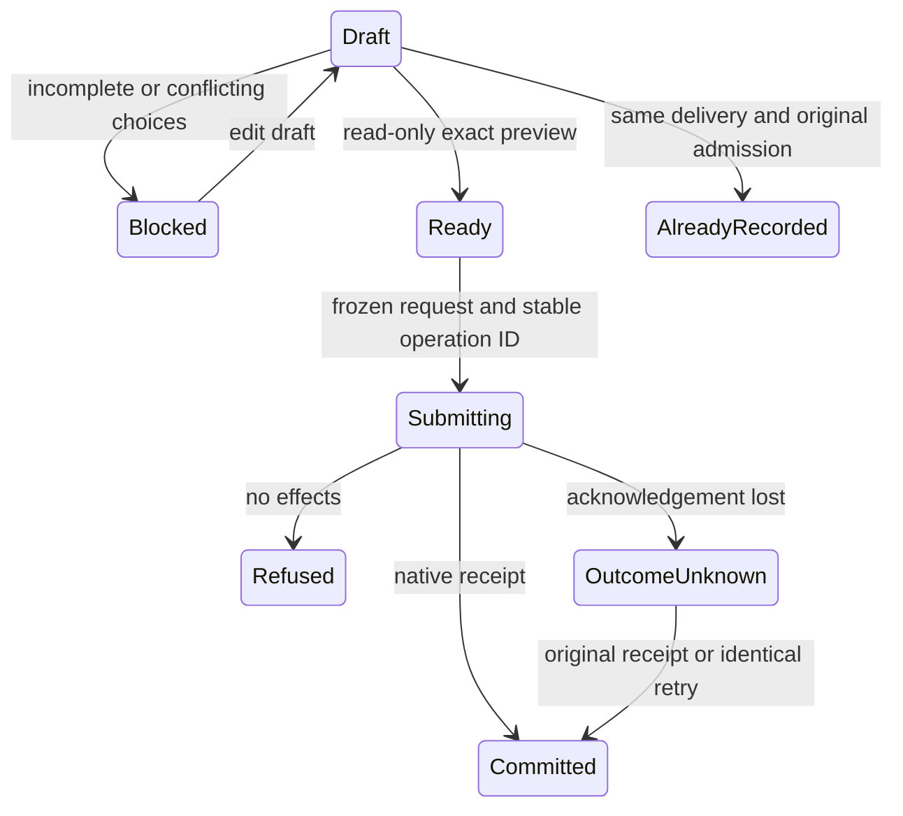

Submission states belong to the existing recovery owner. A committed arrival has
no mutable pending or failed flag. Source packets retain exact document bytes,
observation scope, package grouping, component identities and supplier claims.
Canonical arrival records retain document metadata/hashes and original admission
snapshots; the accepted request/history owns the original bodies. Packages
describe historical delivery grouping, not current storage hierarchy. Packaging
batch and component batch remain separate fields.

Every listed component is identified, physically unidentified, physically
unobserved, observed missing or evidence only. Missing and evidence-only entries
cannot create phantom stock. Unresolved physical entries create genuine vessels
without fake scientific identities or amounts. Identified receipts use explicit
material, exact known or unit-bearing unknown quantity, its measurement/source
basis, independent stock quality, and actual placement. Each physical component
creates a new empty movable vessel; this adapter cannot refill existing stock.

A new received lot requires the exactly observed supplier and component batch,
then composes `create-lot` and `manage-lot`, leaving local assessment
unassessed. Unknown supplier is explicit null. Known material with unknown
supplier lot can be received as explicitly unattributed stock, with a reason,
rather than inventing a batch label. Selecting an existing lot requires a reason
and the same material. No lot matching is inferred from similar supplier
strings. Held or expired lot material can still be physically received;
possession is separate from eligibility.

Known supplier-declared quantities must exactly normalize the selected component
quantity claim within its supported dimension. Unsupported activity units stay
raw evidence; they cannot become volume or mass. A separately measured amount
requires its own explicit reason. Package counts do not establish content
amount. Supplier QC cannot emit local release, stock-quality changes, opening or
expiry interpretation. Those are independent explicit actions.

Documents hash their decoded original bytes. UTF-8 must round-trip; base64 is
strict and canonical. Text byte selections must match original bytes at valid
boundaries; JSON selections retain numeric lexemes. A PDF region is an operator
citation, not a claim of verified extraction. Full originals and excerpts are
explicit coverage choices. No URL fetch, OCR, vendor connection, silent chunking
or larger transport cap is implied. The complete accepted request must fit the
existing inline limit.

The receiving draft retains stable document and claim keys. File selection has
an explicit reading generation; cancellation, replacement and scope changes
invalidate older completions. Preview requires complete retained bytes and a
successful recovery-draft write. Document changes invalidate source-linked
claims and any component quantity selection that depended on them. Selecting
repeated text records that occurrence's exact UTF-8 byte range, rather than
searching for the first matching quotation.

The saved renderer draft has its own version. Its v1 migration preserves the
delivery identity and original text, creates the original document entry and
keeps measured amounts explicitly measured. This does not change inventory
schema or accepted-operation recovery. Browser recovery storage may reject a
file smaller than the native request limit; that refusal blocks submission and
does not silently downgrade to an in-memory-only request. The existing
controller retains ownership of submission, missing acknowledgements and exact
operation retries.

`arrival-document` reads the exact retained body by arrival ID, document key and
expected hash through verified original or nested archive history. It is scoped
and read-only. Missing or corrupt source bytes yield unavailable, never live-URL
fallback. Current stock cannot substitute for a receipt or document preimage.

Arrival identity is checked before generating physical IDs. The identical source
and original choices preview as no-change after use, movement, disposal or
archive adoption, retaining original target IDs. Changed source or admission
requires separate reconciliation; it never replenishes or overwrites. A fresh
no-change apply writes no revision, receipt or event and cannot claim an old
receipt as a new operation. Exact original operation retries retain their
existing recovery contract. A locally generated delivery UUID cannot detect the
same physical package deliberately entered under another delivery ID.

Original admitted amounts, source hashes and initial choices remain immutable.
Current remaining amount, position, stock quarantine, reassociation, custody,
lot decisions and validity can evolve independently. Adoption maps explicit
scientific identities and imported actors while preserving original evidence
hashes and physical identities. One late component failure rolls back all lot,
vessel, stock and arrival effects together; metadata-only arrivals use the same
composite transition without dummy physical commands.

v1–v20 snapshots gain an empty arrival map without invented historical receiving
facts or writes. v20 opening/validity records and earlier controls remain exact.
Receipt context version 4 admits arrivals and preserves the prior monotonic
context rules; older contexts cannot contain new arrivals or too-new source
archives. Orders and receipt allocations are separate; expected orders never
manufacture physical stock, and later consumption cannot undo an actual receipt.

## Expectations, receipt matching and reorder reporting

Expected deliveries are reasoned statements, not physical stock or submitted
supplier orders. `record-expected-delivery` records an explicit material and
positive exact amount. `allocate-arrival` matches a known originally received
component amount to that expectation. All active allocations across every line
share the original received limit, and each line has its own expected limit.
Package labels, unresolved contents and current remaining amounts cannot stand
in for original receipt quantities. Over-delivery stays physically received in
full; unmatched excess remains explicit.

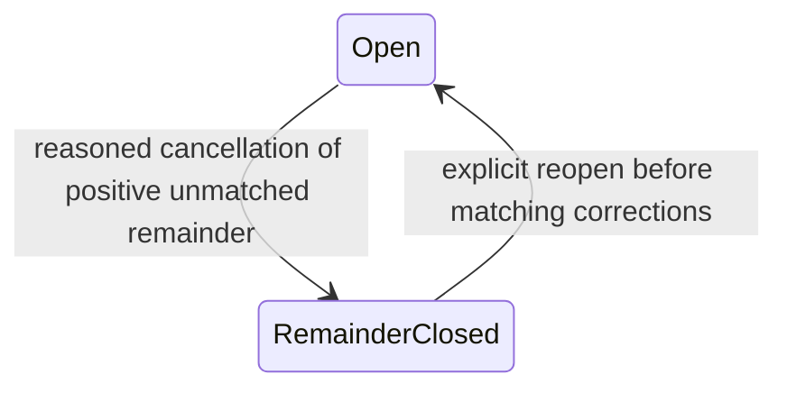

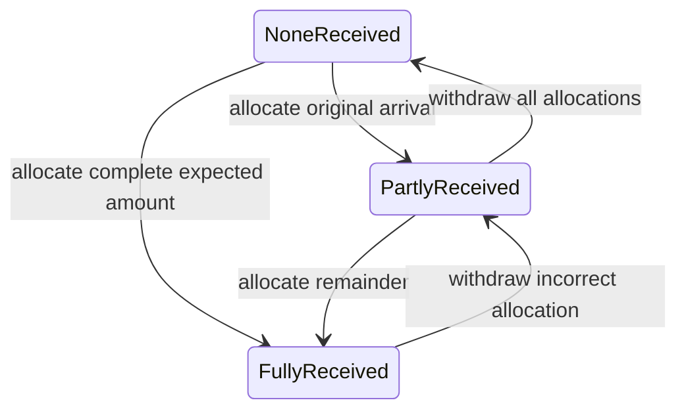

Line lifecycle and received progress are independent. Progress is derived from
active allocation facts; use, transfer, disposal, quarantine, recall and expiry
cannot change what was received. `withdraw-arrival-allocation` retains its
reasoned correction. Closing snapshots the positive unmatched remainder;
closed-line matching changes require `reopen-expected-delivery`. Neither action
changes stock. Replacement expectations remain separate statements with reasons.

Reorder rules declare exact material, amount dimension and threshold plus two
explicit policies: `actionBasis` reserve or withdraw, and `validityBasis`
current-recorded-rules or confirmed-current-validity. Suitable-for-reservation
stock differs from ready-to-withdraw stock: sealed material can satisfy the
former when its opening-dependent rule permits it. Confirmed validity requires
managed coverage and the selected native validity admission; compatibility
coverage is visibly not proof of current/unexpired material. Rule replacement
can retire and record in one batch.

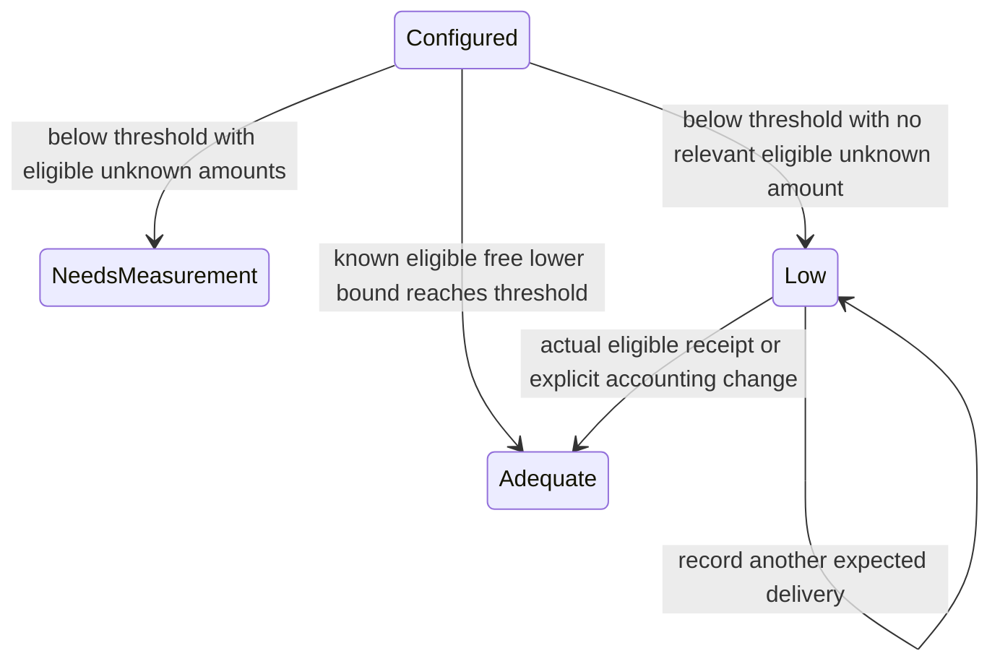

The native `stockroom` read returns expectation progress, original component
allocation remainders and reorder reports at one declared project, inventory,
revision, principal and native observation time. Operational eligibility is
factored inside the existing availability owner before quantity knowledge, so an
eligible unknown amount is retained as unknown rather than silently excluded.
Holds reduce free quantities, including the caller's holds. Matching commercial
receipts does not subtract physical quantity again.

Known eligible free subtotal is a nonnegative lower bound. Reaching the
threshold proves adequate even with additional unknown amounts. Otherwise,
relevant unknowns require measurement; with none, it is low under the selected
policy. Other dimensions, excluded stock and untracked coverage remain explicit.
Unrepresentable sums cannot produce false exact/low claims; a proven adequate
lower bound is marked at-least, otherwise the report is unavailable. Future
boundaries cause a new native read, never a persisted low-stock flag or renderer
business clock. No expected amount enters stock totals and no report submits
orders, messages or payments.

v1–v21 state gains empty expectation, allocation and reorder maps without
inventing historical statements or changing existing arrivals, validity and
controls. Receipt context version 5 admits the seven commands and preserves
older transition semantics, original requests, receipts and hashes. Current
scientific admission applies to material-bearing statements and rules; archive
adoption maps their explicit material references and imported actors.

## Scientific work and saved notebook context

A scientific work observation links a completed manual transfer to an existing
saved notebook page. Previewing a transfer neither moves material nor records
execution. The operator explicitly reports completed work; a software receipt
does not verify pipetting accuracy or biological success.

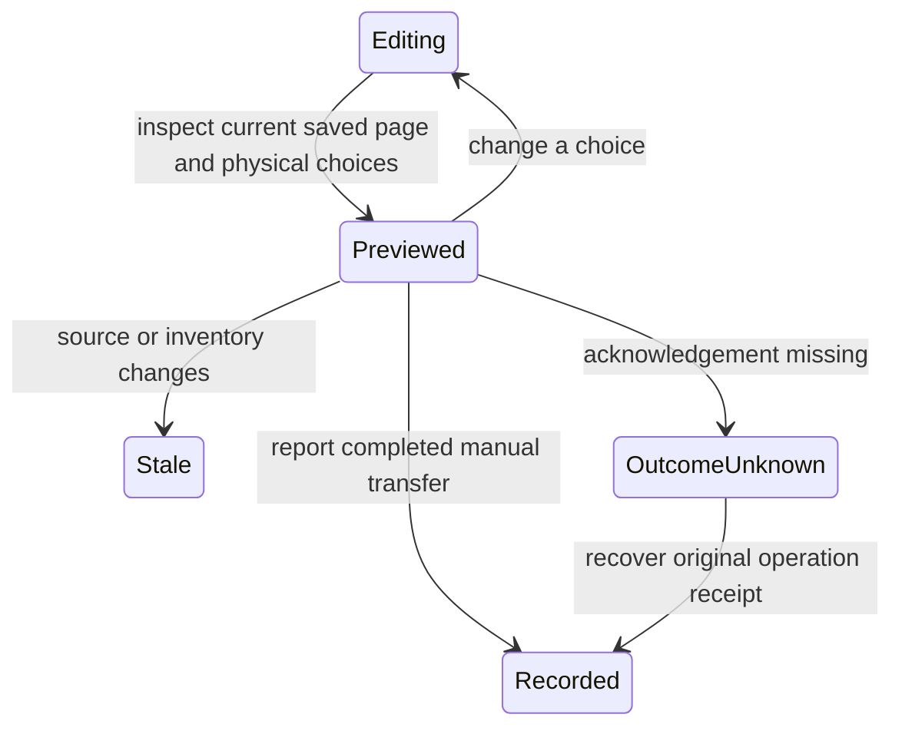

The existing notebook owner supplies canonical project/page identity, its
current file binding and a complete structured saved title/content snapshot.
Only clean, settled V2 pages are admitted. The snapshot has a SHA-256 and
remains native observed saved-source evidence, independent of the notebook's
later edits or availability. Working-copy concurrency tokens are not immutable
scientific revisions. This snapshot does not claim original Markdown or
attachment bytes.

One inventory transaction stores the exact source debit, new aliquot, immutable
work observation, journal and receipt. Existing transfer guards own quantities,
physical contents, lot restrictions, validity, custody and reservations. The
notebook source is checked around this transaction; no notebook file is written
as an implied side effect. Source members and current binding/authority must
remain unchanged during admission.

Stable work identity is separate from operation identity. Repeating an identical
observation cannot debit again, including after later use or movement. A changed
observation under the same work identity is a conflict. Original operation
retries return the original receipt. Historical effects and source metadata do
not change to match current stock or notebook content.

Canonical v23 adds `scientificWorks`; older snapshots gain an empty map without
writes or invented observations. Receipt context version 6 retains the trusted
structured notebook source for scientific-transfer replay. Other requests do not
carry that witness. Historical contexts and request digests remain unchanged.
Adoption maps scientific material references and actors in effect snapshots,
while preserving physical/work identities and foreign notebook provenance.
Notebook context does not create a Protocol Run, plate plan or robot execution.

Canonical v24 adds explicit Protocol Run context alongside the unchanged
notebook context. Reading v23 changes only the outer schema in memory. Its
notebook records retain their exact fields, identities, intent hashes, source
pins and effects. A v23 snapshot cannot declare Run context.

The `record-scientific-transfer-v2` request selects context by kind and
canonical entity ID. Notebook selections normalize to the original V1 intent
encoding; Run selections use a context-aware V2 encoding. Each kind selects
exactly one encoding. An equivalent notebook observation through the new API is
a no-change before reading its current source or checking current physical
availability. Reusing an operation ID with different raw request bytes remains a
conflict. Adding another context to existing work requires a separate
association without a physical transfer.

Receipt context version 7 admits either the unchanged notebook source packet or
an explicit saved Run packet. The Run packet retains the canonical identity,
file-object UUID and complete original UTF-8 JSON text. Its hash binds that
whole packet. Version 6 remains notebook-only, and neither version attaches a
scientific witness to unrelated operations. The existing request-plus-witness
size limit still applies. Adoption retains foreign context provenance while
mapping scientific material references and recorded actors.

## Recorded physical work reads

The Run's Recorded physical work section and authenticated agent query use
`scientificWorksForContext`. The native owner resolves the project and exact
Notebook or Run identity, reads one inventory snapshot and returns immutable
observations in recorded-time and work-ID order. It does not read the current
source file or require its hash to match a historical source pin. Foreign
adopted context remains foreign.

Pages contain at most fifty observations, with twenty as the default. A cursor
binds the exact query, inventory revision and last row. A different query or
invalid row refuses continuation; a changed revision requires the first page
again. The view replaces each page and uses the existing inventory-change
notification to refresh the affected project. It keeps loading, unavailable,
absent inventory and a successful empty page distinct. Late responses cannot
replace a newer Run or page.

Amounts, vessel names and placements are the recorded facts. A saved placement
does not include a full historical freezer hierarchy. Saved context loads
through the existing retained-source reader; current Run navigation resolves its
canonical identity independently. This read path does not write stock, Run
files, inventory revisions or receipts. It does not reinterpret the observation
as a declared Run input, produced material or scientific success.

## Reusable plate plans

A reusable plan is a saved declaration of intended aliquot transfers. Its
logical grid, source roles and ordered instructions contain no physical stock,
plate or execution identity. An unplanned cell says Unplanned. It does not
assert that a physical well is empty.

Canonical v26 adds immutable `platePlanVersions`. Older snapshots gain an empty
map in memory without changing stored bytes, revision or history. Native receipt
version 9 admits `save-plate-plan-version`; earlier versions cannot save plans
or adopt a raw v26 archive. A plan save has no scientific source witness. The
existing scientific transfer and citation witness rules remain intact.

Family identity is exact namespace and plan ID. Version identity combines that
family with the complete canonical definition hash, including title, labels,
layout, source-role order and instruction order. Instructions use positive exact
canonical µL amounts and distinct canonical destinations. At most 256 intended
transfers are supported in a logical grid of at most 10,000 positions. Roles
express intended use, without inferring a required scientific material.

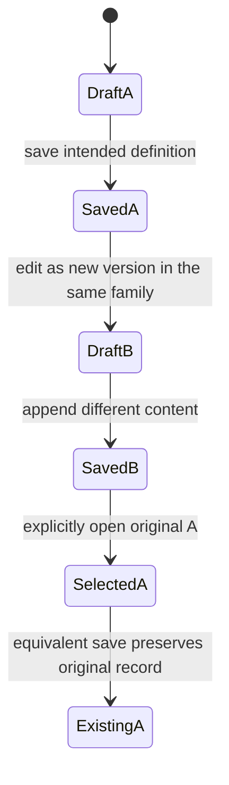

A→B→A retains two versions. There is no native current or latest pointer.
Equivalent content preserves the original save reason, actor and time; another
reason does not create a version or receipt. A changed request under the same
committed operation ID remains a conflict. Saving can initialize an otherwise
absent inventory with metadata only; it creates no physical plate or stock.

`previewPlatePlanVersion` and `applyPlatePlanVersion` share that save contract.
`platePlanVersions` returns bounded summary pages with an exact optional family
filter and query/revision-bound cursors. `platePlanVersion` reads an exact
version and definition hash, plus a rendered or explicitly refused printable
SVG. Definition-only diagrams retain the chosen version, coordinates, source
legend, amounts and instruction order. They are not to physical scale and make
no stock availability, reservation, execution or printer claim. File export uses
the existing destination/write/read-back owner and its exact artifact.

`previewPlatePlanBinding` separately selects an existing compatible fixed-well
plate and exact source stocks for that version. Several roles may bind the same
stock. One ordered command batch simulates all withdrawals on an isolated copy,
including existing quantity, hold, custody, position, lot, validity, capacity
and occupancy guards. Demand aggregates by actual stock ID. Known-zero stock
still occupies a well. Unplanned occupied wells remain unchanged. The simulated
candidate and transient stock IDs are discarded; the response is a read-only
observation with real well IDs and projected remaining balances.

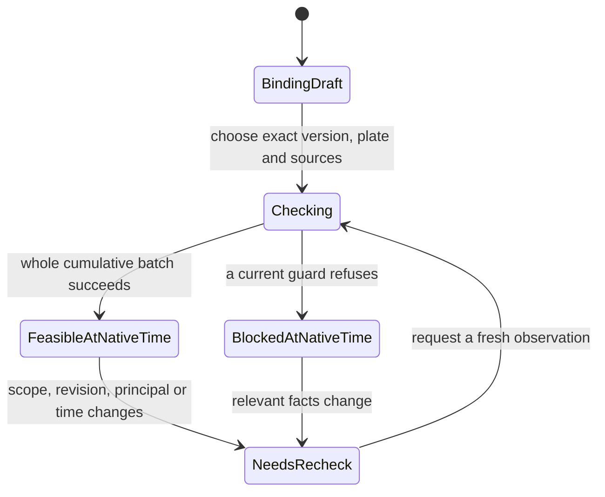

A blocked preview has observed facts and issues, without partial projected
success. A feasible preview can project zero remaining volume. It saves no
stock, reservation, scientific work, citation, source file or inventory event.
Native observation time and the next relevant boundary accompany the result.
Expiry can change feasibility without a revision. An overdue active hold stays
held until an explicit existing command changes it. Cached feasibility becomes
Needs recheck on its boundary, selection changes or resume; it is never restored
as current authority after reopen.

## Reported completed plate-plan uses

An operator can separately report one whole completed manual use of an exact
saved plan. Reporting records inventory facts; it does not operate an instrument
or certify a scientific result. The report has its own occurrence identity,
independent of the reusable plan, selected Run and transport operation. A
feasible binding never becomes a completed report automatically.

Canonical v27 adds immutable `platePlanObservations`. Older states gain an empty
map only in memory. Receipt context version 10 admits
`record-plate-plan-observation` and retains the exact native saved Notebook or
Protocol Run source. Earlier receipt versions cannot record these occurrences or
adopt raw v27 archives. Existing work, citations and plan-version witnesses keep
their original meanings and byte representations.

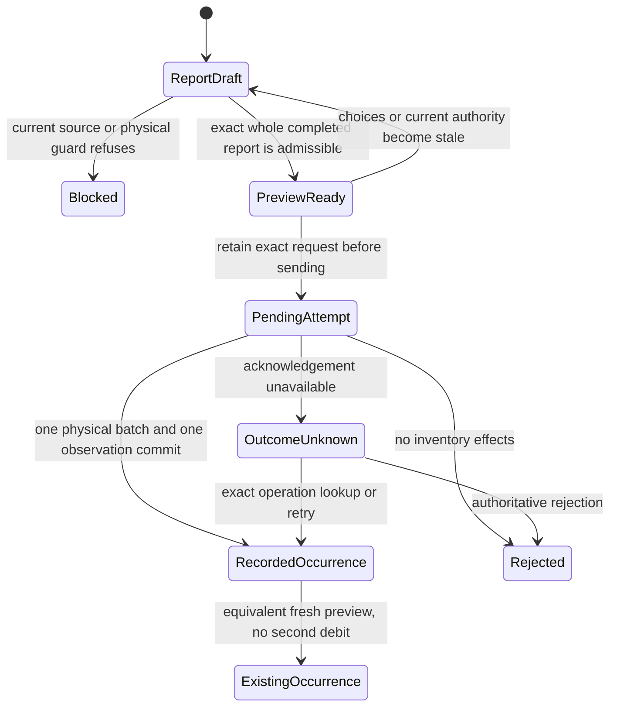

The operator explicitly acknowledges that every listed transfer was completed.
Partial work, uncertain physical outcomes and changed amounts cannot be silently
reported as the complete plan. This is separate from uncertainty about whether a
native request committed. There is no persisted running state, automatic
completion, inverse transfer or withdrawal that restores stock.

The native owner admits the exact saved source, plan version and complete
binding. One ordered batch applies all transfers to distinct empty recorded
permanent wells, preserving the existing physical, amount, hold, custody, lot,
validity and capacity guards. Demand from several roles sharing one stock is
combined. Every output has a deterministic occurrence/action stock identity. The
batch and immutable observation commit in one inventory revision or neither
commits. It cannot mix, top up or chain newly created outputs into later inputs.

The observation retains ordered instructions, grouped source before/final-after
stock facts, resulting aliquots and affected vessel snapshots. Its parent plate
snapshot retains logical geometry and recorded immediate placement. It does not
reconstruct historical freezer paths, configuration evidence or every unplanned
well. Later use, moves, disposal and scientific source edits preserve these
original facts. Aliquots retain source scientific identity and lot provenance;
their creation does not establish a newly synthesized material.

The five methods are `previewPlatePlanObservation`, `applyPlatePlanObservation`,
`platePlanObservations`, `platePlanObservation` and
`platePlanObservationSource`. Summary pages are bounded and bind their version,
context and inventory revision filters in the cursor. Detail and original-source
reads require exact occurrence and intent pins. The Run view shows recorded
plate-plan uses separately from individual recorded transfers. Historical source
reads return the retained packet, rather than today's edited document.

An equivalent occurrence preserves the first report, reason, actor and time.
Changing its binding, context or reason conflicts. A fresh equivalent request
adds no alias, revision or receipt; retrying the accepted operation returns its
original receipt. Different occurrence identities can record separate uses,
subject to the same current physical guards. Disputing a historical report
requires a separate explicit correction; the original facts remain intact.

## Saved citations and correction history

An additional citation links existing physical work to one exact saved Notebook
page or Protocol Run. It records supporting context separately from the original
primary context. Adding, withdrawing or adding a citation again changes metadata
and history. It does not transfer stock, rewrite the original work or save the
source document.

Canonical v25 adds immutable `scientificCitations` and
`scientificCitationWithdrawals` maps. Earlier snapshots gain empty maps in
memory without a write. Earlier raw schemas cannot supply these maps. A
withdrawal identifies the exact assertion and work intent, retains its own
reason and native attribution, and leaves the original assertion and source
readable.

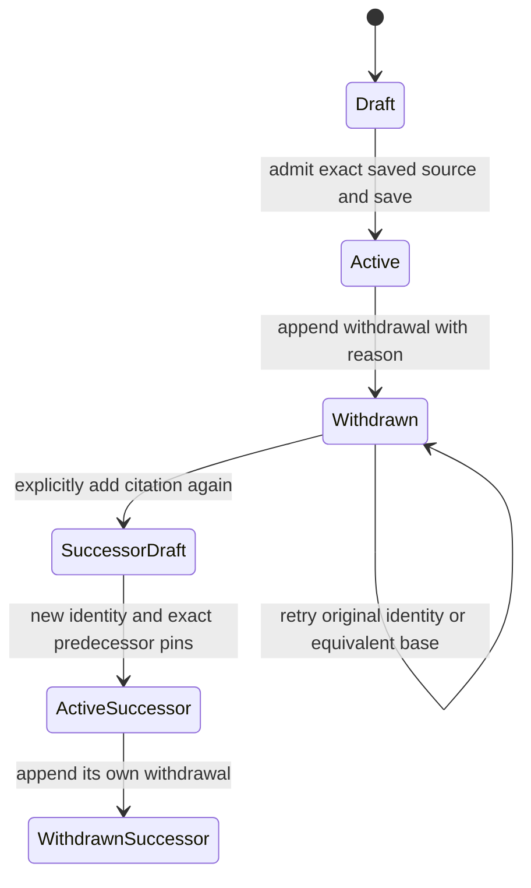

Each successor pins the predecessor citation, withdrawal and both intent hashes.
There is one base assertion per work/source version and one successor per
withdrawal. Generations cannot fork or cycle. Semantic duplicate lookup covers
all history, including withdrawn generations. A duplicate preserves the original
reason and attribution; it creates no alias, revision or receipt. An intentional
successor still requires current saved-source admission at the original pin. A
changed source version is a separate citation choice.

`previewScientificCitation` and `applyScientificCitation` admit the saved source
through its native owner. Callers provide exact choices and source pins, never
source bodies or recorded actors. Withdrawal uses the separate preview/apply
pair and requires no current source-file access. Receipt context version 8
retains a source witness for citation creation or the existing scientific
transfer requests. Withdrawal and unrelated requests omit it. Earlier receipt
versions cannot adopt a v25 archive. Adoption preserves citation identities,
intents, source provenance and imported attribution.

`scientificCitations` reads bounded replacement pages for an exact work and
intent. It includes active assertions and withdrawn history. Its cursor binds
project, inventory, work and revision. `scientificCitationSource` lazily reads
the original retained source, including after withdrawal or archive adoption.
The existing `scientificWorksForContext` remains primary-context-only, and
`scientificSource(workId)` continues to return the original primary source.

The Run view keeps its citation dialog outside replaced work rows. The dialog
and Inventory workspace share one pending-operation coordinator. It retains the
exact request before sending, verifies receipt identity, revision and request
digest, and preserves an unknown result for status inspection or exact retry.
Refreshing a page or changing Runs cannot discard that durable attempt.

## Protocol and Run creation

Protocol creation and Start run use the generic native scientific-package owner.
The Files creation flow, editor and agent clients share that owner. Creating an
in-progress Run is a tracking action with no inventory debit, hardware action or
biological outcome.

The editor requires an explicit successful Save before Start run. Native
admission reads the checked saved source and freezes its exact text, canonical
identity, file-object UUID and execution definition. The original declared
version remains separate because an editor change can leave that declaration
stale. A later template edit does not change the frozen Run. Legacy Runs without
a frozen source remain source-declared; opening them cannot manufacture a
historical snapshot. Saved-file evidence does not acquire accepted scientific
revision authority.

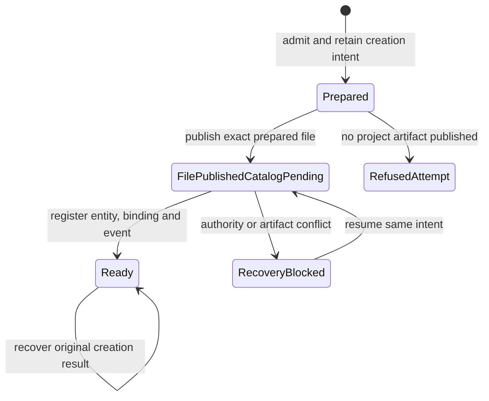

Prepared intent retains the original request, generated identities, native actor
and time, destination and initial source bytes. File publication and SQLite
registration are separate effects. A failed registration preserves the pending
file; recovery uses the same identities and deterministic creation event.
Discovery must not steal a pending creation. A missing acknowledgement is the
caller's uncertainty, separate from persisted creation state.

Once Ready, an original creation retry returns the original result. It cannot
overwrite a later amendment, recreate a removed file or undo a move. Current
availability is checked separately. Guarded Run amendments protect the frozen
source and creation anchors. Protocol and Run creation have no inventory effect;
an operator records a completed manual transfer through the existing inventory
observation owner.

## Protocol declarations and typed Run values

Protocol input/output declarations describe intended values. A Run freezes the
saved definition but starts with actual values absent. Recording a value is an
explicit edit. Missing values remain Not recorded; numeric zero, No and an
explicit empty text value retain their different meanings. Required declarations
do not automatically fill values, complete the Run or prove an experiment
worked.

`editProtocolDeclarations` and `recordRunValues` use the existing native package
owner. Their ordered upserts target exact collection/key identities. Existing
rows keep their order; new rows append. Omission never deletes a row or renames
a key. Unknown members and unsupported imported values remain intact. The first
editor supports Text, Number, Yes or no, and Date and time. Existing saved types
are fixed; quantity, record, attachment and sequence fields remain read only in
these controls.

Declared Run values pin the exact frozen definition and matching direction/key
type. Values added for that Run stay local actuals and cannot shadow a declared
key. Measurements are independent typed values. Their native recording time is
separate from any user-supplied date value and does not assert an assay time.
Unchanged measurements keep their original timestamp. A later Protocol edit does
not retarget existing Run values or replace their frozen declarations.

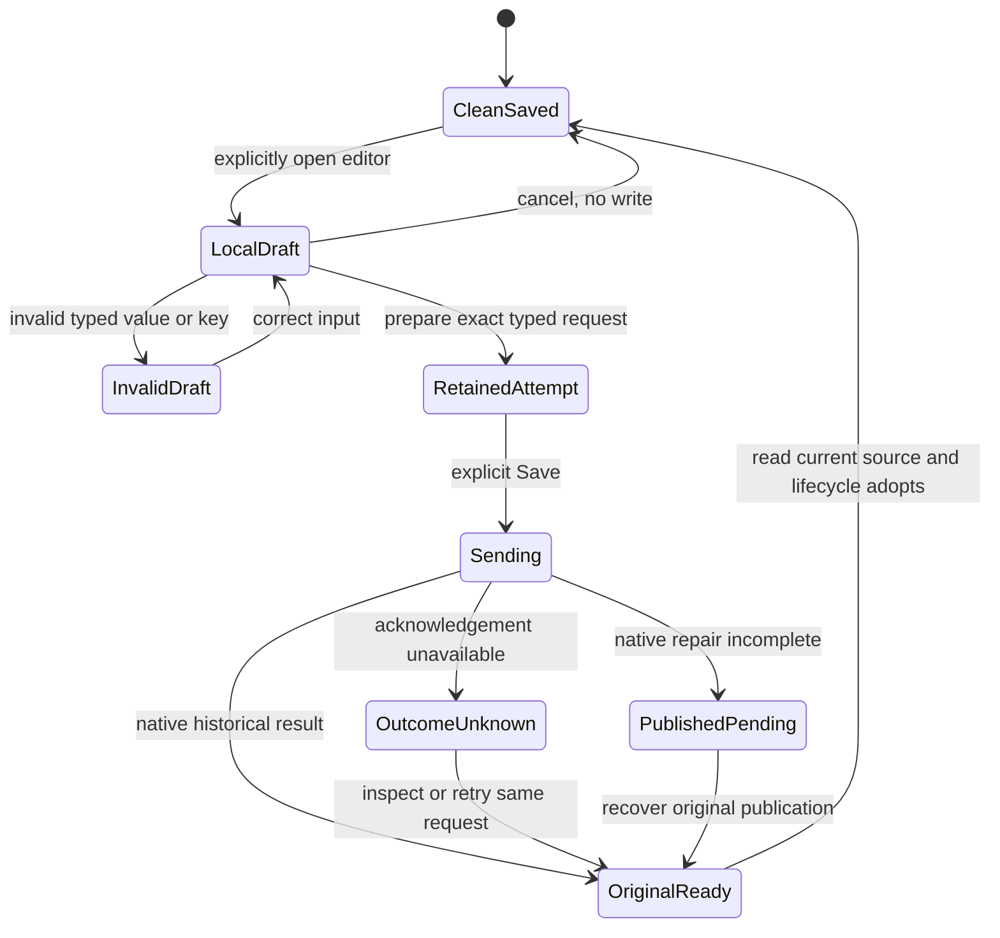

The two purpose commands use an explicit native package receipt2. Receipt1 and
its existing creation/save/recovery meanings stay unchanged. Receipt2 retains
the complete request, original source, native actor/time and validated output at
Prepared before file publication. Pure validation before Prepared has no file
effect. There is no separate accepted-only durable phase. Publication and
catalog repair use the existing recovery owner; they are separate effects.

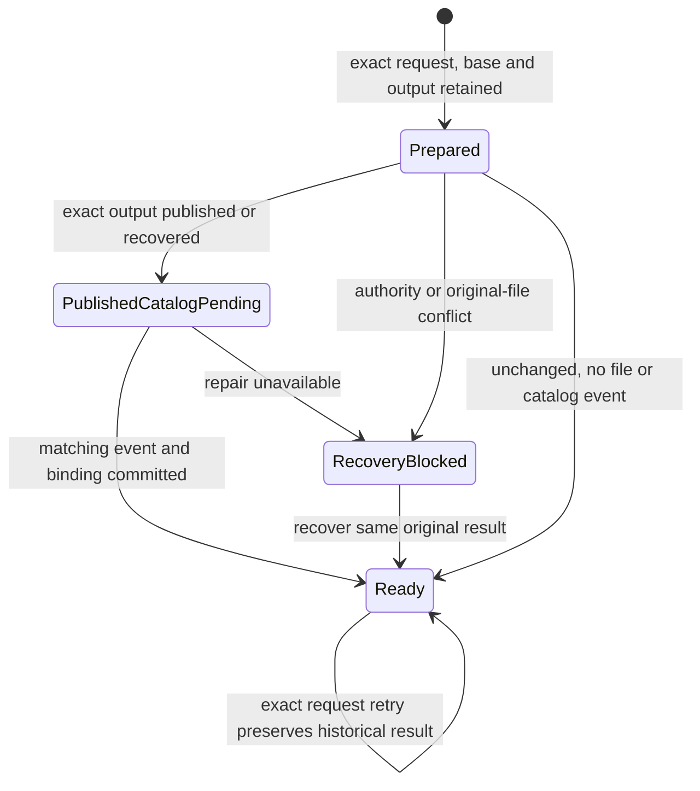

Retry lookup precedes reading today's source or producing another output. A
changed request under the same identity conflicts. Recovery preserves the
original recording timestamp and cannot overwrite later edits or recreate a
removed file. The original saved result remains separate from current file
availability. Ordinary Save and both editors share the same pending operation
owner for a document; an unknown outcome cannot be discarded by closing an
editor.

These edits preserve Protocol/Run v1 source parsing and inventory witness
semantics. They write no stock, inventory history or physical observation.
Run-level typed results do not establish exact aliquot attribution, instrument
evidence, a newly synthesized material or scientific success.

## Physical custody and observations

Custody is independent of quality, quantity, reservation and lifecycle. Each
storage aggregate or movable vessel has a direct custody state. Permanent wells
inherit their plate's custody. One shared projection finds the controlling
ancestor; checking out a box never rewrites every descendant. v1–v5 state
upcasts to available direct custody without writes or revision changes.

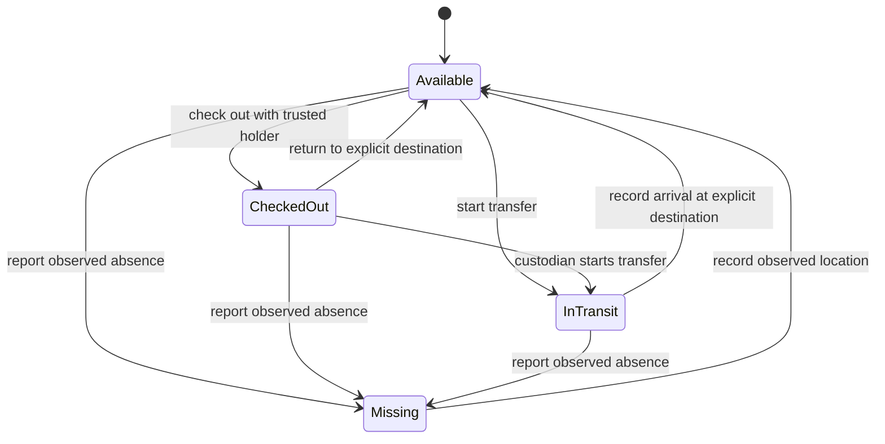

Available here means no outstanding custody record. It does not establish usable
quality or unreserved quantity. Checkout due dates are observation facts; they
never run a timer that returns an item or releases a reservation.

Departure frees the previous slot. Last-known observations retain immutable
names, positions and time separately from current placement. An inherited
subtree split preserves the original absolute observation and separately dates
its relative membership facts. An intended transfer destination is a plan, not
occupied or reserved space. Return and arrival revalidate the actual
destination.

Ordinary movement cannot erase direct or inherited custody. Explicit authorized
custody commands can split a movable subtree; permanent wells never split from
their plate. Missing and transit block physical material debits and credits.
Owned checked-out items remain subject to quality, quantity and reservation
rules. Reconciliation and quality observations remain separate commands.

Checkout and dispatch obey top-only stack retrieval and protect foreign holds. A
missing report records truth, retaining stock amounts, holds and the prior
responsible holder separately from the reporter. A middle-stack missing report
removes recorded occupancy and compacts the remaining ordinal metadata while
preserving relative order. It does not record physical retrieval of the others.

Locating a missing item is an explicit reason-bearing physical observation. It
restores available custody at the accepted destination; immutable history
retains prior responsibility. Reads and old-state upcasts never create custody
events.

## Physical definitions, installed arrangements and fit

A physical type describes a storage item or container, its scalar metadata
fields, default dimensions and structural rules. A recipe names an exact set of
type versions and their parent positions. Scientific material schemas remain
separate; both editors share the scalar field-definition and value primitives.
Creating equipment creates only the explicitly selected components and their
required ancestors. It does not create boxes, vessels or stock merely because a
brochure advertises a capacity.

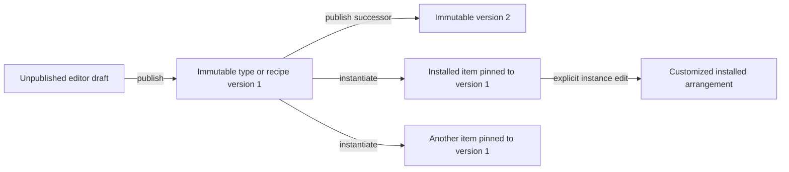

Publishing a successor never mutates existing versions or installed items.
Stable type-family IDs define allowed children; concrete version IDs pin
physical defaults and evidence. Instance-only layout edits preserve the type and
other instances. Removing occupied positions or changing occupied permanent well
geometry is refused. Unavailable positions retain their identities and recorded
contents but refuse new placements. Catalog selection lifecycle is separate from
this immutable content.

Geometry distinguishes external bounds from usable internal bounds. Decimal
dimensions normalize exactly to millimeters. Unknown axes stay unknown. Known
mounting orientations record upright quarter turns; an unknown orientation uses
conservative possible-axis bounds. A smaller bounding box alone never
establishes compatibility with an insert, opening or mounting system.

```mermaid
flowchart LR
    Structure[Kind, allowed children, layout and unavailable positions] --> Logical[Logical placement result]
    Dimensions[Versioned geometry, instance measurements and orientation] --> Fit[Derived fit result]
    Evidence[Exact type-version or installed-configuration evidence] --> Fit
    Logical --> Placement[Placement decision and explanation]
    Fit --> Placement
```

Fit is a projection, not a persisted state machine. It is compatible,
incompatible or unknown, with reasons and applicable evidence IDs. Explicit
structural incompatibility or known physical incompatibility refuses placement.
Unknown fit permits custom equipment and remains visibly unknown. A source URL
alone does not establish fit. Manufacturer assertions and local observations
retain their basis, exact subjects, position scope and orientations. Metadata
corrections preserve a physical configuration revision; relevant physical edits
invalidate evidence scoped to the previous configuration. Recording truthful
dimensions retains current occupancy and exposes a newly discovered misfit.

The curated catalog currently contains 20 configurations from two freezer
families. Each retains manufacturer sources, page locators and publication
scope. Rack alternatives and heterogeneous upper/bottom components remain
distinct. Conflicting exterior-depth sources leave that axis unknown. Catalog
reads are local and do not seed an inventory. Installation atomically publishes
missing definitions and selected components; an existing definition ID with
different content is refused rather than overwritten.

| Command                        | Effect                                                                    |
| ------------------------------ | ------------------------------------------------------------------------- |
| `define-physical-type`         | Publish an immutable physical type version.                               |
| `define-equipment-recipe`      | Publish an immutable arrangement pinned to exact type versions.           |
| `instantiate-physical-type`    | Create one named installed item with explicit metadata and destination.   |
| `instantiate-equipment-recipe` | Create the selected ancestor-closed components without stock.             |
| `configure-item`               | Explicitly set type pin, metadata, orientation and unavailable positions. |
| `reconfigure-storage`          | Change an instance layout while retaining valid identities and occupancy. |
| `record-item-geometry`         | Record reason-bearing dimensions and their optional source.               |
| `record-fit-evidence`          | Record scoped manufacturer support or local observation.                  |

## Catalog selection and update previews

Each exact type and recipe version has an explicit selection state. Content and
publication provenance stay immutable. Retirement changes future selection,
independently of the installed equipment's lifecycle, custody and contents.

```mermaid
stateDiagram-v2
    [*] --> Available: publish exact version
    Available --> Retired: retire with trusted actor, time and reason
    Retired --> Available: restore exact version with reason
```

`retire-catalog-version` and `restore-catalog-version` name a tagged
type-version or recipe-version target. Repeated invalid transitions refuse
atomically. Exact operation retries return the original receipt; replaying a
retirement after a later restore does not retire the version again.

Current versus superseded is derived from version order. The highest published
version remains the current head when retired; an older version never silently
becomes the default. An available superseded version remains an explicit choice.
Retirement never changes installed pins, geometry, fit evidence, stock, holds or
custody. Same-pin edits and material use remain available under ordinary rules.
New instantiation or adoption of a retired version is refused.

Recipe eligibility uses its exact version and the selected components plus their
required ancestors. A retired recipe blocks every new installation. A retired
optional rack blocks selecting that rack; an explicitly selected shell omitting
it remains allowed if its root is available. Restoring a recipe does not restore
its component types. Full-arrangement dependency blockers and actual selected
component eligibility come from the same pure owner.

Catalog update preview classifies strict definitions as new, identical or
conflicting and shows source/model scope and exact installed references. It
never fabricates publication timestamps or writes inventory. Any conflicting ID
blocks applying that pack, including partial fit or recipe publication that
could otherwise refer to different existing geometry. Identical retired
definitions remain retired. Applying selected new definitions uses the ordinary
expected-revision batch owner; stale revisions and conflicting IDs refuse.
Nothing automatically synchronizes sources, replaces versions or migrates
installed equipment.

The native preview reads the offered built-in pack against the current admitted
inventory. An absent inventory is a pure empty snapshot for this calculation; it
remains absent afterward. Human and agent transports invoke the same domain
classifier. Their final write still passes through `inventory.execute`.

The setup view owns its tab and search query for the whole editor/preview
session. Returning from an exact-target dialog preserves that view; closing the
session resets it. Each target form owns a separate draft so changing targets
never carries another version's reason or selections.

## Physical item codes and exact lookup

Codes bind existing storage or movable vessels, separately from their stock,
material, placement and custody. Empty containers are valid targets. Permanent
wells use their plate's identity plus an explicit coordinate rather than an
independent movable-container label.

```mermaid
stateDiagram-v2
    [*] --> Unassigned
    Unassigned --> Active: attach exact namespace and value
    Active --> Retired: retire with trusted actor, time and reason
```

`attach-item-code` records an immutable target, namespace and value with trusted
assignment provenance. `retire-item-code` preserves that assignment permanently.
The exact namespace/value tuple stays reserved after retirement. New duplicate
attachments refuse; an exact operation retry returns the original receipt, even
after later retirement, without reactivating the code. Moving, emptying or
disposing an item never implicitly changes its code lifecycle. Correcting a
wrong label uses a new code and explicit retirement, not silent reassignment.

Namespaces are bounded lowercase ASCII technical identifiers. Values are one to
512 printable ASCII characters with at least one non-space character. Case,
punctuation, leading zeros and spaces remain exact. Unsupported characters and
invalid namespaces are explicit errors. No semantic parser trims, folds case,
coerces numbers or normalizes Unicode. The focused raw-input owner visibly
removes at most one trailing CRLF, LF or CR scanner terminator; interior
controls remain invalid. Scanned URLs remain opaque text and are never fetched.

```mermaid
flowchart LR
    Scope[Admitted project and inventory] --> Lookup[Pure exact alias lookup]
    Query[Exact code and explicit or all namespaces] --> Lookup
    Bindings[Active and retired assignments] --> Lookup
    Lookup --> Result[Invalid, not found, resolved, retired or ambiguous]
    Result --> Facts[Current target facts at one captured inventory revision]
```

Null namespace searches all namespaces in the selected inventory. Multiple exact
matches are ambiguous, including retired matches or aliases of the same item.
There is no first, newest or active preference and no scientific material-search
fallback. Item IDs are inventory-scoped; lookup never silently searches another
inventory or switches projects. Codes grant no access.

The native read returns canonical scope, revision, trusted read time, principal,
resolution and matched target facts. Target records, effective custody, physical
configuration, current location and stock availability come from one parsed
state and availability context. Missing/transit/checkout retain last-known
observations separately from current location. An absent inventory stays absent;
lookup writes no rows, journal, clocks or events.

Lookup never locates a missing item, uses stock, releases holds, changes
quality, or records printing/attachment verification. Expected-item checking
compares full scope and tagged physical identity; a retired match remains
historical. The UI fences old responses by input, scope and inventory revision
and renders the returned snapshot rather than merging another revision's
availability. Ordinary follow-up actions revalidate through the existing command
owner. Generated labels and file output use a separate read/output boundary
below. Physical hardware qualification remains separate work.

## Existing-code labels and output

`inventory.prepare-label` admits one active binding and active physical target,
then invokes the lazy shared renderer on one native snapshot. Missing custody
remains explicit; preparing a label never locates the item. Unknown or retired
bindings, disposed targets, unsupported content and media overflow refuse
without inventory writes, journal entries, events or clock changes. Native and
agent routes recheck current authority after asynchronous module loading.

The artifact retains full scope, source revision, trusted read context, binding
and target snapshots, template/media/encoder/font identities, exact SVG and
SHA256. The QR symbol contains the exact alias bytes. Namespace and complete
tagged target are human-readable paths; the namespace and admitted inventory
context are still required for lookup. No local project fallback becomes a
globally portable identity. Item names are omitted from this bounded template.

```mermaid
stateDiagram-v2
    [*] --> Draft
    Draft --> Rendering: explicit preparation
    Rendering --> Rendered: bounded SVG produced
    Rendering --> Failed: invalid input or overflow
    Rendered --> Draft: change media creates new specification
```

Rendered describes software output. It does not establish independent decoding,
file output, printing, attachment or hardware readability. Two fixed media
profiles retain four dots per module at 300 dpi and a four-module quiet zone.
The adapter composes an upstream QR matrix and reproducibly generated licensed
ASCII glyph paths; no runtime font fetch or parser is needed. Exact payloads
never shrink, truncate or change symbology to fit. Old artifacts retain their
bytes when current facts change. New preparation of a retired binding refuses.

```mermaid
stateDiagram-v2
    [*] --> NotExported
    NotExported --> Choosing: explicit export retained bytes
    Choosing --> NotExported: cancel without previous output
    Choosing --> Writing: destination selected
    Writing --> Confirming: atomic file write returns
    Writing --> OutputUnconfirmed: write effect unavailable
    Confirming --> Exported: saved bytes exactly match artifact
    Confirming --> Failed: observed mismatch
    Confirming --> OutputUnconfirmed: readback unavailable
    OutputUnconfirmed --> Confirming: explicit check saved file
    OutputUnconfirmed --> Writing: explicit retry same retained bytes
```

The existing save dialog, atomic filesystem writer and admitted reader own file
output. No arbitrary-path inventory mutation API is added. Canceling a new copy
restores the previous output observation. A failed dialog or observed byte
mismatch is explicit failure; a transported write error conservatively leaves
output unconfirmed. Exact artifact/destination remain available for check or
explicit retry. Forgetting an attempt leaves any existing file unchanged.

In-memory sessions are keyed by full project/inventory/code scope. Closing the
view detaches it without erasing a pending or unconfirmed copy. A late result
stays with its original session and never becomes another item's output.
Retired/disposed items can reopen retained artifacts; the view labels them as
historical snapshots. These sessions are not a durable print or issuance
journal. App restart retains inventory/code facts and saved files, not a
fabricated successful-output receipt.

Verification independently rasterizes the actual saved SVG, compares all decoded
bytes, and rejects erased symbol geometry. It qualifies that software artifact,
not any printer, scanner, media or cold-storage compatibility.

## Storage-temperature knowledge

Temperature has four independent owners: advertised possible setpoints,
operator-reported target, an installed qualification envelope, and the actual
stock or lot formulation's storage requirement. Signed exact decimal Celsius and
inclusive ranges retain negative values without floating-point conversion.
Unknown is distinct from zero; reversed ranges and temperatures below absolute
zero are rejected.

```mermaid
stateDiagram-v2
    state "Source claim" as Claim {
        [*] --> Active: record scoped immutable claim
        Active --> Withdrawn: explicit reason-bearing withdrawal
    }
    state "Reported setpoint" as Setpoint {
        [*] --> Unknown
        Unknown --> Known: explicit report
        Known --> Known: replacement report
        Known --> Unknown: explicit correction
    }
    state "Stock requirement" as Requirement {
        [*] --> Inherit
        Inherit --> Specified: record formulation requirement
        Inherit --> Unknown: suppress inherited knowledge
        Specified --> Unknown: explicit correction
        Unknown --> Specified: record requirement
        Specified --> Inherit: return to lot requirement
        Unknown --> Inherit: return to lot requirement
    }
    state "Thermal relationship" as Relationship {
        [*] --> InheritSurroundings
        InheritSurroundings --> OwnControl: explicit relationship record
        InheritSurroundings --> RelationshipUnknown: explicit uncertainty
        OwnControl --> InheritSurroundings: explicit relationship record
        OwnControl --> RelationshipUnknown: explicit uncertainty
        RelationshipUnknown --> OwnControl: explicit relationship record
        RelationshipUnknown --> InheritSurroundings: explicit relationship record
    }
```

The five commands record or withdraw evidence, report a setpoint, record a
stock/lot requirement, and record a thermal relationship through the existing
atomic native owner. Each fact has an explicit observation timestamp or null,
separate from trusted recorded time and actor. No read invents an observation
time. A stock requirement may inherit its lot, specify a range, or override
inherited knowledge with unknown. A lot cannot inherit. Scientific designs do
not supply formulation requirements.

Claims retain exact source scope and immutable content. Conflicting applicable
equal-scope ranges remain conflicting; no source wins by being recorded last.
Exact installed capability takes precedence over type capability with all claims
retained. Built-in catalog ranges come from the cited model documents; they
establish neither a current target nor installed qualification. Reapplying an
identical withdrawn source does not reactivate it, and any conflicting
identifier blocks the entire catalog update.

Qualification pins the equipment's physical configuration and an inspectable
snapshot of its physical subtree at a declared setpoint and assumptions.
Descendant identity, internal placement, layout, geometry, physical revision and
thermal relationships are included; metadata, stock quantity and reservations
are excluded. Root external placement is excluded so moving an entire unchanged
assembly preserves its internal pin. Rearrangement makes a retained claim
inapplicable. Returning to the exact saved arrangement and target can make an
active claim applicable again; this does not establish uninterrupted storage or
erase intervening history. Withdrawal is the only terminal evidence lifecycle
transition. New qualifications explicitly declare
`scope: 'physical-and-thermal-arrangement'`. Legacy assertions without this
marker retain unrecorded relationships in both state upcast and command replay.
Migration never broadens what a historical qualification covered.

`inventory.storage-conditions` is a read-only projection at one native revision.
It returns three separate assessments: possible advertised capability, reported
target, and qualified support. Capability asks whether some advertised setting
can meet the requirement. Qualified support requires the entire applicable
envelope inside the requirement, not overlap. Results retain supported,
incompatible, unknown or conflicting states, reasons and source IDs.

An explicit thermal relationship determines context through physical ancestry.
Inherit traverses the parent; Self selects the item even without evidence;
Unknown stops traversal. An absent setting inherits. Claims, withdrawal and
setpoint reports never change the relationship, and names such as Freezer or Box
do not declare control. Checked-out, in-transit or missing custody makes current
context unknown instead of inheriting the former freezer. A whole-holder move
recomputes descendant assessments without changing stock.

Freshness requires an explicit null or nonnegative maximum age policy. No
policy, unknown time and future observations remain distinct from fresh or
stale. Comparisons describe recorded facts; stale evidence is visible and never
becomes live telemetry through a read clock. Temperature results do not control
equipment, observe sensors, establish overall suitability, quarantine stock,
release holds or block custom storage. Environmental incidents have a separate
owner.

## Native archives and adoption

Export captures one admitted SQLite snapshot with exact stored state, request
and receipt strings, their hashes, complete accepted history and typed
scientific dependencies. Capture does not create inventory or write a file. The
deterministic archive excludes incidental capture time. Native source scope,
history continuity, strict schemas, duplicate JSON keys, request/receipt
digests, replay and canonical snapshot parity are checked before use.

Preview is read-only. It binds the exact source text, absent destination,
explicit scientific mappings and current scientific-record fingerprints into a
deterministic plan. Source or binding edits invalidate the human preview. Apply
recomputes admission and the plan inside the existing immediate inventory
transaction. It creates one destination adoption operation, revision one and a
native receipt. Source history remains archived evidence, not destination
receives, checkouts or reservations. Ordinary accepted request shapes and retry
digests remain unchanged; adoption uses a tagged accepted request in the same
journal and receipt owner. Nested re-exports replay the retained source request
with its saved descriptors and native receipt context.

A recorded source holder is distinct from a person currently authorized to act.
Imported holders and recorded actors retain source archive/scope and their
original identity. They cannot gain destination authority by matching a local
profile or agent ID. Re-adoption retains imported attribution flat. Explicit
local cancellation and custody recovery remain ordinary reason-bearing commands.
Source recorded clocks later than native acceptance refuse; imported values
never advance the destination's trusted clock. Observation times remain source
facts. Qualifications retain their original physical and thermal scope.

Inventory origin is explicit and persists beyond history pagination. Native
inventories start with native origin. Adopted inventories record source scope,
source archive hash and revision, native adoption time and the actual importer.
This descriptor does not duplicate source history. Original source bytes remain
in the accepted adoption request. Only typed scientific references are mapped;
metadata text, physical IDs, aliases, exact amounts, arrangement pins and
unknowns retain their meaning. Non-injective scientific bindings require
separate reconciliation and are refused by the first adoption mode.

Human import state is editing, previewing, blocked, ready or stale before
entering the existing durable command recovery machine. An uncertain apply
retains the exact operation, bytes and resolved bindings. Recovery reads the
original receipt or retries that identical request. A repeated archive under a
new operation refuses against populated inventory. No preview stages a hidden
file, row, journal, receipt or event. Existing transport limits are measured
without silent chunking.

```mermaid
stateDiagram-v2
  [*] --> Editing
  Editing --> ReadingSource: choose file
  ReadingSource --> Editing: bounded UTF-8 read succeeds
  ReadingSource --> PreviousDraft: destination selection cancelled
  ReadingSource --> Failed: selection or read fails
  Editing --> Previewing: pin source and bindings
  Previewing --> Blocked: validation or binding issues
  Previewing --> Ready: exact plan admitted
  Previewing --> NoChange: source has no inventory
  Previewing --> Failed: read fails
  Blocked --> Editing: source or binding edited
  Ready --> Editing: source or binding edited
  NoChange --> Editing: source or binding edited
  Ready --> Stale: target changes or acceptance refuses
  Stale --> Previewing: preview retained source again
  Ready --> CommandRecovery: apply exact plan and stable operation
  CommandRecovery --> [*]: committed
```

Reading-source is a draft phase. Blocked, ready and no-change are immutable
preview results; stale is derived from the observed target and command result.
The file path is display information, never source identity. Applying delegates
to the existing command recovery machine rather than adding an import journal.
An uncertain command locks its retained draft; leaving the view does not cancel
an already submitted operation.

Archive file output and labels share retained text-output states: choosing,
writing, confirming, exported, failed or output-unconfirmed. An acknowledgement
is followed by exact saved-text readback. Cancellation retains the capture;
uncertain output retains original bytes and destination for explicit check or
retry. Archive file input and output confirmation use bounded bytes and fatal
UTF-8 decoding, preserving source line endings. Text pasting is an explicit
alternative source, and its received text is pinned exactly. Scientific
documents keep their existing owner. Native archives do not declare spreadsheet
or Benchling export compatibility.

```mermaid
stateDiagram-v2
  [*] --> NotExported
  NotExported --> Choosing: export captured artifact
  Choosing --> PreviousOutput: cancelled
  Choosing --> Failed: selection fails
  Choosing --> Writing: explicit destination
  Writing --> Confirming: acknowledgement
  Writing --> OutputUnconfirmed: write outcome unknown
  Confirming --> Exported: exact text matches
  Confirming --> Failed: different text
  Confirming --> OutputUnconfirmed: read unavailable
  OutputUnconfirmed --> Confirming: check original destination
  OutputUnconfirmed --> Writing: retry original bytes
  Failed --> Writing: retry retained destination
  Failed --> Confirming: check retained destination
  OutputUnconfirmed --> NotExported: explicitly forget output
  Exported --> Choosing: export same capture again
```

Capture and output are independent machines. A pending or unconfirmed output
locks recapture so its bytes cannot change beneath a write or retry. Late output
completion belongs to its original scoped session. Disposal prevents new work
without pretending an in-flight file write was cancelled.

## Canonical receive tables

A receive table proposes changes to a selected inventory. It does not replace
the inventory like archive adoption. The declared CSV/TSV columns have strict
meanings; unknown columns, inferred headers, padded rows and silent truncation
are refused. Scientific keys, location keys and existing-vessel keys require
explicit resolutions. Unknown quantity, known zero and unplaced are separate
choices. Existing vessels and permanent wells keep their names and locations.

```mermaid
stateDiagram-v2
  [*] --> Editing
  Editing --> ReadingSource: choose bounded UTF-8 file
  ReadingSource --> Editing: retain exact source text
  Editing --> Previewing: pin source and explicit choices
  Previewing --> Blocked: unresolved rows or invalid proposal
  Previewing --> Ready: complete atomic proposal
  Previewing --> NoChange: all rows unchanged or explicitly skipped
  Blocked --> Editing: change source or choices
  Ready --> Editing: change source or choices
  NoChange --> Editing: change source or choices
  Ready --> Stale: target revision or acceptance changes
  Stale --> Previewing: regenerate proposal
  Ready --> CommandRecovery: persist operation before sending
  CommandRecovery --> Committed: original native receipt
  CommandRecovery --> OutcomeUnknown: acknowledgement unavailable
  OutcomeUnknown --> CommandRecovery: identical retry or receipt recovery
```

Lifetime correlation is the exact pair of source namespace and source row ID. A
content hash identifies one file, not an imported physical item. A row number
identifies presentation order, not an imported physical item. Neither can serve
as a duplicate-prevention key. Source correlation records retain the normalized
row hash, stock, vessel, scientific identity and original destination decision.
They do not mirror current stock quantity, quality, custody or placement.

```mermaid
stateDiagram-v2
  [*] --> Unbound
  Unbound --> Proposed: explicit create or empty-vessel decision
  Proposed --> Bound: one atomic native commit
  Bound --> Unchanged: same source facts and original decision
  Bound --> NeedsReconciliation: source facts or decision differ
  Unbound --> Skipped: explicit reason
  Bound --> Skipped: explicit reason without inventory change
```

Resolve an existing lifetime binding before deriving new destination IDs. This
preserves identity after archive adoption, which retains physical IDs across
project scopes. Unchanged rows do not replenish consumed stock or move a vessel
back to an old location. Changed rows require a separate explicit reconciliation
workflow. Skipping does not delete or mark stock missing. All-skipped or
unchanged proposals create no receipt.

A ready plan binds exact source text, format, delimiter, namespace, resolutions,
current scientific fingerprints and destination scope/revision. Native apply
recomputes it inside the accepting transaction, then runs the existing atomic
commands and appends their lifetime bindings in one revision. Ordinary commands
cannot forge these bindings. Replay uses saved decisions and the original native
receipt context. It does not consult the live scientific registry. Generated
commands count toward the existing batch bound; oversized proposals refuse
without hidden partial batches. Raw source and explicit skips remain in the
accepted request when a nonempty proposal commits.

## Stocktake observation contract

A stocktake observation records a claim about a particular stock or physical
item. Its subject, measured fact, source time and reason are immutable. Native
recording time and actor come from the owner. Quantity observations target
stock; missing/found observations target an explicitly selected physical item.
Measuring a permanent well does not find its plate. A missing source row is not
a missing-stock observation.

```mermaid
stateDiagram-v2
  [*] --> Draft
  Draft --> Unresolved: subject or row decision absent
  Unresolved --> Ready: explicit resolutions
  Ready --> Recorded: atomic native commit
  Ready --> Skipped: explicit reason without observation
  Recorded --> Recorded: identical source identity and facts
  Recorded --> Conflict: same identity with different facts
```

Application is independent from recording. Record-only is a real observation
write, never a dummy move or quantity reconciliation. A recorded observation may
be applied later with an explicit reason. Application uses the existing quantity
or custody transition and records its actual native actor and time. Its applied
state changes only if that transition succeeds in the same atomic batch.

```mermaid
stateDiagram-v2
  [*] --> Unapplied: observation recorded
  Unapplied --> Applied: explicit valid correction commits
  Unapplied --> Unapplied: correction refused
  Applied --> Applied: same observation imported again
```

Quantity reconciliation may record an amount below active holds. It preserves
those holds and exposes an allocation shortfall. It never releases holds or
changes custody. Missing/found corrections preserve quantity and use explicit
destinations, existing responsibility rules and aggregate custody constraints.
An independently applied permanent-well custody correction refuses.

Stable observation identity is the exact source namespace and observation ID.
Repeated measurements require a new ID. Reimporting an applied observation does
not restore stock consumed afterward. Archive adoption preserves physical
references and observation identity; recorded people remain imported
attribution. A revision of an external receive register is separate from both a
new measurement and approval to change current physical facts.

The stocktake adapter pins source text, format, choices and target
scope/revision in its read-only preview. Recording and applying use the existing
command, transaction, receipt and outcome-unknown recovery machines. Neither
adds a second journal or hidden file. Source edits, unresolved decisions,
changed observation facts or stale targets cannot partially apply a proposal.

## External source revision contract

An accepted receive row binds a stable external identity to physical stock. A
later external edit is neither another receipt of stock nor a measurement.
Acknowledging it changes the accepted source baseline only. Quantity, vessel
name, quality, placement, custody, holds and stocktake observations remain
unchanged.

```mermaid
stateDiagram-v2
  [*] --> Compared
  Compared --> Unchanged: matches effective source baseline
  Compared --> NeedsAcknowledgement: changed source with same bound identities
  Compared --> Blocked: identity changes or source evidence unavailable
  NeedsAcknowledgement --> Proposed: expected baseline hash and explicit reason
  Proposed --> AcceptedRevision: one native atomic metadata transition
  Proposed --> Stale: target or baseline changes
  Stale --> Compared: regenerate source comparison
```

The original row hash and original destination remain immutable. Accepted source
revisions append a previous-hash link, new fields and hash, source destination,
reason and native actor/time. The effective baseline is the latest revision,
otherwise the original binding. An accepted rollback appends another revision.
Current inventory never substitutes for unavailable previous source fields.

Show previous source, revised source and actual inventory separately. Previous
fields come from a verified retained accepted request, including nested archive
evidence, or a saved source revision. Recompute their row hash before use.
Source material aliases may change only while resolving to the same scientific
identity; existing-vessel aliases still identify the same vessel. The first
protocol refuses scientific rebinding, vessel replacement, vessel-kind changes
and unbound rows. A changed source destination does not run placement checks or
move stock.

Acknowledgement has a dedicated accepted request through the existing journal,
receipt and recovery path. Saved verified preimages make replay independent of
live sources. Preserve legacy receive-v1 request shapes and plan digests when
adding empty revision history to canonical state. Reimport compares the
effective baseline before deriving physical IDs and never reverses later use or
movement. Archive adoption retains the source chain and fields, maps only typed
scientific identity, and keeps acknowledgement actors as imported attribution.

## Hierarchy table contract

A hierarchy table creates explicit storage layouts and parent relationships.
Freezers, shelves, boxes, permanent-well plates and plate stacks use the
existing storage owner. Names do not imply hardware specifications, dimensions,
temperature control or qualified fit. Scientific stock receiving remains a
separate visible atomic stage.

```mermaid
stateDiagram-v2
  [*] --> Parsed
  Parsed --> Blocked: invalid rows or ambiguous parent references
  Parsed --> Resolved: explicit layouts and source/existing parents
  Resolved --> Blocked: cycle, occupancy, stack or batch contradiction
  Resolved --> Ready: topologically ordered existing commands
  Ready --> Stale: target changes
  Stale --> Parsed: regenerate proposal
  Ready --> CommandRecovery: persist stable operation before sending
  CommandRecovery --> Committed: all locations and bindings accepted
  CommandRecovery --> OutcomeUnknown: response unavailable
  OutcomeUnknown --> CommandRecovery: identical retry or original receipt
```

Lifetime hierarchy bindings use the exact namespace and source ID, with a source
row hash, physical storage ID and original destination. Resolve existing
bindings before generating IDs. Reimport never moves a container back or
recreates it after later use, movement or disposal. Changed source facts require
separate reconciliation. Source parent references are explicit; skipped unbound
parents cannot become invented roots.

Topological ordering creates parents before children. Permanent wells belong to
the plate owner. A stack ordinal is explicit source data, not input row order;
the importer uses ordinary push commands and current stack constraints. A late
contradiction refuses the whole proposal. No hierarchy-only journal, migration
coordinator or hidden batch splitting is introduced.

## Mapped plate spreadsheet contract

A plate spreadsheet adapter preserves the entire raw source while making its
physical interpretation explicit. Scientific primer publication and hierarchy
creation use their existing owners. Physical receiving binds current admitted
scientific identities and existing permanent wells; it does not create either
implicitly.

```mermaid
stateDiagram-v2
  [*] --> SourceDraft
  SourceDraft --> ColumnResolution: exact source and delimiter selected
  ColumnResolution --> RowResolution: every source column has a disposition
  RowResolution --> Blocked: missing material, plate, well or quality decisions
  RowResolution --> Ready: complete normalized receive plan
  Ready --> Stale: target or scientific bindings change
  Stale --> RowResolution: regenerate interpretation
  Ready --> CommandRecovery: persist raw source and exact choices
  CommandRecovery --> Committed: one atomic stock operation
  CommandRecovery --> OutcomeUnknown: response unavailable
  OutcomeUnknown --> CommandRecovery: original receipt or identical retry
```

The first format maps source identity, plate and well columns. Every remaining
column requires an evidence-only disposition with a reason. Well-label
translation is an explicit source-to-position map; leading zeros are never
stripped automatically. Quantities are explicitly unknown with a reason when the
register has no measurements. Each row's usable/quarantined choice is explicit;
external QC labels do not establish that choice. Source plate and box labels do
not establish dimensions, hierarchy or hardware.

A deterministic normalizer produces the existing receive-v1 physical rows and
choices. The outer plan pins exact original source, normalizer version, column
dispositions, explicit decisions, resolved scientific fingerprints, target
scope/revision and inner receive-plan digest. Native acceptance regenerates both
plans inside the existing transaction. Saved choices and native receipt context
drive replay, with no live registry lookup. No new inventory state map or
scientific import coordinator is needed.

Existing table bindings correlate physical stock. Reordering or changed CSV
quoting does not duplicate it. Changed normalized interpretation requires
existing source reconciliation. Changes only to evidence-only fields may produce
no physical changes; such a preview saves no new source or receipt. Do not imply
the revised evidence file was retained. Original raw source and all decisions
remain in committed mapped requests. Source baseline discovery normalizes those
retained requests, never reconstructs source fields from current stock.

## Foreign physical capture boundary

A versioned offline source capture is evidence, not execution authority. The
Benchling adapter must pin its response version and retain raw page bodies,
endpoint/query context and explicit scope. An omitted field cannot acquire a
default physical meaning through parsing.

```mermaid
stateDiagram-v2
  [*] --> Omitted
  [*] --> ExplicitNull
  [*] --> Present
  Present --> Conflict: incompatible observation of same source identity
  Omitted --> Resolved: explicit source or human decision
  ExplicitNull --> Resolved: declared interpretation
  Present --> Resolved: supported source fact verified
  Conflict --> Resolved: explicit conflict disposition
```

```mermaid
stateDiagram-v2
  [*] --> Staged
  Staged --> NeedsResolution: missing, contradictory or unsupported facts
  NeedsResolution --> Staged: explicit decisions
  Staged --> Validated: source, dependencies and target pinned
  Validated --> Stale: source, target or scientific bindings change
  Stale --> Staged: regenerate plan
  Validated --> CommandRecovery: persist exact operation and source
  CommandRecovery --> Committed: one atomic native operation
  CommandRecovery --> OutcomeUnknown: acknowledgement unavailable
  OutcomeUnknown --> CommandRecovery: original receipt or identical retry
  Staged --> Canceled
  NeedsResolution --> Canceled
```

Capture consistency, source completeness, row disposition, identity correlation
and submitted-command recovery are independent. Page order cannot choose the
winner among conflicting snapshots. Source actors, archive state, reservations,
checkout and restrictions cannot become local principals, grants or invented
history. Multiple contents require a supported mixture interpretation or an
explicit refusal; never choose one entity silently.

Source numeric precision precedes inventory arithmetic. Keep original JSON
number lexemes and their decoded pointers through duplicate-key validation.
Exact volume interpretation uses those tokens, not an already rounded number.
Unit dimensions and absent/null/zero amounts remain explicit. Empty movable
containers need lifetime physical identity independent of stock existence.

Capture application uses explicit field observations or reason-bearing local
declarations. An empty registered-contents array alone does not establish a
physically empty container. The bounded source-empty choice requires that array
and an explicitly selected supported volume of exactly zero. Positive,
unresolved or non-volume amounts remain unresolved rather than silently empty. A
container with a registered entity and zero amount stays identified stock.
Selecting deprecated volume while current quantity is supplied needs an explicit
reason; field order never chooses precedence.

Physical source correlation and content admission have separate lifetimes.
Storage already has hierarchy bindings and stock has receive-table bindings.
Vessel bindings, introduced in v17, can refer to an empty movable container or a
permanent plate well. Foreign capture application owns their commitment;
read-only capture inspection never creates a binding.

```mermaid
stateDiagram-v2
  [*] --> Unbound
  Unbound --> Proposed: explicit physical interpretation
  Proposed --> Unbound: refusal or canceled draft
  Proposed --> Bound: atomic native commitment
  Bound --> Bound: move, dispose, reimport or retire label
```

```mermaid
stateDiagram-v2
  [*] --> NoStock
  NoStock --> ContentProposed: explicit scientific identity and quantity decision
  ContentProposed --> NoStock: refusal or canceled draft
  ContentProposed --> StockBound: receive into the already bound vessel
  StockBound --> StockBound: use, reconcile or acknowledge changed source
```

Bound is lifetime identity, including a disposed physical target. A missing or
empty source contents field cannot erase local stock. Resolve existing bindings
before generating destination-scoped identifiers, including after archive
adoption. A fixed well binds its foreign container identity to its plate and
coordinate; a matrix-plate tube remains an independently movable vessel.

Item codes remain physical labels. They can identify empty movable vessels but
deliberately cannot target permanent wells. Using label retirement and derived
plate-relative lookups as import correlation would create two hidden identity
routes. The planned vessel binding keeps one explicit route for both vessel
kinds, separate from label lifecycle and stock existence.

Foreign physical and stock projections have separate immutable baselines.
Changing contents or quantity must not allocate a replacement container.
Changing physical source facts must not overwrite later local movement. Capture
application must assemble one existing command batch and binding additions for
one native transaction, rather than chaining independently committed hierarchy,
vessel and stock imports.

### Capture application

The capture application uses one accepted request, `import-benchling-capture`.
Preview is read-only. Its private construction phases do not publish
intermediate inventories or consume extra revisions. The final proposal is
checked again against the original inventory before one transaction commits
commands, physical bindings, stock bindings, the original capture and its
receipt together.

```mermaid
stateDiagram-v2
  [*] --> Inspecting
  Inspecting --> Invalid: malformed or over-limit capture
  Inspecting --> Decisions: exact observations retained
  Decisions --> Previewing: every record and source issue has a disposition
  Previewing --> Decisions: unresolved facts or refused complete batch
  Previewing --> NoChange: no commands or new bindings
  Previewing --> Ready: original target and scientific admissions pinned
  Ready --> Decisions: source or interpretation edited
  Ready --> Stale: target revision or scientific admission changed
  Stale --> Previewing: regenerate against current facts
  Ready --> Submitted: exact request retained by controller
  Submitted --> Committed: single native transaction
  Submitted --> OutcomeUnknown: acknowledgement unavailable
  OutcomeUnknown --> Submitted: original receipt lookup or identical retry
  NoChange --> Decisions: no receipt or revised source saved
```

Each location, box, plate and container needs an explicit import or skip
decision. Schema records remain source evidence. Locations require declared
local layouts; boxes and plates require explicitly selected schema dimensions or
declared bounded dimensions. Names cannot establish dimensions. Permanent wells
and removable matrix tubes use different physical owners. Every captured
container identity receives a durable vessel binding. Existing bindings resolve
before new IDs are generated, including after archive adoption.

```mermaid
stateDiagram-v2
  [*] --> Unbound
  Unbound --> Bound: explicit target and validated physical projection
  Bound --> Bound: local move, use, disposition or archive adoption
  Bound --> Unchanged: same source physical projection
  Bound --> NeedsReconciliation: changed physical facts or interpretation
  Unchanged --> Bound: retain original target and local state
  NeedsReconciliation --> Bound: explicit reconciliation outside import
```

Contents decisions are independent of physical bindings. Captured contents `[]`
can establish an initial empty vessel only when an explicitly selected supported
volume is exactly zero. Nonempty contents with zero volume remain identified
stock. Multicontent tubes can remain physically present and unidentified;
omitted contents can remain unobserved. Uncaptured permanent wells are
initialized as unobserved in the same batch. Uncaptured removable-container
coordinates require an explicit unavailable-position policy. No phantom tube is
created.

Exact source volume interpretation uses the original JSON numeric token and
bounded decimal arithmetic. Unsupported or absent amounts require an explicit
unknown-volume reason. Quality and current local scientific identity are
separate explicit choices. Scientific admission fingerprints cover the saved
Registry row, catalog identity and file-binding metadata; they are not raw
file-content hashes. Foreign restrictions and checkout records remain source
evidence.

A versioned physical projection preserves omitted, null, present and conflicting
source facts. It excludes contents, quantity, foreign status, observation order
and explanatory prose. Plate membership maps do not rename the plate's physical
baseline; each identified well has its own binding. Reimport preserves current
movement, contents knowledge and stock use. Changed stock source fields require
source reconciliation and cannot replenish inventory. New source contents for a
previously empty or unresolved bound vessel use its original physical identity.

Canonical stock preimages regenerate from retained capture text, saved typed
choices and resolved targets. They never derive from current remaining stock.
Validated nested archive histories use the same normalizer. A real new binding
without physical commands advances one metadata revision; a no-change preview
creates no receipt and saves no revised capture. The existing complete-batch and
inline transport limits apply without splitting the operation.

## Material identity and conservation

A vessel's contents knowledge is separate from its quantity and source identity.
A missing stock record cannot mean both an explicitly empty vessel and a vessel
whose contents have not been inventoried. An unidentified tube can still be
moved, labeled, checked out or reported missing.

```mermaid
stateDiagram-v2
  [*] --> DeclaredEmpty: create a new empty vessel
  [*] --> Unobserved: contents have not been checked
  [*] --> Unidentified: material is present without admitted identity
  DeclaredEmpty --> Identified: receive linked stock
  DeclaredEmpty --> Unobserved: record unresolved contents with reason
  DeclaredEmpty --> Unidentified: record unidentified contents with reason
  Unobserved --> Unidentified: record material present with reason
  Unidentified --> Unobserved: correct knowledge with reason
  Unobserved --> DeclaredEmpty: explicitly declare empty with reason
  Unidentified --> DeclaredEmpty: explicitly declare empty with reason
  Unobserved --> Identified: identify existing contents
  Unidentified --> Identified: identify existing contents
  Identified --> Identified: use or reconcile, including known zero
```

The contents knowledge value introduced in v17 is recorded, unobserved or
unidentified. The shared domain projection combines recorded knowledge with
actual stock records to distinguish declared-empty from identified. A known zero
stock stays identified; unknown quantity also stays identified. Legacy and
ordinary vessel creation retain their recorded declaration without inventing an
observation time or actor during upcast.

Unobserved and unidentified vessels cannot accept ordinary receiving or any
operation requiring an empty destination. Identifying their existing contents
has its own explicit command, using the same scientific admission, capacity,
custody and configuration rules as receiving. It does not invent a physical
receipt. Recording unresolved knowledge requires a reason and trusted actor and
time, and cannot erase an existing stock, including a known zero stock. There is
no identified-to-empty shortcut in this boundary.

A scientific record identifies a material. A lot identifies one supplier batch
or internal preparation. Stocks reference a lot or an explicit unattributed
root. An aliquot inherits that reference. Independent unattributed stocks are
not compatible merely because both lack batch metadata.

Lots retain immutable supplier/preparation/pool/dilution origins. Contribution
snapshots retain source stock, material, provenance and exact withdrawn volume.
Later attribution does not change earlier snapshots or aliquots. Creating a
preparation records source identity, not a volume withdrawal. Lot provenance is
acyclic and does not follow a root stock’s mutable current attribution.

Transfer debits equal destination credits. Existing destinations require the
same scientific identity and provenance. Pool and dilute require an empty
destination, explicit output material and a new lot. Pool credits equal summed
contributions; dilution debits both the sample and a tracked diluent. Every
source debit, output credit and lineage record commits in one revision.

Known physical volume capacity and dead volume constrain volume balances. Mass
or count does not establish physical volume or imply a density conversion.
Unknown physical limits and volumes remain explicit. Reconciliation records a
measurement; it does not invent a transfer. Quantities use exact decimal
arithmetic, including mixed units. Composition distinguishes unknown from
homogeneous with explicit analyte facts. Known concentration is an exact reduced
rational in canonical mass/volume or amount/volume units. Compatible decimal
input units normalize exactly; mass and molar quantities are not converted
without molecular weight. Unlisted analytes are unmeasured, not zero.

Pool, dilution and transfer into existing stock require an explicit output
mixing choice before calculating weighted concentrations. Non-volume transfer
into existing stock permits unknown mixing with unknown resulting concentration;
homogeneous mixing, pooling and dilution require volume amounts. Legacy request
shapes without mixing remain unchanged and produce unknown mixed composition. A
new aliquot inherits its source. Missing input measurements or incompatible
units remain explicit unknown results. Contribution snapshots deep-copy the
facts used at commitment. Later measurements do not rewrite them.

Measurement input accepts decimal values and strict canonical facts. This lets
an edit preserve an existing one-third concentration and unknown reason while
changing another analyte. Internal arithmetic supports bounded input sets;
canonical stored results have explicit size limits. Final results do not depend
on contribution order.

## Atomic commands and receipts

`inventory.execute` accepts a project reference, inventory ID, operation ID,
expected revision, and command batch. The first accepted batch binds the
inventory to the admitted project. The native owner checks scientific material
references against eligible records in that project. Inventory does not infer
that a design exists physically.

One accepted batch increments the inventory revision once. Its state, immutable
accepted-command history and receipt commit in one SQLite transaction. A refused
batch changes no inventory state and has no committed receipt. Reads do not
create inventories or tables.

```mermaid
stateDiagram-v2
    [*] --> Submitted
    Submitted --> Replayed: exact operation already committed
    Submitted --> IdentityConflict: ID bound to another request
    Submitted --> RevisionConflict: stale expected revision
    Submitted --> Refused: invalid state transition or access
    Submitted --> Committed: atomic state, history and receipt
```

These are outcomes of an attempt. An identity conflict does not change or
replace the original committed receipt. The owner looks up a receipt before
checking the expected revision, so an exact successful retry remains readable
after later operations.

The operation identity is scoped to its inventory. The canonical request
includes the admitted project identity, operation ID, expected revision and
commands. Trusted actor identity and commit time are recorded separately.
Current authorization is still required to replay or inspect an old operation.

```mermaid
stateDiagram-v2
    [*] --> AwaitingResult: submit stable operation ID
    AwaitingResult --> Confirmed: committed receipt received
    AwaitingResult --> Refused: explicit refusal
    AwaitingResult --> OutcomeUnknown: connection interrupted
    OutcomeUnknown --> Confirmed: retrieve matching receipt
    OutcomeUnknown --> AwaitingResult: retry identical operation
```

A timeout describes the caller's knowledge. It does not establish failure or
permit another debit under a new operation ID. The synchronous local owner has
no durable running state that needs abandoned-job recovery. Hardware actions
require a separate reconciliation protocol.

## Native boundary

All routes use the existing loopback endpoint, native credential, owner instance
identity and registered project scope:

| Command                            | Request and result                                                                                            |
| ---------------------------------- | ------------------------------------------------------------------------------------------------------------- |
| `inventory.projects`               | List admitted projects and stable default inventory identities.                                               |
| `inventory.materials`              | Search eligible scientific material in one admitted project.                                                  |
| `inventory.catalog`                | Read detached equipment definitions for an admitted project without inventory creation.                       |
| `inventory.catalog-update-preview` | Classify one built-in pack against an admitted inventory without publication or inventory creation.           |
| `inventory.resolve-item-code`      | Resolve exact scoped physical item codes and current target facts without mutation.                           |
| `inventory.prepare-label`          | Render an immutable existing-code QR SVG artifact from an admitted snapshot without file or inventory writes. |
| `inventory.storage-conditions`     | Compare scoped temperature facts and formulation requirements at one revision without inventory writes.       |
| `inventory.export-snapshot`        | Capture exact state and full accepted journal as a read-only native archive.                                  |
| `inventory.preview-import`         | Validate pinned archive and scientific bindings without destination effects.                                  |
| `inventory.apply-import`           | Adopt validated facts into absent inventory through the existing journal and native authority.                |
| `inventory.availability`           | Derive quantities, reservations, custody and physical compatibility from current facts.                       |
| `inventory.execute`                | Apply an expected-revision command batch; return a committed receipt or explicit rejection.                   |
| `inventory.inspect`                | Read current state for an admitted project and inventory.                                                     |
| `inventory.operation`              | Read one original committed operation receipt.                                                                |
| `inventory.history`                | Read accepted operations with revision pagination.                                                            |

Agent requests recheck their exact current grant through the shared native
authorizer before read/write dispatch. Forwarded capability claims alone do not
authorize an operation. Native token and instance checks still bind the command
server, and the owner rechecks project authority at commitment. Desktop actor
records identify a trusted local window origin, not a verified human name.

The owner also verifies replay of accepted history against the persisted state.
This is a bounded local inventory recovery check, not a general migration or
cross-device synchronization protocol.

## Verification

Use
[the inventory verification skill](../skills/verify-inventory-core/SKILL.md). It
drives the real loopback command server, real registered-project authority and
real SQLite owner with synthetic material, then preserves state and receipt
readback after reopen. The bounded state exploration calls the production domain
transition function directly. The workspace map drives the genuine Electron
receive, move, use and history journey and checks exact state after application
restart. These checks do not establish a deployed service, real freezer fit,
cross-device behavior or robot execution.

## Saved values and recorded physical subjects

A value association asserts that one exact saved Run value describes one
recorded physical subject. The subject is a source stock or output action in an
existing manual plate-plan observation. Its historical quantity and the Run
value remain separate facts. Recording the association changes metadata only.

The association retains the complete selected JSON row, its canonical hash, the
complete original Run source witness, the file binding, and the exact
observation and subject identities. Opaque row members remain intact. New
associations admit text, finite safe numbers, booleans and canonical UTC dates.
Other saved value kinds remain readable without being coerced into those types.

```mermaid
stateDiagram-v2
    [*] --> Active
    Active --> Withdrawn: explicit reasoned withdrawal
    Withdrawn --> Withdrawn: retry or restored source content
    Withdrawn --> Successor: explicit fresh identity and predecessor pins
```

Withdrawal is terminal. A successor retains the same Run, file binding,
collection and value key, and names the exact prior association and withdrawal.
It may deliberately select a changed saved value or a different physical
subject. There is no mutable latest-association pointer. Exact and semantic
retries return the original record, including its withdrawn status.

Current content comparison is independent of that lifecycle.

```mermaid
stateDiagram-v2
    [*] --> Unavailable
    Unavailable --> SameSource: current source admitted
    SameSource --> ChangedSourceSameRow: another part of the Run changes
    SameSource --> ChangedRow: selected row changes
    ChangedRow --> SameSource: exact original content restored
    SameSource --> MissingRow: selected row disappears
    SameSource --> ReplacedBinding: native file identity changes
    SameSource --> Unavailable: current proof cannot be obtained
```

A matching hash establishes content equality, not edit history or scientific
acceptance. Restoring old content never reactivates a withdrawn association.
File-change events invalidate cached comparisons even when inventory revision
has not changed. Foreign adopted sources remain readable as historical records;
the current local Run is never substituted for them.

Candidate and history reads are bounded and revision-bound. Candidates also pin
the current source hash. Detail reads obtain a fresh independent comparison;
retained-source reads obtain the original witness from accepted history without
falling back to the current file. Source-free withdrawal remains available when
the Run is missing or foreign. Mutations reuse the inventory pending-attempt
owner so an interrupted response retains the exact original request.

Canonical schema 28 adds two append-only association maps. Older schemas upcast
empty maps in memory and refuse supplied future maps. Receipt context 11 admits
the new record and withdrawal kinds. Earlier receipt contexts refuse this new
family throughout nested archive adoption while preserving their existing
historical interpretation. Protocol file receipt formats remain separate.

## Versioned scientific designs

The saved Run view offers explicit **Set up versioned designs** for a project
that has no accepted scientific history. Setup uses the existing scientific
submission, recovery checkpoint and file-delivery owner. It initializes an empty
identity map. It creates no DNA design, physical stock or inventory operation,
and leaves older files under their existing resource owners.

```mermaid
stateDiagram-v2
    [*] --> NeedsSetup: no accepted head or retained attempt
    NeedsSetup --> Sending: retain exact setup request before submission
    Sending --> UnknownOriginal: acknowledgement unavailable
    UnknownOriginal --> Sending: retry identical operation
    Sending --> AcceptedPending: accepted, file delivery incomplete
    AcceptedPending --> Sending: resume original operation
    Sending --> Ready: accepted and delivered
    Sending --> Refused: definite rejection or conflict
```

Current accepted head, the original request's receipt and file delivery remain
separate facts. A catalog read cannot confirm an unknown request or complete
pending delivery. An original setup retry retains its null expected head and
purpose. It returns its original outcome after later design changes, without
replacing the newer namespace. A fresh null-head request conflicts once another
actor has initialized the project.

An existing scientific map blocks empty initialization before acceptance. The
existing explicit submission flow handles authored maps. External file changes
after acceptance can block delivery while preserving both the accepted record
and the external bytes. No atomic filesystem/database guarantee is implied.

After setup, use **Files → New… → DNA sequences → Create** and the normal
sequence editor and Save. An empty DNA package and a saved nonempty accepted
design are distinct steps. Neither establishes physical production or quality.

An unrelated accepted head does not enroll an older primer or strain. Exact
legacy creation retries retain the saved identity and existing projection
recovery. Accepted identity/path ownership, tombstones, changed intent and
misplaced files still prevent legacy fallback. Legacy projection repair may
write its existing catalog or registry records; it does not rewrite the source
artifact or publish a new accepted design.

New artifact creation also follows the resource's publication authority. A new
primer bound to an older, unaccepted local DNA document retains its complete
binding through the existing local file and projection owner. A new strain with
local dependencies or relationships outside the native scientific representation
uses that same local record model, preserving its fields, assertions and
payloads. An ordinary Registry reference may point to an accepted entity without
becoming accepted scientific evidence. Local records remain subject to their
existing schema, endpoint, duplicate and lineage checks. A new local artifact
must choose a path with no removed accepted owner. Restore or reconcile a
removed accepted source through its explicit owner; local creation does not
reuse that path.

```mermaid
stateDiagram-v2
    [*] --> InspectOutput
    InspectOutput --> AcceptedOwner: existing accepted identity and path
    InspectOutput --> ExistingLocal: existing exact unclaimed file
    InspectOutput --> ClassifyNew: new unclaimed output
    InspectOutput --> Refused: moved, removed or colliding ownership
    ExistingLocal --> LocalProjection: recover original source
    ClassifyNew --> AcceptedOwner: native representation and accepted dependencies
    ClassifyNew --> LocalCandidate: legacy representation or local dependency
    LocalCandidate --> Refused: ownership changed or accepted relationship owner
    LocalCandidate --> CreateLocal: current resource ownership agrees
    CreateLocal --> LocalProjection
    AcceptedOwner --> AcceptedPending: accepted, delivery or projection incomplete
    AcceptedOwner --> Saved: accepted publication complete
    AcceptedOwner --> Refused: native admission refuses
    LocalProjection --> LocalPending: source saved, recovery incomplete
    LocalProjection --> Saved: projections and history complete
    AcceptedPending --> AcceptedOwner: recover original publication
    LocalPending --> ExistingLocal: recover same saved source
```

Representation is classified before publication using the existing native codec.
Malformed input and unexpected failures refuse; they do not select a local
writer. Existing accepted outputs always retain their native owner. A refused or
pending native publication never falls back to local creation. Known dependency
identity, path, removal and relationship ownership remain protected; for
`carried_by`, the strain at the destination owns the biological relationship.
Exact local retries do not automatically enroll their source when a dependency
later becomes accepted.
