# Inventory command contract

The inventory core records physical possession separately from scientific
identity. A registered scientific record can have no physical stock or several
stocks. Storage locations hold named positions, vessels occupy positions, and
stock links a vessel to a scientific record. An empty vessel is valid.

The browser-safe domain owner is
`packages/core/domain-services/src/inventory.ts`. The native SQLite owner is
`apps/desktop/src/main/inventory-owner.ts`. Request parsing lives in
`apps/desktop/src/shared/inventory-command.ts`; the authenticated native command
server and desktop IPC invoke the same inventory owner.

The Inventory workspace and authenticated agent tool consume this same owner.
Layouts distinguish named positions, grids, removable-tube boxes, permanent-well
plates and ordered stacks. This version supports one stock per vessel and exact
volume accounting. Lots, internal preparations, exact-volume transfers, pooling,
tracked dilution, exact concentration facts and known container limits use the
same command owner. Quantity and item reservations and physical custody use that
owner too. Physical types, equipment recipes, installed arrangements and scoped
fit evidence use that owner. Team synchronization remains separate work.

Permanent wells have stable identity and remain attached to their plate. A plate
moves with all its wells. Whole-plate disposal retains historical stock and
disposes every well. Stack order is derived from child placement alone. Explicit
push and pop commands enforce capacity and removal from the top.
`removal: 'top-only'` governs retrieval order; recording quantity does not prove
physical access to a buried plate.

Canonical state is v16. v1/v2/v3 composition facts upcast to explicit unknown
values. v1–v4 snapshots gain an empty reservation map and recorded clock floor
without a revision change. Reading v1 upcasts named layouts and movable vessels;
v1/v2 stocks receive distinct unattributed roots and unknown container limits.
Reads do not write or increment revision. Historical command shapes and request
digests stay unchanged for retry and replay. v1–v6 snapshots gain empty type,
recipe and fit-evidence maps and explicit untyped item configurations. The
original request and receipt bytes remain unchanged. v1–v7 published type and
recipe versions gain explicit available selection state without changing their
content, installed pins, revision or clock. v1–v8 snapshots gain an empty
item-code map through state-only upcast; existing retired catalog selections
remain intact. v1–v9 snapshots gain empty temperature-claim, reported-setpoint
and storage-requirement maps without changing historical request or receipt
bytes, physical pins, recorded clock or inventory revision. v1–v10 snapshots
gain an empty explicit thermal-relationship map. Legacy v10 qualification pins
gain an unrecorded relationship value; they do not acquire new scope or
applicability through migration. v1–v11 snapshots gain native inventory origin
without changing recorded facts. v12 separates imported recorded attribution
from principals that can execute commands. Native invocation and receipt
contexts retain strict native actors. v1–v12 snapshots gain an empty lifetime
table-binding map. v12 imported origins and recorded actors retain their exact
attribution during this upcast. v1–v13 snapshots gain an empty observation map;
existing table bindings, origins and imported attribution remain intact. v1–v14
source bindings gain an empty accepted-source revision list. Legacy receive-v1
plan hashes retain their original binding representation. v1–v15 snapshots gain
an empty hierarchy-binding map without changing source revisions or imported
attribution. Reading never writes the upgraded snapshot.

## Independent states

These machines describe independent facts. They are not combined into a single
status field.

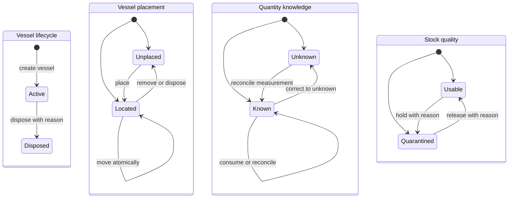

Disposal removes the vessel's current placement, retains its stock record and
last quantity, and prevents further use, movement, or quality changes. Known
zero does not dispose a vessel. Numerical consumption from unknown or
quarantined stock is refused.

Storage placement is either an explicit root or an immediate parent and named
slot. Vessel placement is explicitly unplaced or located. Each position is
exclusive across storage and vessels. Containment is acyclic. Moving a parent
changes its immediate placement and preserves descendant identities and local
positions.

Quantities use non-negative decimal strings in `L`, `mL`, `uL`, or `nL`, with
exact arithmetic and canonical `uL` readback. Unsupported units, negative
values, exponential notation and unrepresentable results are refused.
Consumption requires a positive amount. Reconciliation, quality changes,
consumption and disposal require a reason.

## Reservations and trusted time

Reservations record planned allocation independently of physical quantity and
placement. Each hold belongs to a stable local profile or verified agent. A
local profile represents an installation profile, not a verified person.

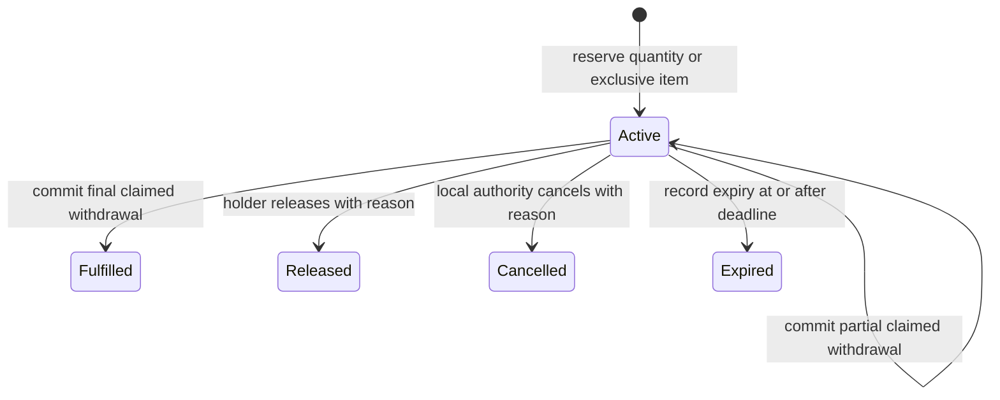

All terminal states are final. The clock passing a deadline changes eligibility
for fulfillment; it does not mutate the hold. An overdue hold remains allocated
until explicitly released, cancelled or expired. No timer owns business state.

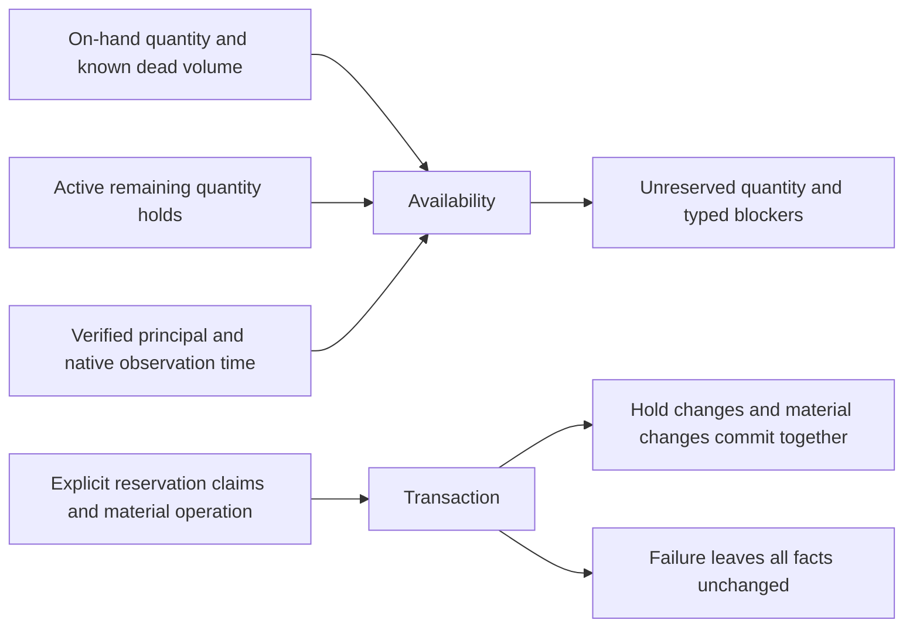

Availability is derived, never stored as another status. Unknown quantity,
quarantine, disposed containers, conflicting item holds and allocation
shortfalls are explicit blockers. Reconciliation can reveal that promises exceed
stock; it retains both the truthful measurement and holds. An overdue hold does
not prevent using the unreserved remainder.

Ordinary withdrawals protect held quantity. Reserved withdrawals explicitly bind
claims to source debits through `fulfill-reservations`. Item holds respect
ancestor and descendant containment, including permanent wells. Movement cannot
introduce overlapping holds belonging to different principals.

The native owner derives the principal and samples time inside the same SQLite
transaction as the accepted state, receipt and journal. Accepted time is at
least the previous recorded floor. Exact operation retries return the original
receipt before sampling a new clock. New receipts carry versioned context
separately from the existing actor string. Replay uses saved context and time;
historical receipt bytes and request digests remain unchanged. This is a local
monotonic clock guarantee; shared authority belongs to team synchronization.

## Physical custody and observations

Custody is independent of quality, quantity, reservation and lifecycle. Each
storage aggregate or movable vessel has a direct custody state. Permanent wells
inherit their plate's custody. One shared projection finds the controlling
ancestor; checking out a box never rewrites every descendant. v1–v5 state
upcasts to available direct custody without writes or revision changes.

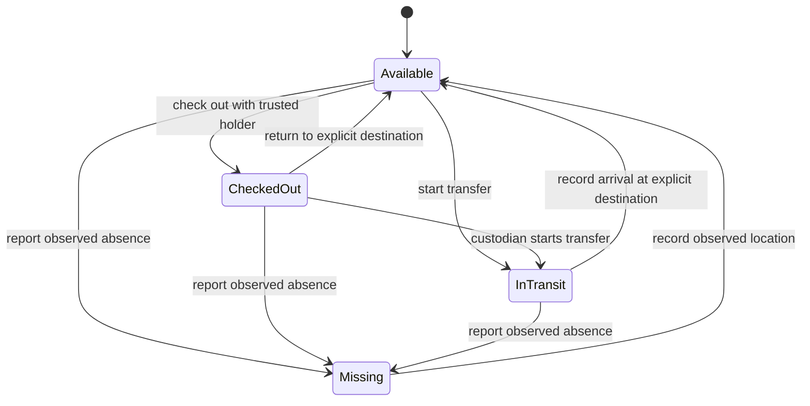

Available here means no outstanding custody record. It does not establish usable
quality or unreserved quantity. Checkout due dates are observation facts; they
never run a timer that returns an item or releases a reservation.

Departure frees the previous slot. Last-known observations retain immutable
names, positions and time separately from current placement. An inherited
subtree split preserves the original absolute observation and separately dates
its relative membership facts. An intended transfer destination is a plan, not
occupied or reserved space. Return and arrival revalidate the actual
destination.

Ordinary movement cannot erase direct or inherited custody. Explicit authorized
custody commands can split a movable subtree; permanent wells never split from
their plate. Missing and transit block physical material debits and credits.
Owned checked-out items remain subject to quality, quantity and reservation
rules. Reconciliation and quality observations remain separate commands.

Checkout and dispatch obey top-only stack retrieval and protect foreign holds. A
missing report records truth, retaining stock amounts, holds and the prior
responsible holder separately from the reporter. A middle-stack missing report
removes recorded occupancy and compacts the remaining ordinal metadata while
preserving relative order. It does not record physical retrieval of the others.

Locating a missing item is an explicit reason-bearing physical observation. It
restores available custody at the accepted destination; immutable history
retains prior responsibility. Reads and old-state upcasts never create custody
events.

## Physical definitions, installed arrangements and fit

A physical type describes a storage item or container, its scalar metadata
fields, default dimensions and structural rules. A recipe names an exact set of
type versions and their parent positions. Scientific material schemas remain
separate; both editors share the scalar field-definition and value primitives.
Creating equipment creates only the explicitly selected components and their
required ancestors. It does not create boxes, vessels or stock merely because a
brochure advertises a capacity.

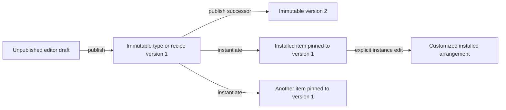

Publishing a successor never mutates existing versions or installed items.
Stable type-family IDs define allowed children; concrete version IDs pin
physical defaults and evidence. Instance-only layout edits preserve the type and
other instances. Removing occupied positions or changing occupied permanent well
geometry is refused. Unavailable positions retain their identities and recorded
contents but refuse new placements. Catalog selection lifecycle is separate from
this immutable content.

Geometry distinguishes external bounds from usable internal bounds. Decimal
dimensions normalize exactly to millimeters. Unknown axes stay unknown. Known
mounting orientations record upright quarter turns; an unknown orientation uses
conservative possible-axis bounds. A smaller bounding box alone never
establishes compatibility with an insert, opening or mounting system.

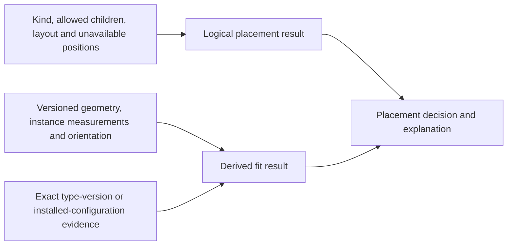

Fit is a projection, not a persisted state machine. It is compatible,
incompatible or unknown, with reasons and applicable evidence IDs. Explicit
structural incompatibility or known physical incompatibility refuses placement.
Unknown fit permits custom equipment and remains visibly unknown. A source URL
alone does not establish fit. Manufacturer assertions and local observations
retain their basis, exact subjects, position scope and orientations. Metadata
corrections preserve a physical configuration revision; relevant physical edits
invalidate evidence scoped to the previous configuration. Recording truthful
dimensions retains current occupancy and exposes a newly discovered misfit.

The curated catalog currently contains 20 configurations from two freezer
families. Each retains manufacturer sources, page locators and publication
scope. Rack alternatives and heterogeneous upper/bottom components remain
distinct. Conflicting exterior-depth sources leave that axis unknown. Catalog
reads are local and do not seed an inventory. Installation atomically publishes
missing definitions and selected components; an existing definition ID with
different content is refused rather than overwritten.

| Command                        | Effect                                                                    |
| ------------------------------ | ------------------------------------------------------------------------- |
| `define-physical-type`         | Publish an immutable physical type version.                               |
| `define-equipment-recipe`      | Publish an immutable arrangement pinned to exact type versions.           |
| `instantiate-physical-type`    | Create one named installed item with explicit metadata and destination.   |
| `instantiate-equipment-recipe` | Create the selected ancestor-closed components without stock.             |
| `configure-item`               | Explicitly set type pin, metadata, orientation and unavailable positions. |
| `reconfigure-storage`          | Change an instance layout while retaining valid identities and occupancy. |
| `record-item-geometry`         | Record reason-bearing dimensions and their optional source.               |
| `record-fit-evidence`          | Record scoped manufacturer support or local observation.                  |

## Catalog selection and update previews

Each exact type and recipe version has an explicit selection state. Content and
publication provenance stay immutable. Retirement changes future selection,
independently of the installed equipment's lifecycle, custody and contents.

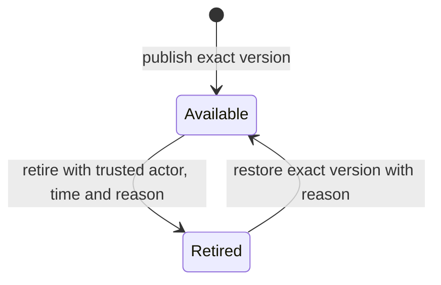

`retire-catalog-version` and `restore-catalog-version` name a tagged
type-version or recipe-version target. Repeated invalid transitions refuse
atomically. Exact operation retries return the original receipt; replaying a
retirement after a later restore does not retire the version again.

Current versus superseded is derived from version order. The highest published
version remains the current head when retired; an older version never silently
becomes the default. An available superseded version remains an explicit choice.
Retirement never changes installed pins, geometry, fit evidence, stock, holds or
custody. Same-pin edits and material use remain available under ordinary rules.
New instantiation or adoption of a retired version is refused.

Recipe eligibility uses its exact version and the selected components plus their
required ancestors. A retired recipe blocks every new installation. A retired
optional rack blocks selecting that rack; an explicitly selected shell omitting
it remains allowed if its root is available. Restoring a recipe does not restore
its component types. Full-arrangement dependency blockers and actual selected
component eligibility come from the same pure owner.

Catalog update preview classifies strict definitions as new, identical or
conflicting and shows source/model scope and exact installed references. It
never fabricates publication timestamps or writes inventory. Any conflicting ID
blocks applying that pack, including partial fit or recipe publication that
could otherwise refer to different existing geometry. Identical retired
definitions remain retired. Applying selected new definitions uses the ordinary
expected-revision batch owner; stale revisions and conflicting IDs refuse.
Nothing automatically synchronizes sources, replaces versions or migrates
installed equipment.

The native preview reads the offered built-in pack against the current admitted
inventory. An absent inventory is a pure empty snapshot for this calculation; it
remains absent afterward. Human and agent transports invoke the same domain
classifier. Their final write still passes through `inventory.execute`.

The setup view owns its tab and search query for the whole editor/preview
session. Returning from an exact-target dialog preserves that view; closing the
session resets it. Each target form owns a separate draft so changing targets
never carries another version's reason or selections.

## Physical item codes and exact lookup

Codes bind existing storage or movable vessels, separately from their stock,
material, placement and custody. Empty containers are valid targets. Permanent
wells use their plate's identity plus an explicit coordinate rather than an
independent movable-container label.

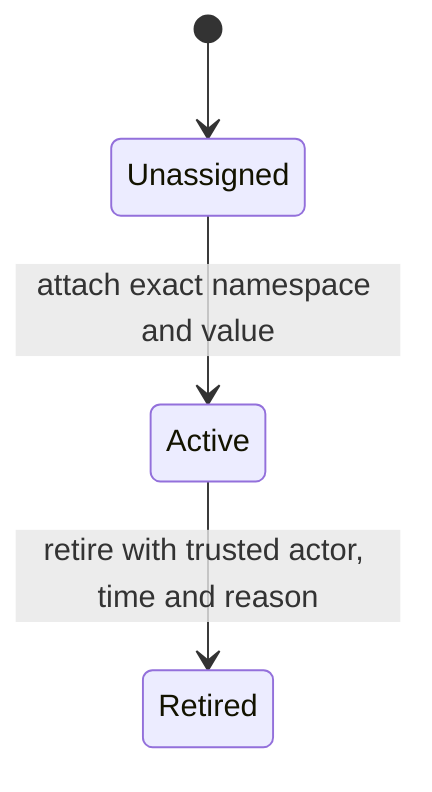

`attach-item-code` records an immutable target, namespace and value with trusted
assignment provenance. `retire-item-code` preserves that assignment permanently.
The exact namespace/value tuple stays reserved after retirement. New duplicate
attachments refuse; an exact operation retry returns the original receipt, even
after later retirement, without reactivating the code. Moving, emptying or
disposing an item never implicitly changes its code lifecycle. Correcting a
wrong label uses a new code and explicit retirement, not silent reassignment.

Namespaces are bounded lowercase ASCII technical identifiers. Values are one to
512 printable ASCII characters with at least one non-space character. Case,
punctuation, leading zeros and spaces remain exact. Unsupported characters and
invalid namespaces are explicit errors. No semantic parser trims, folds case,
coerces numbers or normalizes Unicode. The focused raw-input owner visibly
removes at most one trailing CRLF, LF or CR scanner terminator; interior
controls remain invalid. Scanned URLs remain opaque text and are never fetched.

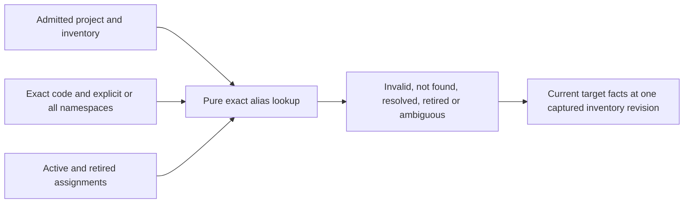

Null namespace searches all namespaces in the selected inventory. Multiple exact
matches are ambiguous, including retired matches or aliases of the same item.
There is no first, newest or active preference and no scientific material-search
fallback. Item IDs are inventory-scoped; lookup never silently searches another
inventory or switches projects. Codes grant no access.

The native read returns canonical scope, revision, trusted read time, principal,
resolution and matched target facts. Target records, effective custody, physical
configuration, current location and stock availability come from one parsed
state and availability context. Missing/transit/checkout retain last-known
observations separately from current location. An absent inventory stays absent;
lookup writes no rows, journal, clocks or events.

Lookup never locates a missing item, uses stock, releases holds, changes
quality, or records printing/attachment verification. Expected-item checking
compares full scope and tagged physical identity; a retired match remains
historical. The UI fences old responses by input, scope and inventory revision
and renders the returned snapshot rather than merging another revision's
availability. Ordinary follow-up actions revalidate through the existing command
owner. Generated labels and file output use a separate read/output boundary
below. Physical hardware qualification remains separate work.

## Existing-code labels and output

`inventory.prepare-label` admits one active binding and active physical target,
then invokes the lazy shared renderer on one native snapshot. Missing custody
remains explicit; preparing a label never locates the item. Unknown or retired
bindings, disposed targets, unsupported content and media overflow refuse
without inventory writes, journal entries, events or clock changes. Native and
agent routes recheck current authority after asynchronous module loading.

The artifact retains full scope, source revision, trusted read context, binding
and target snapshots, template/media/encoder/font identities, exact SVG and
SHA256. The QR symbol contains the exact alias bytes. Namespace and complete
tagged target are human-readable paths; the namespace and admitted inventory
context are still required for lookup. No local project fallback becomes a
globally portable identity. Item names are omitted from this bounded template.

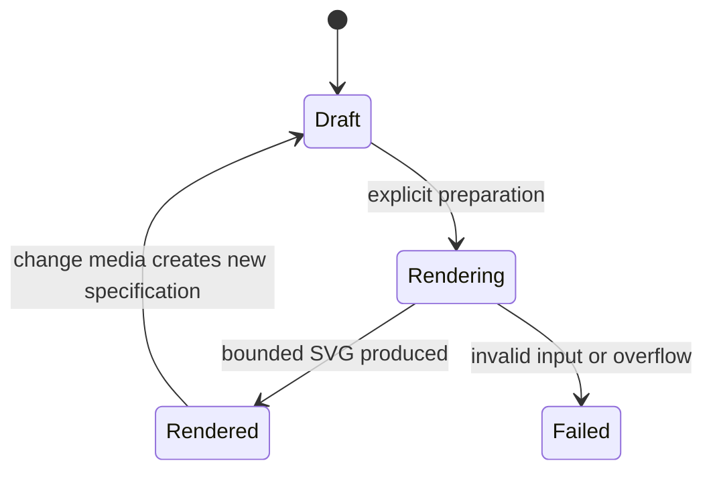

Rendered describes software output. It does not establish independent decoding,
file output, printing, attachment or hardware readability. Two fixed media
profiles retain four dots per module at 300 dpi and a four-module quiet zone.
The adapter composes an upstream QR matrix and reproducibly generated licensed
ASCII glyph paths; no runtime font fetch or parser is needed. Exact payloads
never shrink, truncate or change symbology to fit. Old artifacts retain their
bytes when current facts change. New preparation of a retired binding refuses.

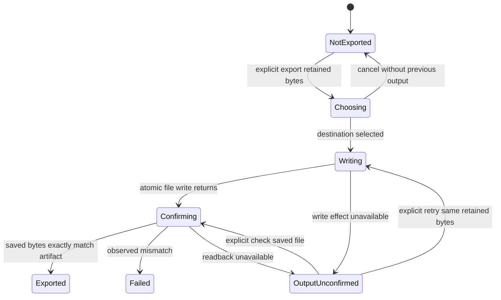

The existing save dialog, atomic filesystem writer and admitted reader own file
output. No arbitrary-path inventory mutation API is added. Canceling a new copy
restores the previous output observation. A failed dialog or observed byte
mismatch is explicit failure; a transported write error conservatively leaves
output unconfirmed. Exact artifact/destination remain available for check or
explicit retry. Forgetting an attempt leaves any existing file unchanged.

In-memory sessions are keyed by full project/inventory/code scope. Closing the
view detaches it without erasing a pending or unconfirmed copy. A late result
stays with its original session and never becomes another item's output.
Retired/disposed items can reopen retained artifacts; the view labels them as
historical snapshots. These sessions are not a durable print or issuance
journal. App restart retains inventory/code facts and saved files, not a
fabricated successful-output receipt.

Verification independently rasterizes the actual saved SVG, compares all decoded
bytes, and rejects erased symbol geometry. It qualifies that software artifact,
not any printer, scanner, media or cold-storage compatibility.

## Storage-temperature knowledge

Temperature has four independent owners: advertised possible setpoints,
operator-reported target, an installed qualification envelope, and the actual
stock or lot formulation's storage requirement. Signed exact decimal Celsius and
inclusive ranges retain negative values without floating-point conversion.
Unknown is distinct from zero; reversed ranges and temperatures below absolute
zero are rejected.

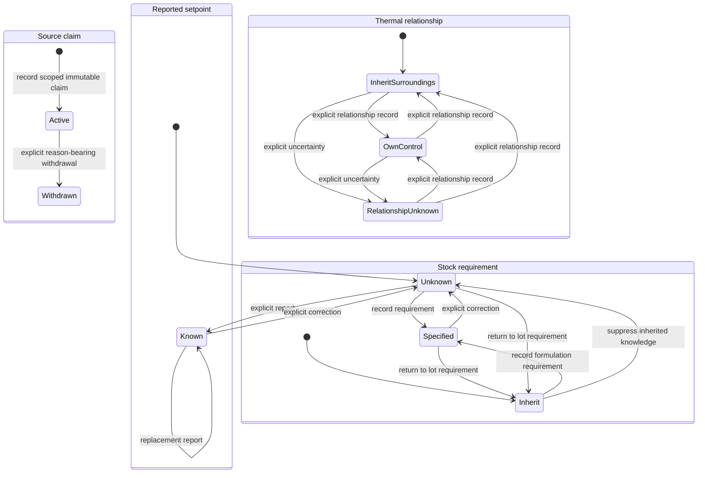

The five commands record or withdraw evidence, report a setpoint, record a
stock/lot requirement, and record a thermal relationship through the existing
atomic native owner. Each fact has an explicit observation timestamp or null,
separate from trusted recorded time and actor. No read invents an observation
time. A stock requirement may inherit its lot, specify a range, or override
inherited knowledge with unknown. A lot cannot inherit. Scientific designs do
not supply formulation requirements.

Claims retain exact source scope and immutable content. Conflicting applicable
equal-scope ranges remain conflicting; no source wins by being recorded last.
Exact installed capability takes precedence over type capability with all claims
retained. Built-in catalog ranges come from the cited model documents; they
establish neither a current target nor installed qualification. Reapplying an
identical withdrawn source does not reactivate it, and any conflicting
identifier blocks the entire catalog update.

Qualification pins the equipment's physical configuration and an inspectable
snapshot of its physical subtree at a declared setpoint and assumptions.
Descendant identity, internal placement, layout, geometry, physical revision and
thermal relationships are included; metadata, stock quantity and reservations
are excluded. Root external placement is excluded so moving an entire unchanged
assembly preserves its internal pin. Rearrangement makes a retained claim
inapplicable. Returning to the exact saved arrangement and target can make an
active claim applicable again; this does not establish uninterrupted storage or
erase intervening history. Withdrawal is the only terminal evidence lifecycle
transition. New qualifications explicitly declare
`scope: 'physical-and-thermal-arrangement'`. Legacy assertions without this
marker retain unrecorded relationships in both state upcast and command replay.
Migration never broadens what a historical qualification covered.

`inventory.storage-conditions` is a read-only projection at one native revision.
It returns three separate assessments: possible advertised capability, reported
target, and qualified support. Capability asks whether some advertised setting
can meet the requirement. Qualified support requires the entire applicable
envelope inside the requirement, not overlap. Results retain supported,
incompatible, unknown or conflicting states, reasons and source IDs.

An explicit thermal relationship determines context through physical ancestry.
Inherit traverses the parent; Self selects the item even without evidence;
Unknown stops traversal. An absent setting inherits. Claims, withdrawal and
setpoint reports never change the relationship, and names such as Freezer or Box
do not declare control. Checked-out, in-transit or missing custody makes current
context unknown instead of inheriting the former freezer. A whole-holder move
recomputes descendant assessments without changing stock.

Freshness requires an explicit null or nonnegative maximum age policy. No
policy, unknown time and future observations remain distinct from fresh or
stale. Comparisons describe recorded facts; stale evidence is visible and never
becomes live telemetry through a read clock. Temperature results do not control
equipment, observe sensors, establish overall suitability, quarantine stock,
release holds or block custom storage. Environmental incidents have a separate
owner.

## Native archives and adoption

Export captures one admitted SQLite snapshot with exact stored state, request
and receipt strings, their hashes, complete accepted history and typed
scientific dependencies. Capture does not create inventory or write a file. The
deterministic archive excludes incidental capture time. Native source scope,
history continuity, strict schemas, duplicate JSON keys, request/receipt
digests, replay and canonical snapshot parity are checked before use.

Preview is read-only. It binds the exact source text, absent destination,
explicit scientific mappings and current scientific-record fingerprints into a
deterministic plan. Source or binding edits invalidate the human preview. Apply
recomputes admission and the plan inside the existing immediate inventory
transaction. It creates one destination adoption operation, revision one and a
native receipt. Source history remains archived evidence, not destination
receives, checkouts or reservations. Ordinary accepted request shapes and retry
digests remain unchanged; adoption uses a tagged accepted request in the same
journal and receipt owner. Nested re-exports replay the retained source request
with its saved descriptors and native receipt context.

A recorded source holder is distinct from a person currently authorized to act.
Imported holders and recorded actors retain source archive/scope and their
original identity. They cannot gain destination authority by matching a local
profile or agent ID. Re-adoption retains imported attribution flat. Explicit
local cancellation and custody recovery remain ordinary reason-bearing commands.
Source recorded clocks later than native acceptance refuse; imported values
never advance the destination's trusted clock. Observation times remain source
facts. Qualifications retain their original physical and thermal scope.

Inventory origin is explicit and persists beyond history pagination. Native
inventories start with native origin. Adopted inventories record source scope,
source archive hash and revision, native adoption time and the actual importer.
This descriptor does not duplicate source history. Original source bytes remain
in the accepted adoption request. Only typed scientific references are mapped;
metadata text, physical IDs, aliases, exact amounts, arrangement pins and
unknowns retain their meaning. Non-injective scientific bindings require
separate reconciliation and are refused by the first adoption mode.

Human import state is editing, previewing, blocked, ready or stale before
entering the existing durable command recovery machine. An uncertain apply
retains the exact operation, bytes and resolved bindings. Recovery reads the
original receipt or retries that identical request. A repeated archive under a
new operation refuses against populated inventory. No preview stages a hidden
file, row, journal, receipt or event. Existing transport limits are measured
without silent chunking.

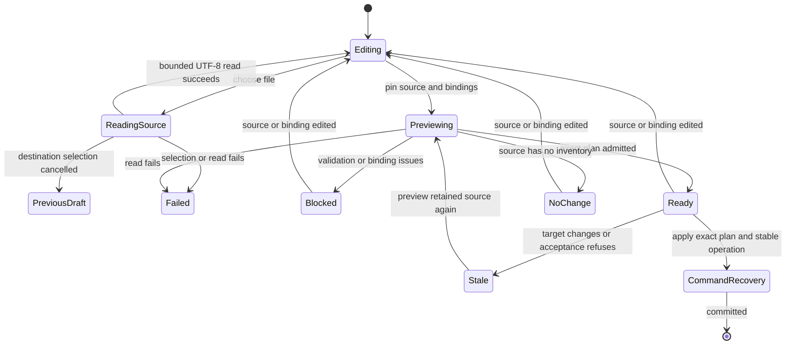

Reading-source is a draft phase. Blocked, ready and no-change are immutable
preview results; stale is derived from the observed target and command result.
The file path is display information, never source identity. Applying delegates
to the existing command recovery machine rather than adding an import journal.
An uncertain command locks its retained draft; leaving the view does not cancel
an already submitted operation.

Archive file output and labels share retained text-output states: choosing,
writing, confirming, exported, failed or output-unconfirmed. An acknowledgement
is followed by exact saved-text readback. Cancellation retains the capture;
uncertain output retains original bytes and destination for explicit check or
retry. Archive file input and output confirmation use bounded bytes and fatal
UTF-8 decoding, preserving source line endings. Text pasting is an explicit
alternative source, and its received text is pinned exactly. Scientific
documents keep their existing owner. Native archives do not declare spreadsheet
or Benchling export compatibility.

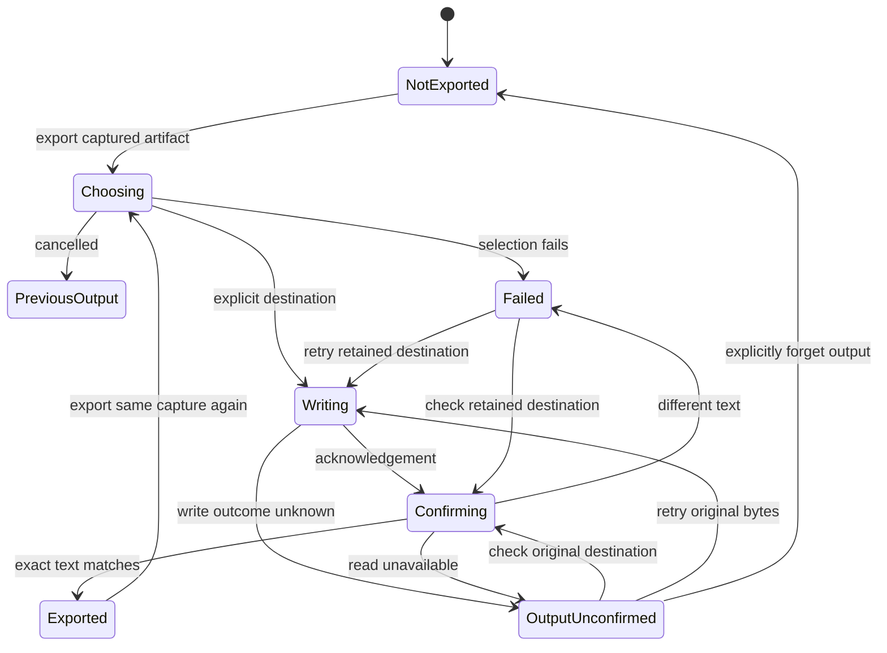

Capture and output are independent machines. A pending or unconfirmed output
locks recapture so its bytes cannot change beneath a write or retry. Late output
completion belongs to its original scoped session. Disposal prevents new work
without pretending an in-flight file write was cancelled.

## Canonical receive tables

A receive table proposes changes to a selected inventory. It does not replace
the inventory like archive adoption. The declared CSV/TSV columns have strict
meanings; unknown columns, inferred headers, padded rows and silent truncation
are refused. Scientific keys, location keys and existing-vessel keys require
explicit resolutions. Unknown quantity, known zero and unplaced are separate
choices. Existing vessels and permanent wells keep their names and locations.

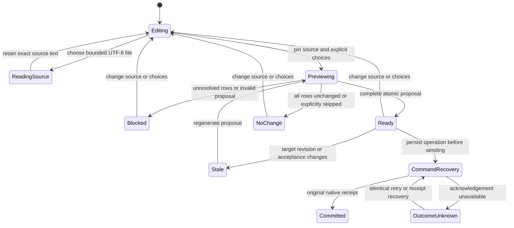

Lifetime correlation is the exact pair of source namespace and source row ID. A
content hash identifies one file, not an imported physical item. A row number
identifies presentation order, not an imported physical item. Neither can serve
as a duplicate-prevention key. Source correlation records retain the normalized
row hash, stock, vessel, scientific identity and original destination decision.
They do not mirror current stock quantity, quality, custody or placement.

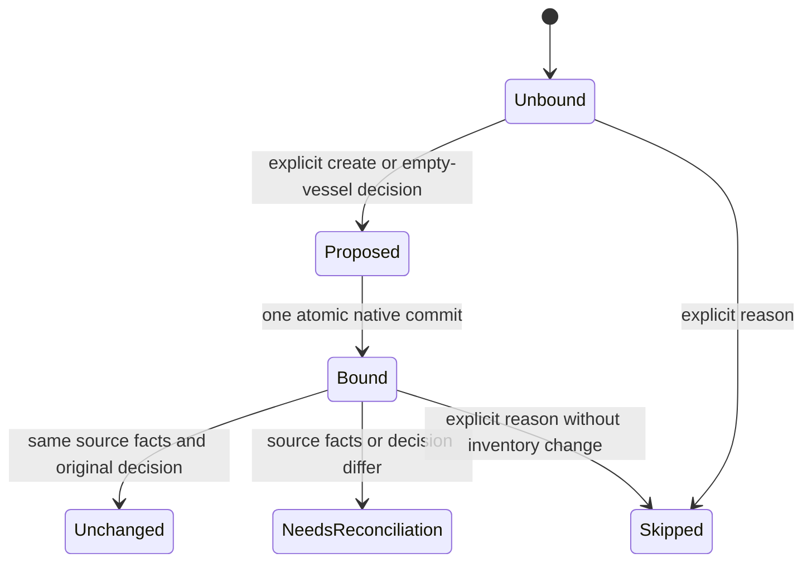

Resolve an existing lifetime binding before deriving new destination IDs. This
preserves identity after archive adoption, which retains physical IDs across
project scopes. Unchanged rows do not replenish consumed stock or move a vessel
back to an old location. Changed rows require a separate explicit reconciliation
workflow. Skipping does not delete or mark stock missing. All-skipped or
unchanged proposals create no receipt.

A ready plan binds exact source text, format, delimiter, namespace, resolutions,
current scientific fingerprints and destination scope/revision. Native apply
recomputes it inside the accepting transaction, then runs the existing atomic
commands and appends their lifetime bindings in one revision. Ordinary commands
cannot forge these bindings. Replay uses saved decisions and the original native
receipt context. It does not consult the live scientific registry. Generated
commands count toward the existing batch bound; oversized proposals refuse
without hidden partial batches. Raw source and explicit skips remain in the
accepted request when a nonempty proposal commits.

## Stocktake observation contract

A stocktake observation records a claim about a particular stock or physical
item. Its subject, measured fact, source time and reason are immutable. Native
recording time and actor come from the owner. Quantity observations target
stock; missing/found observations target an explicitly selected physical item.
Measuring a permanent well does not find its plate. A missing source row is not
a missing-stock observation.

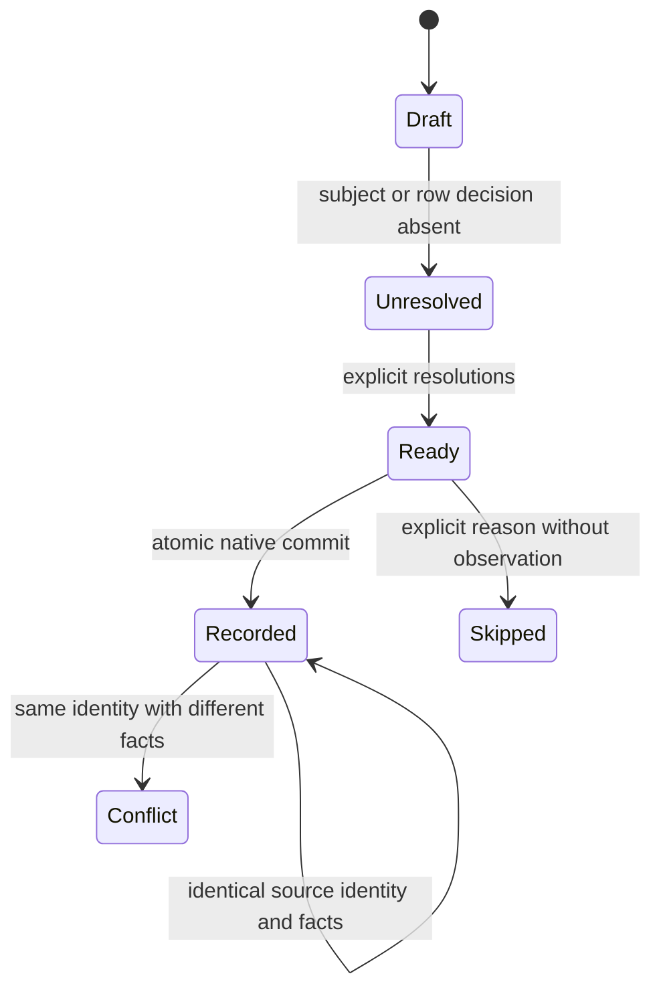

Application is independent from recording. Record-only is a real observation
write, never a dummy move or quantity reconciliation. A recorded observation may
be applied later with an explicit reason. Application uses the existing quantity
or custody transition and records its actual native actor and time. Its applied
state changes only if that transition succeeds in the same atomic batch.

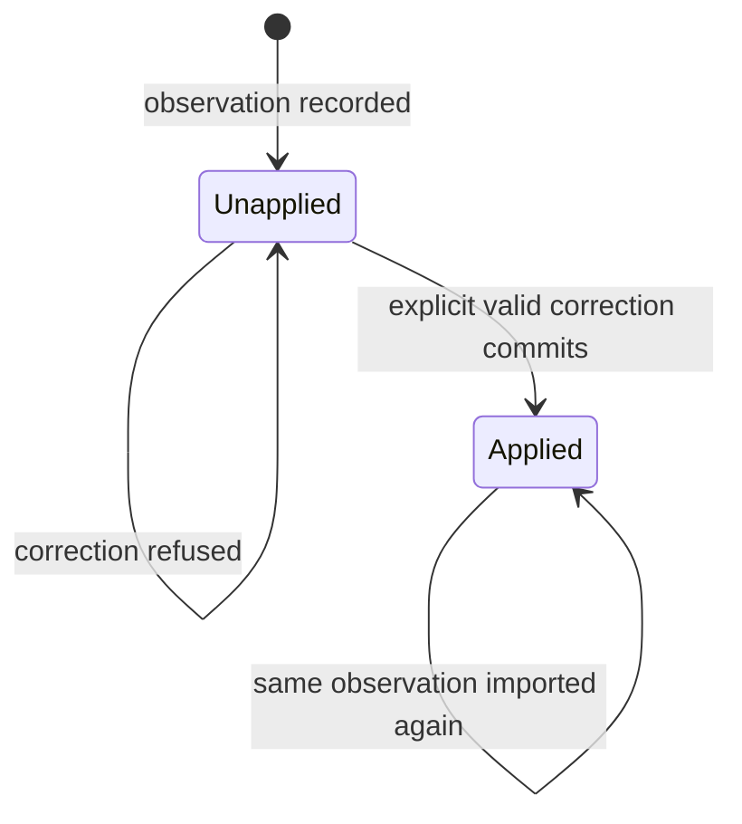

Quantity reconciliation may record an amount below active holds. It preserves
those holds and exposes an allocation shortfall. It never releases holds or
changes custody. Missing/found corrections preserve quantity and use explicit
destinations, existing responsibility rules and aggregate custody constraints.
An independently applied permanent-well custody correction refuses.

Stable observation identity is the exact source namespace and observation ID.
Repeated measurements require a new ID. Reimporting an applied observation does
not restore stock consumed afterward. Archive adoption preserves physical
references and observation identity; recorded people remain imported
attribution. A revision of an external receive register is separate from both a
new measurement and approval to change current physical facts.

The stocktake adapter pins source text, format, choices and target
scope/revision in its read-only preview. Recording and applying use the existing
command, transaction, receipt and outcome-unknown recovery machines. Neither
adds a second journal or hidden file. Source edits, unresolved decisions,
changed observation facts or stale targets cannot partially apply a proposal.

## External source revision contract

An accepted receive row binds a stable external identity to physical stock. A
later external edit is neither another receipt of stock nor a measurement.
Acknowledging it changes the accepted source baseline only. Quantity, vessel
name, quality, placement, custody, holds and stocktake observations remain
unchanged.

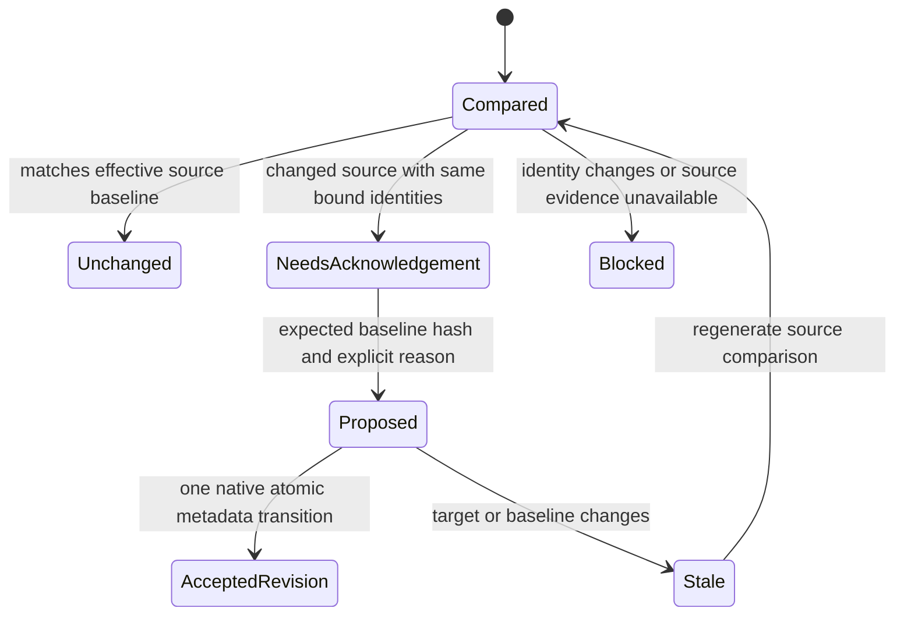

The original row hash and original destination remain immutable. Accepted source
revisions append a previous-hash link, new fields and hash, source destination,
reason and native actor/time. The effective baseline is the latest revision,
otherwise the original binding. An accepted rollback appends another revision.
Current inventory never substitutes for unavailable previous source fields.

Show previous source, revised source and actual inventory separately. Previous
fields come from a verified retained accepted request, including nested archive
evidence, or a saved source revision. Recompute their row hash before use.
Source material aliases may change only while resolving to the same scientific
identity; existing-vessel aliases still identify the same vessel. The first
protocol refuses scientific rebinding, vessel replacement, vessel-kind changes
and unbound rows. A changed source destination does not run placement checks or
move stock.

Acknowledgement has a dedicated accepted request through the existing journal,
receipt and recovery path. Saved verified preimages make replay independent of
live sources. Preserve legacy receive-v1 request shapes and plan digests when
adding empty revision history to canonical state. Reimport compares the
effective baseline before deriving physical IDs and never reverses later use or
movement. Archive adoption retains the source chain and fields, maps only typed
scientific identity, and keeps acknowledgement actors as imported attribution.

## Hierarchy table contract

A hierarchy table creates explicit storage layouts and parent relationships.
Freezers, shelves, boxes, permanent-well plates and plate stacks use the
existing storage owner. Names do not imply hardware specifications, dimensions,
temperature control or qualified fit. Scientific stock receiving remains a
separate visible atomic stage.

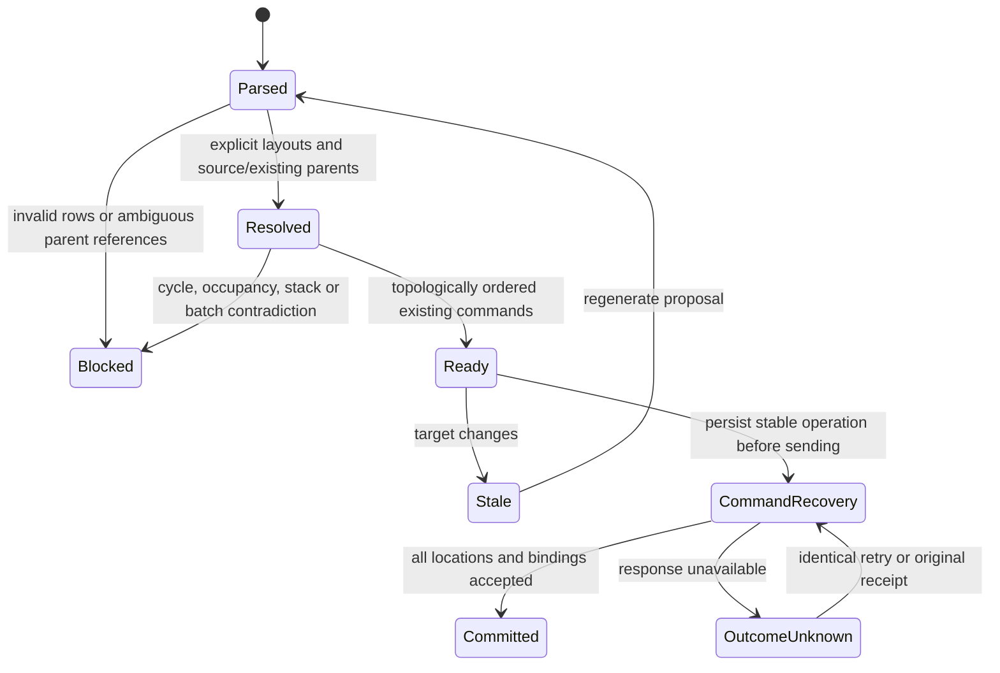

Lifetime hierarchy bindings use the exact namespace and source ID, with a source
row hash, physical storage ID and original destination. Resolve existing
bindings before generating IDs. Reimport never moves a container back or
recreates it after later use, movement or disposal. Changed source facts require
separate reconciliation. Source parent references are explicit; skipped unbound
parents cannot become invented roots.

Topological ordering creates parents before children. Permanent wells belong to
the plate owner. A stack ordinal is explicit source data, not input row order;
the importer uses ordinary push commands and current stack constraints. A late
contradiction refuses the whole proposal. No hierarchy-only journal, migration
coordinator or hidden batch splitting is introduced.

## Mapped plate spreadsheet contract

A plate spreadsheet adapter preserves the entire raw source while making its
physical interpretation explicit. Scientific primer publication and hierarchy
creation use their existing owners. Physical receiving binds current admitted
scientific identities and existing permanent wells; it does not create either
implicitly.

```mermaid
stateDiagram-v2
  [*] --> SourceDraft
  SourceDraft --> ColumnResolution: exact source and delimiter selected
  ColumnResolution --> RowResolution: every source column has a disposition
  RowResolution --> Blocked: missing material, plate, well or quality decisions
  RowResolution --> Ready: complete normalized receive plan
  Ready --> Stale: target or scientific bindings change
  Stale --> RowResolution: regenerate interpretation
  Ready --> CommandRecovery: persist raw source and exact choices
  CommandRecovery --> Committed: one atomic stock operation
  CommandRecovery --> OutcomeUnknown: response unavailable
  OutcomeUnknown --> CommandRecovery: original receipt or identical retry
```

The first format maps source identity, plate and well columns. Every remaining
column requires an evidence-only disposition with a reason. Well-label
translation is an explicit source-to-position map; leading zeros are never
stripped automatically. Quantities are explicitly unknown with a reason when the
register has no measurements. Each row's usable/quarantined choice is explicit;
external QC labels do not establish that choice. Source plate and box labels do
not establish dimensions, hierarchy or hardware.

A deterministic normalizer produces the existing receive-v1 physical rows and
choices. The outer plan pins exact original source, normalizer version, column
dispositions, explicit decisions, resolved scientific fingerprints, target
scope/revision and inner receive-plan digest. Native acceptance regenerates both
plans inside the existing transaction. Saved choices and native receipt context
drive replay, with no live registry lookup. No new inventory state map or
scientific import coordinator is needed.

Existing table bindings correlate physical stock. Reordering or changed CSV
quoting does not duplicate it. Changed normalized interpretation requires
existing source reconciliation. Changes only to evidence-only fields may produce
no physical changes; such a preview saves no new source or receipt. Do not imply
the revised evidence file was retained. Original raw source and all decisions
remain in committed mapped requests. Source baseline discovery normalizes those
retained requests, never reconstructs source fields from current stock.

## Foreign physical capture boundary

A versioned offline source capture is evidence, not execution authority. The
Benchling adapter must pin its response version and retain raw page bodies,
endpoint/query context and explicit scope. An omitted field cannot acquire a
default physical meaning through parsing.

```mermaid
stateDiagram-v2
  [*] --> Omitted
  [*] --> ExplicitNull
  [*] --> Present
  Present --> Conflict: incompatible observation of same source identity
  Omitted --> Resolved: explicit source or human decision
  ExplicitNull --> Resolved: declared interpretation
  Present --> Resolved: supported source fact verified
  Conflict --> Resolved: explicit conflict disposition
```

```mermaid
stateDiagram-v2
  [*] --> Staged
  Staged --> NeedsResolution: missing, contradictory or unsupported facts
  NeedsResolution --> Staged: explicit decisions
  Staged --> Validated: source, dependencies and target pinned
  Validated --> Stale: source, target or scientific bindings change
  Stale --> Staged: regenerate plan
  Validated --> CommandRecovery: persist exact operation and source
  CommandRecovery --> Committed: one atomic native operation
  CommandRecovery --> OutcomeUnknown: acknowledgement unavailable
  OutcomeUnknown --> CommandRecovery: original receipt or identical retry
  Staged --> Canceled
  NeedsResolution --> Canceled
```

Capture consistency, source completeness, row disposition, identity correlation
and submitted-command recovery are independent. Page order cannot choose the
winner among conflicting snapshots. Source actors, archive state, reservations,
checkout and restrictions cannot become local principals, grants or invented
history. Multiple contents require a supported mixture interpretation or an
explicit refusal; never choose one entity silently.

Source numeric precision precedes inventory arithmetic. Keep original JSON
number lexemes and their decoded pointers through duplicate-key validation.
Exact volume interpretation uses those tokens, not an already rounded number.
Unit dimensions and absent/null/zero amounts remain explicit. Empty movable
containers need lifetime physical identity independent of stock existence.

Capture application uses explicit field observations or reason-bearing local
declarations. An empty registered-contents array alone does not establish a
physically empty container. The bounded source-empty choice requires that array
and an explicitly selected supported volume of exactly zero. Positive,
unresolved or non-volume amounts remain unresolved rather than silently empty. A
container with a registered entity and zero amount stays identified stock.
Selecting deprecated volume while current quantity is supplied needs an explicit
reason; field order never chooses precedence.

Physical source correlation and content admission have separate lifetimes.
Storage already has hierarchy bindings and stock has receive-table bindings.
Canonical v17 also has vessel bindings that can refer to an empty movable
container or a permanent plate well. Foreign capture application owns their
commitment; read-only capture inspection never creates a binding.

```mermaid
stateDiagram-v2
  [*] --> Unbound
  Unbound --> Proposed: explicit physical interpretation
  Proposed --> Unbound: refusal or canceled draft
  Proposed --> Bound: atomic native commitment
  Bound --> Bound: move, dispose, reimport or retire label
```

```mermaid
stateDiagram-v2
  [*] --> NoStock
  NoStock --> ContentProposed: explicit scientific identity and quantity decision
  ContentProposed --> NoStock: refusal or canceled draft
  ContentProposed --> StockBound: receive into the already bound vessel
  StockBound --> StockBound: use, reconcile or acknowledge changed source
```

Bound is lifetime identity, including a disposed physical target. A missing or
empty source contents field cannot erase local stock. Resolve existing bindings
before generating destination-scoped identifiers, including after archive
adoption. A fixed well binds its foreign container identity to its plate and
coordinate; a matrix-plate tube remains an independently movable vessel.

Item codes remain physical labels. They can identify empty movable vessels but
deliberately cannot target permanent wells. Using label retirement and derived
plate-relative lookups as import correlation would create two hidden identity
routes. The planned vessel binding keeps one explicit route for both vessel
kinds, separate from label lifecycle and stock existence.

Foreign physical and stock projections have separate immutable baselines.
Changing contents or quantity must not allocate a replacement container.
Changing physical source facts must not overwrite later local movement. Capture
application must assemble one existing command batch and binding additions for
one native transaction, rather than chaining independently committed hierarchy,
vessel and stock imports.

### Capture application

The capture application uses one accepted request, `import-benchling-capture`.
Preview is read-only. Its private construction phases do not publish
intermediate inventories or consume extra revisions. The final proposal is
checked again against the original inventory before one transaction commits
commands, physical bindings, stock bindings, the original capture and its
receipt together.

```mermaid
stateDiagram-v2
  [*] --> Inspecting
  Inspecting --> Invalid: malformed or over-limit capture
  Inspecting --> Decisions: exact observations retained
  Decisions --> Previewing: every record and source issue has a disposition
  Previewing --> Decisions: unresolved facts or refused complete batch
  Previewing --> NoChange: no commands or new bindings
  Previewing --> Ready: original target and scientific admissions pinned
  Ready --> Decisions: source or interpretation edited
  Ready --> Stale: target revision or scientific admission changed
  Stale --> Previewing: regenerate against current facts
  Ready --> Submitted: exact request retained by controller
  Submitted --> Committed: single native transaction
  Submitted --> OutcomeUnknown: acknowledgement unavailable
  OutcomeUnknown --> Submitted: original receipt lookup or identical retry
  NoChange --> Decisions: no receipt or revised source saved
```

Each location, box, plate and container needs an explicit import or skip
decision. Schema records remain source evidence. Locations require declared
local layouts; boxes and plates require explicitly selected schema dimensions or
declared bounded dimensions. Names cannot establish dimensions. Permanent wells
and removable matrix tubes use different physical owners. Every captured
container identity receives a durable vessel binding. Existing bindings resolve
before new IDs are generated, including after archive adoption.

```mermaid
stateDiagram-v2
  [*] --> Unbound
  Unbound --> Bound: explicit target and validated physical projection
  Bound --> Bound: local move, use, disposition or archive adoption
  Bound --> Unchanged: same source physical projection
  Bound --> NeedsReconciliation: changed physical facts or interpretation
  Unchanged --> Bound: retain original target and local state
  NeedsReconciliation --> Bound: explicit reconciliation outside import
```

Contents decisions are independent of physical bindings. Captured contents `[]`
can establish an initial empty vessel only when an explicitly selected supported
volume is exactly zero. Nonempty contents with zero volume remain identified
stock. Multicontent tubes can remain physically present and unidentified;
omitted contents can remain unobserved. Uncaptured permanent wells are
initialized as unobserved in the same batch. Uncaptured removable-container
coordinates require an explicit unavailable-position policy. No phantom tube is
created.

Exact source volume interpretation uses the original JSON numeric token and
bounded decimal arithmetic. Unsupported or absent amounts require an explicit
unknown-volume reason. Quality and current local scientific identity are
separate explicit choices. Scientific admission fingerprints cover the saved
Registry row, catalog identity and file-binding metadata; they are not raw
file-content hashes. Foreign restrictions and checkout records remain source
evidence.

A versioned physical projection preserves omitted, null, present and conflicting
source facts. It excludes contents, quantity, foreign status, observation order
and explanatory prose. Plate membership maps do not rename the plate's physical
baseline; each identified well has its own binding. Reimport preserves current
movement, contents knowledge and stock use. Changed stock source fields require
source reconciliation and cannot replenish inventory. New source contents for a
previously empty or unresolved bound vessel use its original physical identity.

Canonical stock preimages regenerate from retained capture text, saved typed
choices and resolved targets. They never derive from current remaining stock.
Validated nested archive histories use the same normalizer. A real new binding
without physical commands advances one metadata revision; a no-change preview
creates no receipt and saves no revised capture. The existing complete-batch and
inline transport limits apply without splitting the operation.

## Material identity and conservation

A vessel's contents knowledge is separate from its quantity and source identity.
A missing stock record cannot mean both an explicitly empty vessel and a vessel
whose contents have not been inventoried. An unidentified tube can still be
moved, labeled, checked out or reported missing.

```mermaid
stateDiagram-v2
  [*] --> DeclaredEmpty: create a new empty vessel
  [*] --> Unobserved: contents have not been checked
  [*] --> Unidentified: material is present without admitted identity
  DeclaredEmpty --> Identified: receive linked stock
  DeclaredEmpty --> Unobserved: record unresolved contents with reason
  DeclaredEmpty --> Unidentified: record unidentified contents with reason
  Unobserved --> Unidentified: record material present with reason
  Unidentified --> Unobserved: correct knowledge with reason
  Unobserved --> DeclaredEmpty: explicitly declare empty with reason
  Unidentified --> DeclaredEmpty: explicitly declare empty with reason
  Unobserved --> Identified: identify existing contents
  Unidentified --> Identified: identify existing contents
  Identified --> Identified: use or reconcile, including known zero
```

The v17 knowledge value is recorded, unobserved or unidentified. The shared
domain projection combines recorded knowledge with actual stock records to
distinguish declared-empty from identified. A known zero stock stays identified;
unknown quantity also stays identified. Legacy and ordinary vessel creation
retain their recorded declaration without inventing an observation time or actor
during upcast.

Unobserved and unidentified vessels cannot accept ordinary receiving or any
operation requiring an empty destination. Identifying their existing contents
has its own explicit command, using the same scientific admission, capacity,
custody and configuration rules as receiving. It does not invent a physical
receipt. Recording unresolved knowledge requires a reason and trusted actor and
time, and cannot erase an existing stock, including a known zero stock. There is
no identified-to-empty shortcut in this boundary.

A scientific record identifies a material. A lot identifies one supplier batch
or internal preparation. Stocks reference a lot or an explicit unattributed
root. An aliquot inherits that reference. Independent unattributed stocks are
not compatible merely because both lack batch metadata.

Lots retain immutable supplier/preparation/pool/dilution origins. Contribution
snapshots retain source stock, material, provenance and exact withdrawn volume.
Later attribution does not change earlier snapshots or aliquots. Creating a
preparation records source identity, not a volume withdrawal. Lot provenance is
acyclic and does not follow a root stock’s mutable current attribution.

Transfer debits equal destination credits. Existing destinations require the
same scientific identity and provenance. Pool and dilute require an empty
destination, explicit output material and a new lot. Pool credits equal summed
contributions; dilution debits both the sample and a tracked diluent. Every
source debit, output credit and lineage record commits in one revision.

Known capacity limits additions and measured quantities. Known dead volume
limits withdrawals. Unknown limits remain explicit. Reconciliation records a
measurement; it does not invent a transfer. Quantities use exact decimal
arithmetic, including mixed units. Composition distinguishes unknown from
homogeneous with explicit analyte facts. Known concentration is an exact reduced
rational in canonical mass/volume or amount/volume units. Compatible decimal
input units normalize exactly; mass and molar quantities are not converted
without molecular weight. Unlisted analytes are unmeasured, not zero.

Pool, dilution and transfer into existing stock require an explicit output
mixing choice before calculating weighted concentrations. Legacy request shapes
without mixing remain unchanged and produce unknown mixed composition. A new
aliquot inherits its source. Missing input measurements or incompatible units
remain explicit unknown results. Contribution snapshots deep-copy the facts used
at commitment. Later measurements do not rewrite them.

Measurement input accepts decimal values and strict canonical facts. This lets
an edit preserve an existing one-third concentration and unknown reason while
changing another analyte. Internal arithmetic supports bounded input sets;
canonical stored results have explicit size limits. Final results do not depend
on contribution order.

## Atomic commands and receipts

`inventory.execute` accepts a project reference, inventory ID, operation ID,
expected revision, and command batch. The first accepted batch binds the
inventory to the admitted project. The native owner checks scientific material
references against eligible records in that project. Inventory does not infer
that a design exists physically.

One accepted batch increments the inventory revision once. Its state, immutable
accepted-command history and receipt commit in one SQLite transaction. A refused
batch changes no inventory state and has no committed receipt. Reads do not
create inventories or tables.

```mermaid
stateDiagram-v2
    [*] --> Submitted
    Submitted --> Replayed: exact operation already committed
    Submitted --> IdentityConflict: ID bound to another request
    Submitted --> RevisionConflict: stale expected revision
    Submitted --> Refused: invalid state transition or access
    Submitted --> Committed: atomic state, history and receipt
```

These are outcomes of an attempt. An identity conflict does not change or
replace the original committed receipt. The owner looks up a receipt before
checking the expected revision, so an exact successful retry remains readable
after later operations.

The operation identity is scoped to its inventory. The canonical request
includes the admitted project identity, operation ID, expected revision and
commands. Trusted actor identity and commit time are recorded separately.
Current authorization is still required to replay or inspect an old operation.

```mermaid
stateDiagram-v2
    [*] --> AwaitingResult: submit stable operation ID
    AwaitingResult --> Confirmed: committed receipt received
    AwaitingResult --> Refused: explicit refusal
    AwaitingResult --> OutcomeUnknown: connection interrupted
    OutcomeUnknown --> Confirmed: retrieve matching receipt
    OutcomeUnknown --> AwaitingResult: retry identical operation
```

A timeout describes the caller's knowledge. It does not establish failure or
permit another debit under a new operation ID. The synchronous local owner has
no durable running state that needs abandoned-job recovery. Hardware actions
require a separate reconciliation protocol.

## Native boundary

All routes use the existing loopback endpoint, native credential, owner instance
identity and registered project scope:

| Command                            | Request and result                                                                                            |
| ---------------------------------- | ------------------------------------------------------------------------------------------------------------- |
| `inventory.projects`               | List admitted projects and stable default inventory identities.                                               |
| `inventory.materials`              | Search eligible scientific material in one admitted project.                                                  |
| `inventory.catalog`                | Read detached equipment definitions for an admitted project without inventory creation.                       |
| `inventory.catalog-update-preview` | Classify one built-in pack against an admitted inventory without publication or inventory creation.           |
| `inventory.resolve-item-code`      | Resolve exact scoped physical item codes and current target facts without mutation.                           |
| `inventory.prepare-label`          | Render an immutable existing-code QR SVG artifact from an admitted snapshot without file or inventory writes. |
| `inventory.storage-conditions`     | Compare scoped temperature facts and formulation requirements at one revision without inventory writes.       |
| `inventory.export-snapshot`        | Capture exact state and full accepted journal as a read-only native archive.                                  |
| `inventory.preview-import`         | Validate pinned archive and scientific bindings without destination effects.                                  |
| `inventory.apply-import`           | Adopt validated facts into absent inventory through the existing journal and native authority.                |
| `inventory.availability`           | Derive quantities, reservations, custody and physical compatibility from current facts.                       |
| `inventory.execute`                | Apply an expected-revision command batch; return a committed receipt or explicit rejection.                   |
| `inventory.inspect`                | Read current state for an admitted project and inventory.                                                     |
| `inventory.operation`              | Read one original committed operation receipt.                                                                |
| `inventory.history`                | Read accepted operations with revision pagination.                                                            |

Agent requests recheck their exact current grant through the shared native
authorizer before read/write dispatch. Forwarded capability claims alone do not
authorize an operation. Native token and instance checks still bind the command
server, and the owner rechecks project authority at commitment. Desktop actor
records identify a trusted local window origin, not a verified human name.

The owner also verifies replay of accepted history against the persisted state.
This is a bounded local inventory recovery check, not a general migration or
cross-device synchronization protocol.

## Verification

Use
[the inventory verification skill](../skills/verify-inventory-core/SKILL.md). It
drives the real loopback command server, real registered-project authority and
real SQLite owner with synthetic material, then preserves state and receipt
readback after reopen. The bounded state exploration calls the production domain
transition function directly. The workspace map drives the genuine Electron
receive, move, use and history journey and checks exact state after application
restart. These checks do not establish a deployed service, real freezer fit,
cross-device behavior or robot execution.
