# Inventory command contract

The inventory core records physical possession separately from scientific
identity. A registered scientific record can have no physical stock or several
stocks. Storage locations hold named positions, vessels occupy positions, and
stock links a vessel to a scientific record. An empty vessel is valid.

The browser-safe domain owner is
`packages/core/domain-services/src/inventory.ts`. The native SQLite owner is
`apps/desktop/src/main/inventory-owner.ts`. Request parsing lives in
`apps/desktop/src/shared/inventory-command.ts`; the authenticated native command
server and desktop IPC invoke the same inventory owner.

The Inventory workspace and authenticated agent tool consume this same owner.
Layouts distinguish named positions, grids, removable-tube boxes, permanent-well
plates and ordered stacks. This version supports one stock per vessel and exact
volume accounting. Lots, internal preparations, exact-volume transfers, pooling,
tracked dilution, exact concentration facts and known container limits use the
same command owner. Quantity and item reservations and physical custody use that
owner too. Physical types, equipment recipes, installed arrangements and scoped
fit evidence use that owner. Team synchronization remains separate work.

Permanent wells have stable identity and remain attached to their plate. A plate
moves with all its wells. Whole-plate disposal retains historical stock and
disposes every well. Stack order is derived from child placement alone. Explicit
push and pop commands enforce capacity and removal from the top.
`removal: 'top-only'` governs retrieval order; recording quantity does not prove
physical access to a buried plate.

Canonical state is v9. v1/v2/v3 composition facts upcast to explicit unknown
values. v1–v4 snapshots gain an empty reservation map and recorded clock floor
without a revision change. Reading v1 upcasts named layouts and movable vessels;
v1/v2 stocks receive distinct unattributed roots and unknown container limits.
Reads do not write or increment revision. Historical command shapes and request
digests stay unchanged for retry and replay. v1–v6 snapshots gain empty type,
recipe and fit-evidence maps and explicit untyped item configurations. The
original request and receipt bytes remain unchanged. v1–v7 published type and
recipe versions gain explicit available selection state without changing their
content, installed pins, revision or clock. v1–v8 snapshots gain an empty
item-code map through state-only upcast; existing retired catalog selections
remain intact.

## Independent states

These machines describe independent facts. They are not combined into a single
status field.

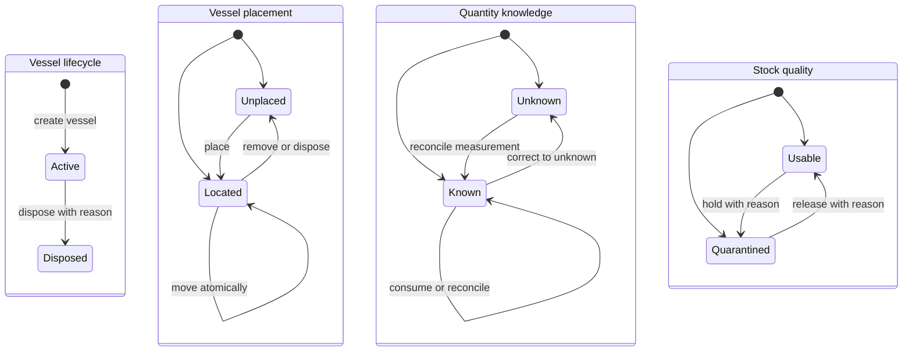

Disposal removes the vessel's current placement, retains its stock record and
last quantity, and prevents further use, movement, or quality changes. Known
zero does not dispose a vessel. Numerical consumption from unknown or
quarantined stock is refused.

Storage placement is either an explicit root or an immediate parent and named
slot. Vessel placement is explicitly unplaced or located. Each position is
exclusive across storage and vessels. Containment is acyclic. Moving a parent
changes its immediate placement and preserves descendant identities and local
positions.

Quantities use non-negative decimal strings in `L`, `mL`, `uL`, or `nL`, with
exact arithmetic and canonical `uL` readback. Unsupported units, negative
values, exponential notation and unrepresentable results are refused.
Consumption requires a positive amount. Reconciliation, quality changes,
consumption and disposal require a reason.

## Reservations and trusted time

Reservations record planned allocation independently of physical quantity and
placement. Each hold belongs to a stable local profile or verified agent. A
local profile represents an installation profile, not a verified person.

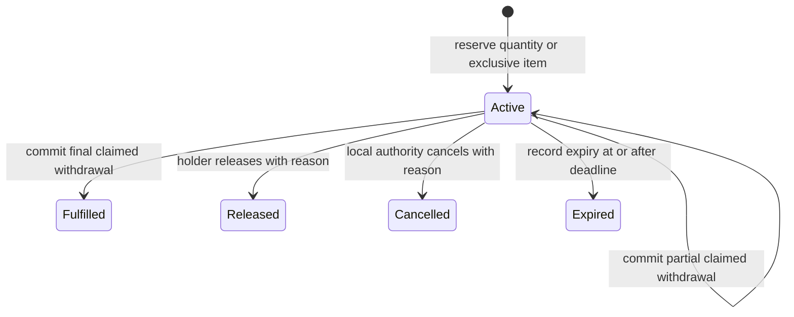

All terminal states are final. The clock passing a deadline changes eligibility
for fulfillment; it does not mutate the hold. An overdue hold remains allocated
until explicitly released, cancelled or expired. No timer owns business state.

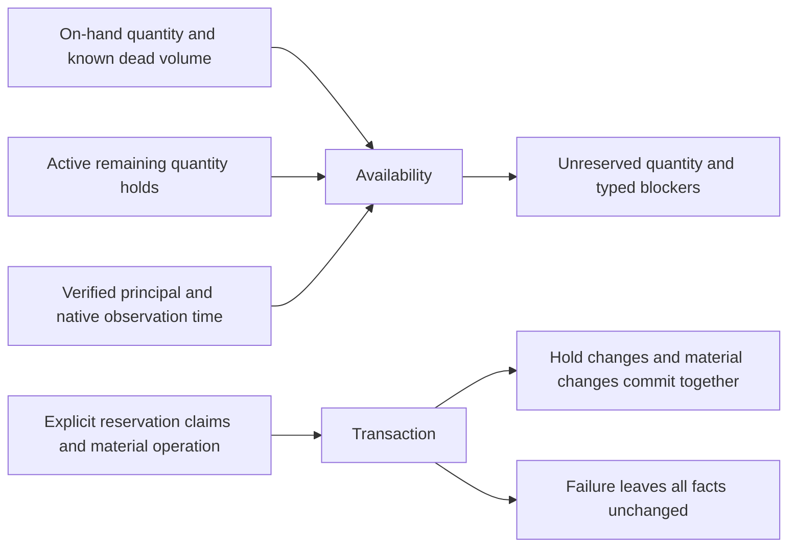

Availability is derived, never stored as another status. Unknown quantity,
quarantine, disposed containers, conflicting item holds and allocation
shortfalls are explicit blockers. Reconciliation can reveal that promises exceed
stock; it retains both the truthful measurement and holds. An overdue hold does
not prevent using the unreserved remainder.

Ordinary withdrawals protect held quantity. Reserved withdrawals explicitly bind
claims to source debits through `fulfill-reservations`. Item holds respect
ancestor and descendant containment, including permanent wells. Movement cannot
introduce overlapping holds belonging to different principals.

The native owner derives the principal and samples time inside the same SQLite
transaction as the accepted state, receipt and journal. Accepted time is at
least the previous recorded floor. Exact operation retries return the original
receipt before sampling a new clock. New receipts carry versioned context
separately from the existing actor string. Replay uses saved context and time;
historical receipt bytes and request digests remain unchanged. This is a local
monotonic clock guarantee; shared authority belongs to team synchronization.

## Physical custody and observations

Custody is independent of quality, quantity, reservation and lifecycle. Each
storage aggregate or movable vessel has a direct custody state. Permanent wells
inherit their plate's custody. One shared projection finds the controlling
ancestor; checking out a box never rewrites every descendant. v1–v5 state
upcasts to available direct custody without writes or revision changes.

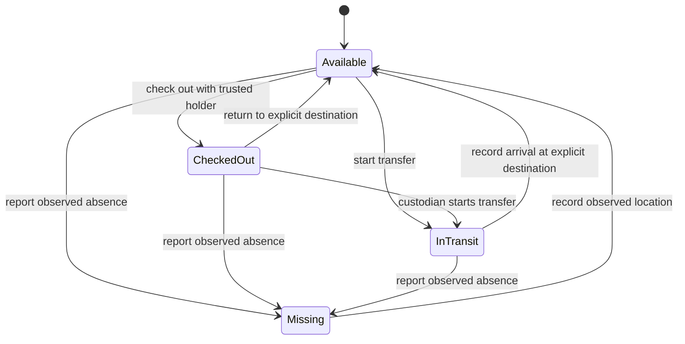

Available here means no outstanding custody record. It does not establish usable
quality or unreserved quantity. Checkout due dates are observation facts; they
never run a timer that returns an item or releases a reservation.

Departure frees the previous slot. Last-known observations retain immutable
names, positions and time separately from current placement. An inherited
subtree split preserves the original absolute observation and separately dates
its relative membership facts. An intended transfer destination is a plan, not
occupied or reserved space. Return and arrival revalidate the actual
destination.

Ordinary movement cannot erase direct or inherited custody. Explicit authorized
custody commands can split a movable subtree; permanent wells never split from
their plate. Missing and transit block physical material debits and credits.
Owned checked-out items remain subject to quality, quantity and reservation
rules. Reconciliation and quality observations remain separate commands.

Checkout and dispatch obey top-only stack retrieval and protect foreign holds. A
missing report records truth, retaining stock amounts, holds and the prior
responsible holder separately from the reporter. A middle-stack missing report
removes recorded occupancy and compacts the remaining ordinal metadata while
preserving relative order. It does not record physical retrieval of the others.

Locating a missing item is an explicit reason-bearing physical observation. It
restores available custody at the accepted destination; immutable history
retains prior responsibility. Reads and old-state upcasts never create custody
events.

## Physical definitions, installed arrangements and fit

A physical type describes a storage item or container, its scalar metadata
fields, default dimensions and structural rules. A recipe names an exact set of
type versions and their parent positions. Scientific material schemas remain
separate; both editors share the scalar field-definition and value primitives.
Creating equipment creates only the explicitly selected components and their
required ancestors. It does not create boxes, vessels or stock merely because a
brochure advertises a capacity.

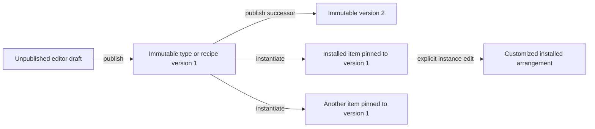

Publishing a successor never mutates existing versions or installed items.
Stable type-family IDs define allowed children; concrete version IDs pin
physical defaults and evidence. Instance-only layout edits preserve the type and
other instances. Removing occupied positions or changing occupied permanent well
geometry is refused. Unavailable positions retain their identities and recorded
contents but refuse new placements. Catalog selection lifecycle is separate from
this immutable content.

Geometry distinguishes external bounds from usable internal bounds. Decimal
dimensions normalize exactly to millimeters. Unknown axes stay unknown. Known
mounting orientations record upright quarter turns; an unknown orientation uses
conservative possible-axis bounds. A smaller bounding box alone never
establishes compatibility with an insert, opening or mounting system.

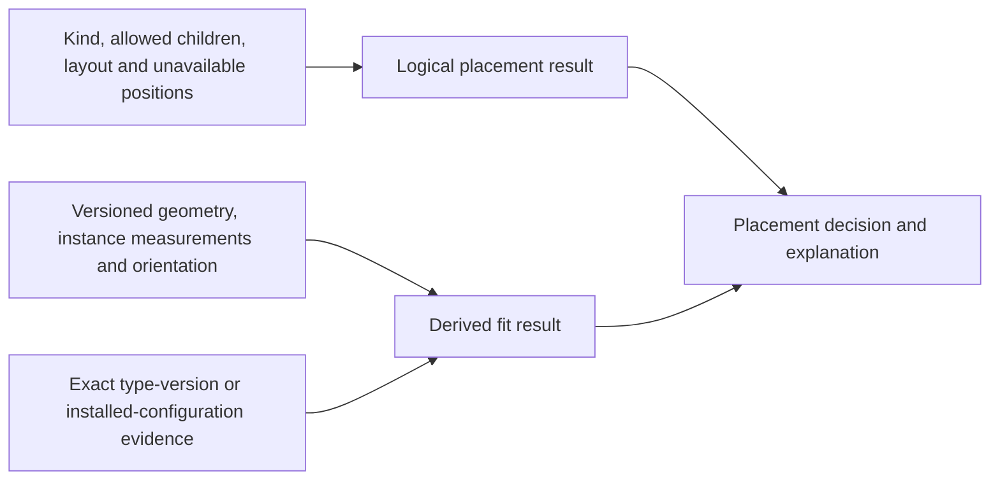

Fit is a projection, not a persisted state machine. It is compatible,
incompatible or unknown, with reasons and applicable evidence IDs. Explicit
structural incompatibility or known physical incompatibility refuses placement.
Unknown fit permits custom equipment and remains visibly unknown. A source URL
alone does not establish fit. Manufacturer assertions and local observations
retain their basis, exact subjects, position scope and orientations. Metadata
corrections preserve a physical configuration revision; relevant physical edits
invalidate evidence scoped to the previous configuration. Recording truthful
dimensions retains current occupancy and exposes a newly discovered misfit.

The curated catalog currently contains 20 configurations from two freezer
families. Each retains manufacturer sources, page locators and publication
scope. Rack alternatives and heterogeneous upper/bottom components remain
distinct. Conflicting exterior-depth sources leave that axis unknown. Catalog
reads are local and do not seed an inventory. Installation atomically publishes
missing definitions and selected components; an existing definition ID with
different content is refused rather than overwritten.

| Command                        | Effect                                                                    |
| ------------------------------ | ------------------------------------------------------------------------- |
| `define-physical-type`         | Publish an immutable physical type version.                               |
| `define-equipment-recipe`      | Publish an immutable arrangement pinned to exact type versions.           |
| `instantiate-physical-type`    | Create one named installed item with explicit metadata and destination.   |
| `instantiate-equipment-recipe` | Create the selected ancestor-closed components without stock.             |
| `configure-item`               | Explicitly set type pin, metadata, orientation and unavailable positions. |
| `reconfigure-storage`          | Change an instance layout while retaining valid identities and occupancy. |
| `record-item-geometry`         | Record reason-bearing dimensions and their optional source.               |
| `record-fit-evidence`          | Record scoped manufacturer support or local observation.                  |

## Catalog selection and update previews

Each exact type and recipe version has an explicit selection state. Content and
publication provenance stay immutable. Retirement changes future selection,
independently of the installed equipment's lifecycle, custody and contents.

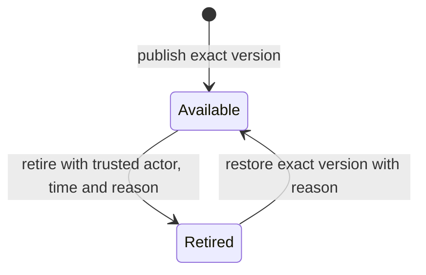

`retire-catalog-version` and `restore-catalog-version` name a tagged
type-version or recipe-version target. Repeated invalid transitions refuse
atomically. Exact operation retries return the original receipt; replaying a
retirement after a later restore does not retire the version again.

Current versus superseded is derived from version order. The highest published
version remains the current head when retired; an older version never silently
becomes the default. An available superseded version remains an explicit choice.
Retirement never changes installed pins, geometry, fit evidence, stock, holds or
custody. Same-pin edits and material use remain available under ordinary rules.
New instantiation or adoption of a retired version is refused.

Recipe eligibility uses its exact version and the selected components plus their
required ancestors. A retired recipe blocks every new installation. A retired
optional rack blocks selecting that rack; an explicitly selected shell omitting
it remains allowed if its root is available. Restoring a recipe does not restore
its component types. Full-arrangement dependency blockers and actual selected
component eligibility come from the same pure owner.

Catalog update preview classifies strict definitions as new, identical or
conflicting and shows source/model scope and exact installed references. It
never fabricates publication timestamps or writes inventory. Any conflicting ID
blocks applying that pack, including partial fit or recipe publication that
could otherwise refer to different existing geometry. Identical retired
definitions remain retired. Applying selected new definitions uses the ordinary
expected-revision batch owner; stale revisions and conflicting IDs refuse.
Nothing automatically synchronizes sources, replaces versions or migrates
installed equipment.

The native preview reads the offered built-in pack against the current admitted
inventory. An absent inventory is a pure empty snapshot for this calculation; it
remains absent afterward. Human and agent transports invoke the same domain
classifier. Their final write still passes through `inventory.execute`.

The setup view owns its tab and search query for the whole editor/preview
session. Returning from an exact-target dialog preserves that view; closing the
session resets it. Each target form owns a separate draft so changing targets
never carries another version's reason or selections.

## Physical item codes and exact lookup

Codes bind existing storage or movable vessels, separately from their stock,
material, placement and custody. Empty containers are valid targets. Permanent
wells use their plate's identity plus an explicit coordinate rather than an
independent movable-container label.

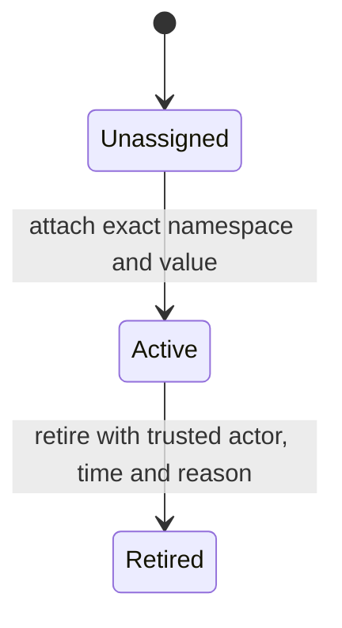

`attach-item-code` records an immutable target, namespace and value with trusted
assignment provenance. `retire-item-code` preserves that assignment permanently.
The exact namespace/value tuple stays reserved after retirement. New duplicate
attachments refuse; an exact operation retry returns the original receipt, even
after later retirement, without reactivating the code. Moving, emptying or
disposing an item never implicitly changes its code lifecycle. Correcting a
wrong label uses a new code and explicit retirement, not silent reassignment.

Namespaces are bounded lowercase ASCII technical identifiers. Values are one to
512 printable ASCII characters with at least one non-space character. Case,
punctuation, leading zeros and spaces remain exact. Unsupported characters and
invalid namespaces are explicit errors. No semantic parser trims, folds case,
coerces numbers or normalizes Unicode. The focused raw-input owner visibly
removes at most one trailing CRLF, LF or CR scanner terminator; interior
controls remain invalid. Scanned URLs remain opaque text and are never fetched.

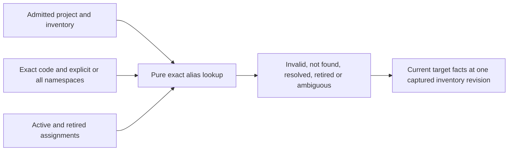

Null namespace searches all namespaces in the selected inventory. Multiple exact
matches are ambiguous, including retired matches or aliases of the same item.
There is no first, newest or active preference and no scientific material-search
fallback. Item IDs are inventory-scoped; lookup never silently searches another
inventory or switches projects. Codes grant no access.

The native read returns canonical scope, revision, trusted read time, principal,
resolution and matched target facts. Target records, effective custody, physical
configuration, current location and stock availability come from one parsed
state and availability context. Missing/transit/checkout retain last-known
observations separately from current location. An absent inventory stays absent;
lookup writes no rows, journal, clocks or events.

Lookup never locates a missing item, uses stock, releases holds, changes
quality, or records printing/attachment verification. Expected-item checking
compares full scope and tagged physical identity; a retired match remains
historical. The UI fences old responses by input, scope and inventory revision
and renders the returned snapshot rather than merging another revision's
availability. Ordinary follow-up actions revalidate through the existing command
owner. Generated labels and file output use a separate read/output boundary
below. Physical hardware qualification remains separate work.

## Existing-code labels and output

`inventory.prepare-label` admits one active binding and active physical target,
then invokes the lazy shared renderer on one native snapshot. Missing custody
remains explicit; preparing a label never locates the item. Unknown or retired
bindings, disposed targets, unsupported content and media overflow refuse
without inventory writes, journal entries, events or clock changes. Native and
agent routes recheck current authority after asynchronous module loading.

The artifact retains full scope, source revision, trusted read context, binding
and target snapshots, template/media/encoder/font identities, exact SVG and
SHA256. The QR symbol contains the exact alias bytes. Namespace and complete
tagged target are human-readable paths; the namespace and admitted inventory
context are still required for lookup. No local project fallback becomes a
globally portable identity. Item names are omitted from this bounded template.

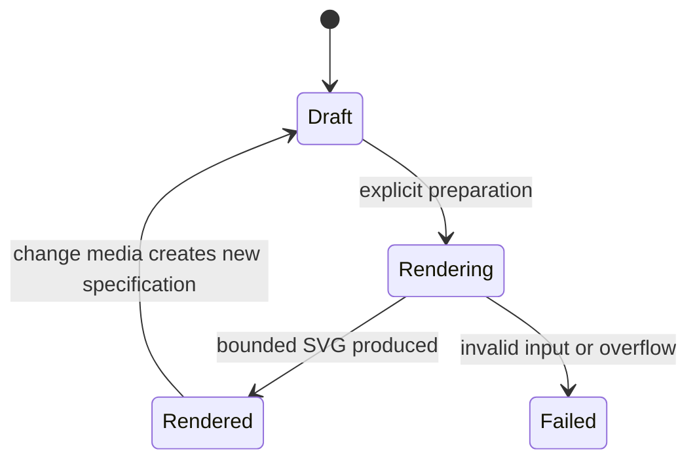

Rendered describes software output. It does not establish independent decoding,
file output, printing, attachment or hardware readability. Two fixed media
profiles retain four dots per module at 300 dpi and a four-module quiet zone.
The adapter composes an upstream QR matrix and reproducibly generated licensed
ASCII glyph paths; no runtime font fetch or parser is needed. Exact payloads
never shrink, truncate or change symbology to fit. Old artifacts retain their
bytes when current facts change. New preparation of a retired binding refuses.

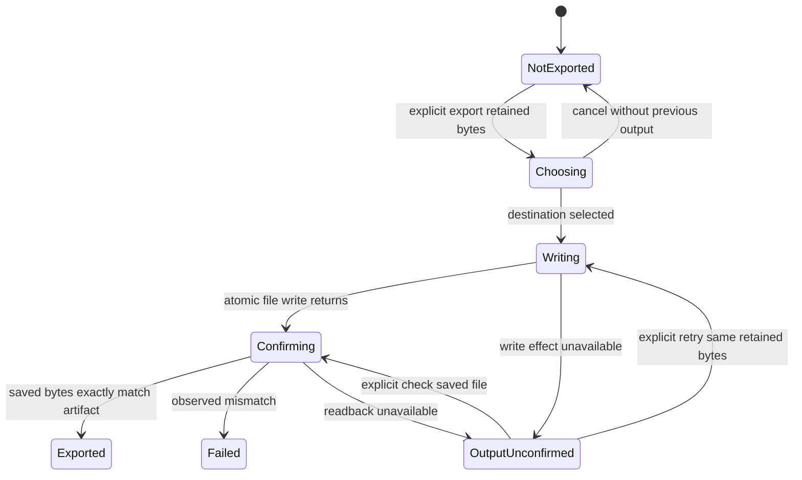

The existing save dialog, atomic filesystem writer and admitted reader own file
output. No arbitrary-path inventory mutation API is added. Canceling a new copy
restores the previous output observation. A failed dialog or observed byte
mismatch is explicit failure; a transported write error conservatively leaves
output unconfirmed. Exact artifact/destination remain available for check or
explicit retry. Forgetting an attempt leaves any existing file unchanged.

In-memory sessions are keyed by full project/inventory/code scope. Closing the
view detaches it without erasing a pending or unconfirmed copy. A late result
stays with its original session and never becomes another item's output.
Retired/disposed items can reopen retained artifacts; the view labels them as
historical snapshots. These sessions are not a durable print or issuance
journal. App restart retains inventory/code facts and saved files, not a
fabricated successful-output receipt.

Verification independently rasterizes the actual saved SVG, compares all decoded
bytes, and rejects erased symbol geometry. It qualifies that software artifact,
not any printer, scanner, media or cold-storage compatibility.

## Material identity and conservation

A scientific record identifies a material. A lot identifies one supplier batch
or internal preparation. Stocks reference a lot or an explicit unattributed
root. An aliquot inherits that reference. Independent unattributed stocks are
not compatible merely because both lack batch metadata.

Lots retain immutable supplier/preparation/pool/dilution origins. Contribution
snapshots retain source stock, material, provenance and exact withdrawn volume.
Later attribution does not change earlier snapshots or aliquots. Creating a
preparation records source identity, not a volume withdrawal. Lot provenance is
acyclic and does not follow a root stock’s mutable current attribution.

Transfer debits equal destination credits. Existing destinations require the
same scientific identity and provenance. Pool and dilute require an empty
destination, explicit output material and a new lot. Pool credits equal summed
contributions; dilution debits both the sample and a tracked diluent. Every
source debit, output credit and lineage record commits in one revision.

Known capacity limits additions and measured quantities. Known dead volume
limits withdrawals. Unknown limits remain explicit. Reconciliation records a
measurement; it does not invent a transfer. Quantities use exact decimal
arithmetic, including mixed units. Composition distinguishes unknown from
homogeneous with explicit analyte facts. Known concentration is an exact reduced
rational in canonical mass/volume or amount/volume units. Compatible decimal
input units normalize exactly; mass and molar quantities are not converted
without molecular weight. Unlisted analytes are unmeasured, not zero.

Pool, dilution and transfer into existing stock require an explicit output
mixing choice before calculating weighted concentrations. Legacy request shapes
without mixing remain unchanged and produce unknown mixed composition. A new
aliquot inherits its source. Missing input measurements or incompatible units
remain explicit unknown results. Contribution snapshots deep-copy the facts used
at commitment. Later measurements do not rewrite them.

Measurement input accepts decimal values and strict canonical facts. This lets
an edit preserve an existing one-third concentration and unknown reason while
changing another analyte. Internal arithmetic supports bounded input sets;
canonical stored results have explicit size limits. Final results do not depend
on contribution order.

## Atomic commands and receipts

`inventory.execute` accepts a project reference, inventory ID, operation ID,
expected revision, and command batch. The first accepted batch binds the
inventory to the admitted project. The native owner checks scientific material
references against eligible records in that project. Inventory does not infer
that a design exists physically.

One accepted batch increments the inventory revision once. Its state, immutable
accepted-command history and receipt commit in one SQLite transaction. A refused
batch changes no inventory state and has no committed receipt. Reads do not
create inventories or tables.

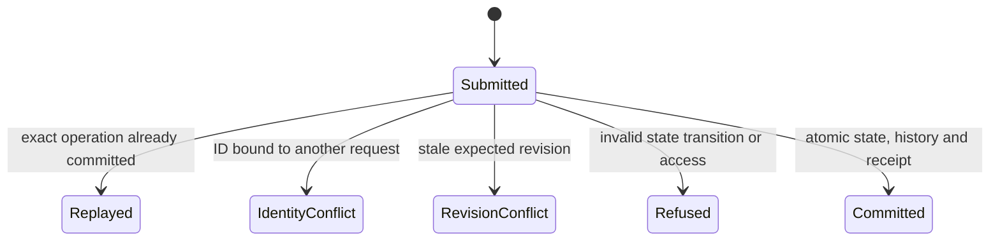

These are outcomes of an attempt. An identity conflict does not change or
replace the original committed receipt. The owner looks up a receipt before
checking the expected revision, so an exact successful retry remains readable
after later operations.

The operation identity is scoped to its inventory. The canonical request
includes the admitted project identity, operation ID, expected revision and
commands. Trusted actor identity and commit time are recorded separately.
Current authorization is still required to replay or inspect an old operation.

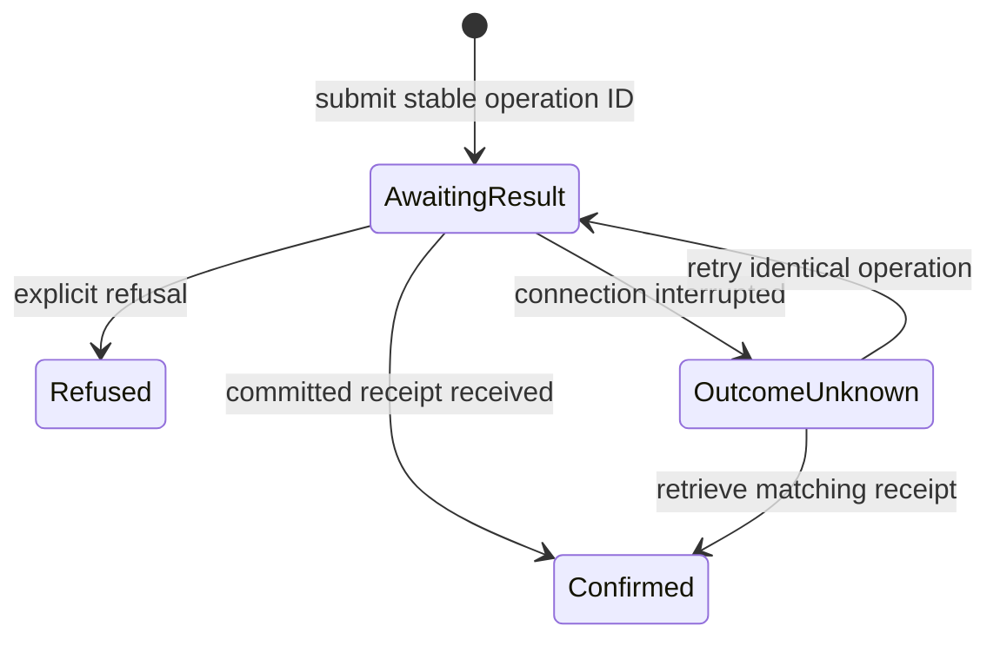

A timeout describes the caller's knowledge. It does not establish failure or
permit another debit under a new operation ID. The synchronous local owner has
no durable running state that needs abandoned-job recovery. Hardware actions
require a separate reconciliation protocol.

## Native boundary

All routes use the existing loopback endpoint, native credential, owner instance
identity and registered project scope:

| Command                            | Request and result                                                                                            |
| ---------------------------------- | ------------------------------------------------------------------------------------------------------------- |
| `inventory.projects`               | List admitted projects and stable default inventory identities.                                               |
| `inventory.materials`              | Search eligible scientific material in one admitted project.                                                  |
| `inventory.catalog`                | Read detached equipment definitions for an admitted project without inventory creation.                       |
| `inventory.catalog-update-preview` | Classify one built-in pack against an admitted inventory without publication or inventory creation.           |
| `inventory.resolve-item-code`      | Resolve exact scoped physical item codes and current target facts without mutation.                           |
| `inventory.prepare-label`          | Render an immutable existing-code QR SVG artifact from an admitted snapshot without file or inventory writes. |
| `inventory.availability`           | Derive quantities, reservations, custody and physical compatibility from current facts.                       |
| `inventory.execute`                | Apply an expected-revision command batch; return a committed receipt or explicit rejection.                   |
| `inventory.inspect`                | Read current state for an admitted project and inventory.                                                     |
| `inventory.operation`              | Read one original committed operation receipt.                                                                |
| `inventory.history`                | Read accepted operations with revision pagination.                                                            |

Agent requests recheck their exact current grant through the shared native
authorizer before read/write dispatch. Forwarded capability claims alone do not
authorize an operation. Native token and instance checks still bind the command
server, and the owner rechecks project authority at commitment. Desktop actor
records identify a trusted local window origin, not a verified human name.

The owner also verifies replay of accepted history against the persisted state.
This is a bounded local inventory recovery check, not a general migration or
cross-device synchronization protocol.

## Verification

Use
[the inventory verification skill](../skills/verify-inventory-core/SKILL.md). It
drives the real loopback command server, real registered-project authority and
real SQLite owner with synthetic material, then preserves state and receipt
readback after reopen. The bounded state exploration calls the production domain
transition function directly. The workspace map drives the genuine Electron
receive, move, use and history journey and checks exact state after application
restart. These checks do not establish a deployed service, real freezer fit,
cross-device behavior or robot execution.
