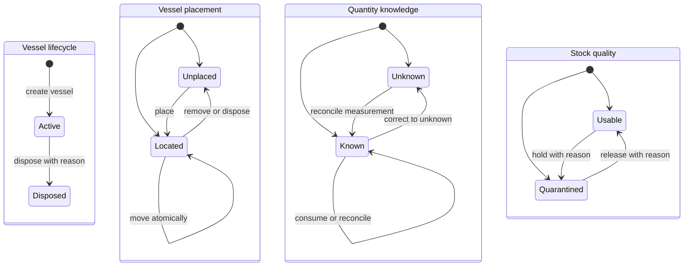
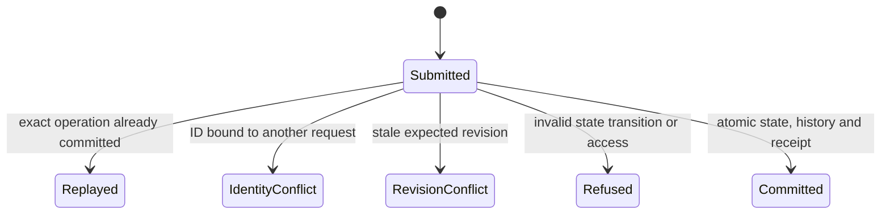
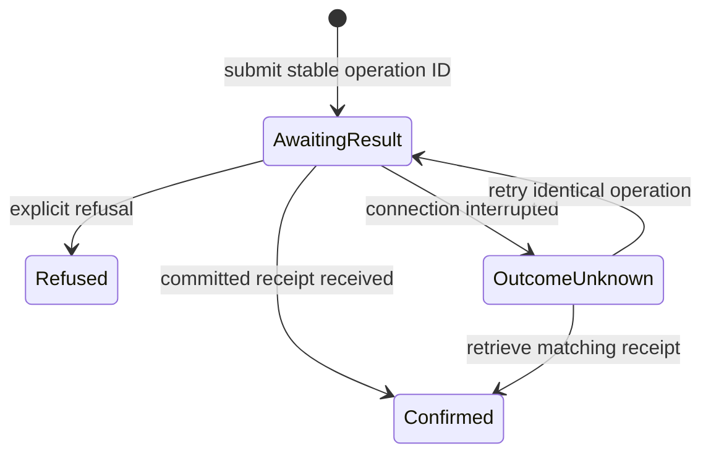

# Inventory command contract

The inventory core records physical possession separately from scientific
identity. A registered scientific record can have no physical stock or several
stocks. Storage locations hold named positions, vessels occupy positions, and
stock links a vessel to a scientific record. An empty vessel is valid.

The browser-safe domain owner is
`packages/core/domain-services/src/inventory.ts`. The native SQLite owner is
`apps/desktop/src/main/inventory-owner.ts`. Request parsing lives in
`apps/desktop/src/shared/inventory-command.ts`; the authenticated native command
server invokes the same owner that later interfaces can consume.

This version supports named positions, one stock per vessel, and exact volume
accounting. It has no inventory GUI, team synchronization, preparation/lot
model, mixtures, plate/grid rules, ordered-stack rules, or physical equipment
qualification. A slot named A1 does not turn a location into a plate.

## Independent states

These machines describe independent facts. They are not combined into a single
status field.

Disposal removes the vessel's current placement, retains its stock record and
last quantity, and prevents further use, movement, or quality changes. Known
zero does not dispose a vessel. Numerical consumption from unknown or
quarantined stock is refused.

Storage placement is either an explicit root or an immediate parent and named
slot. Vessel placement is explicitly unplaced or located. Each position is
exclusive across storage and vessels. Containment is acyclic. Moving a parent
changes its immediate placement and preserves descendant identities and local
positions.

Quantities use non-negative decimal strings in `L`, `mL`, `uL`, or `nL`, with
exact arithmetic and canonical `uL` readback. Unsupported units, negative
values, exponential notation and unrepresentable results are refused.
Consumption requires a positive amount. Reconciliation, quality changes,
consumption and disposal require a reason.

## Atomic commands and receipts

`inventory.execute` accepts a project reference, inventory ID, operation ID,
expected revision, and command batch. The first accepted batch binds the
inventory to the admitted project. The native owner checks scientific material
references against eligible records in that project. Inventory does not infer
that a design exists physically.

One accepted batch increments the inventory revision once. Its state, immutable
accepted-command history and receipt commit in one SQLite transaction. A refused
batch changes no inventory state and has no committed receipt. Reads do not
create inventories or tables.

These are outcomes of an attempt. An identity conflict does not change or
replace the original committed receipt. The owner looks up a receipt before
checking the expected revision, so an exact successful retry remains readable
after later operations.

The operation identity is scoped to its inventory. The canonical request
includes the admitted project identity, operation ID, expected revision and
commands. Trusted actor identity and commit time are recorded separately.
Current authorization is still required to replay or inspect an old operation.

A timeout describes the caller's knowledge. It does not establish failure or
permit another debit under a new operation ID. The synchronous local owner has
no durable running state that needs abandoned-job recovery. Hardware actions
require a separate reconciliation protocol.

## Native boundary

All routes use the existing loopback endpoint, native credential, owner instance
identity and registered project scope:

| Command               | Request and result                                                                          |
| --------------------- | ------------------------------------------------------------------------------------------- |
| `inventory.execute`   | Apply an expected-revision command batch; return a committed receipt or explicit rejection. |
| `inventory.inspect`   | Read current state for an admitted project and inventory.                                   |
| `inventory.operation` | Read one original committed operation receipt.                                              |
| `inventory.history`   | Read accepted operations with revision pagination.                                          |

The owner also verifies replay of accepted history against the persisted state.
This is a bounded local inventory recovery check, not a general migration or
cross-device synchronization protocol.

## Verification

Use
[the inventory verification skill](../skills/verify-inventory-core/SKILL.md). It
drives the real loopback command server, real registered-project authority and
real SQLite owner with synthetic material, then preserves state and receipt
readback after reopen. The bounded state exploration calls the production domain
transition function directly. Neither check qualifies a graphical inventory
workflow, a deployed service, real freezer fit, or robot execution.
