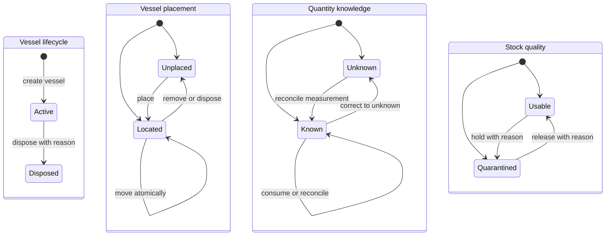
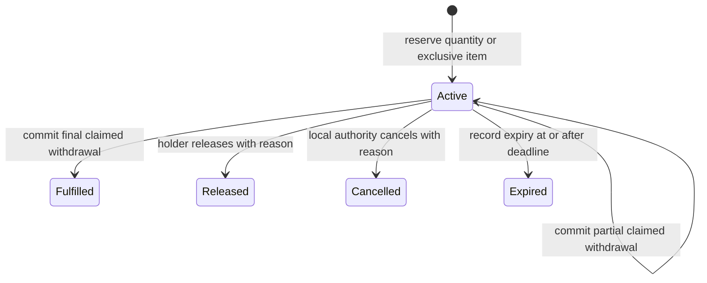
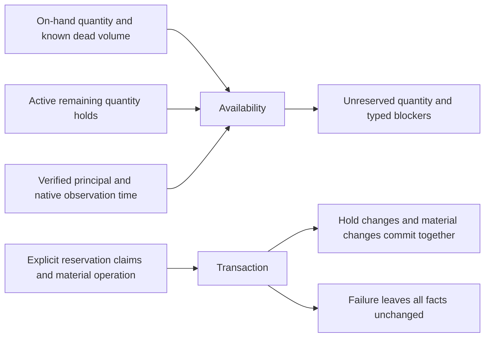
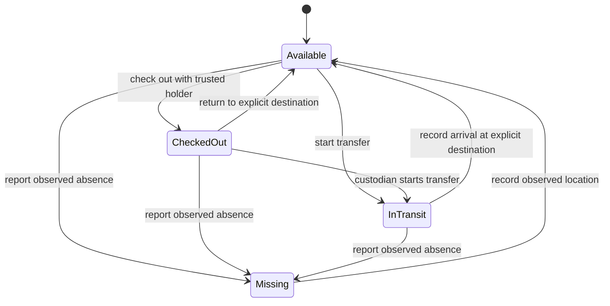
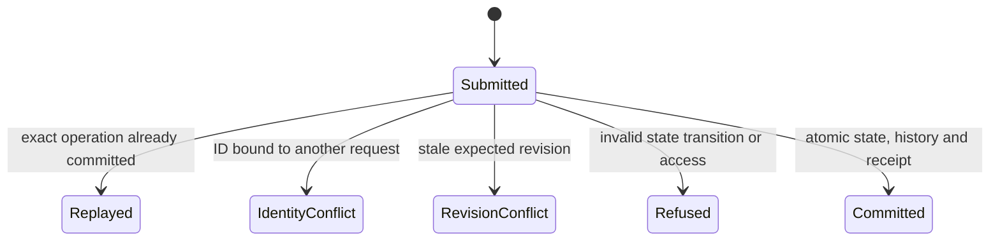
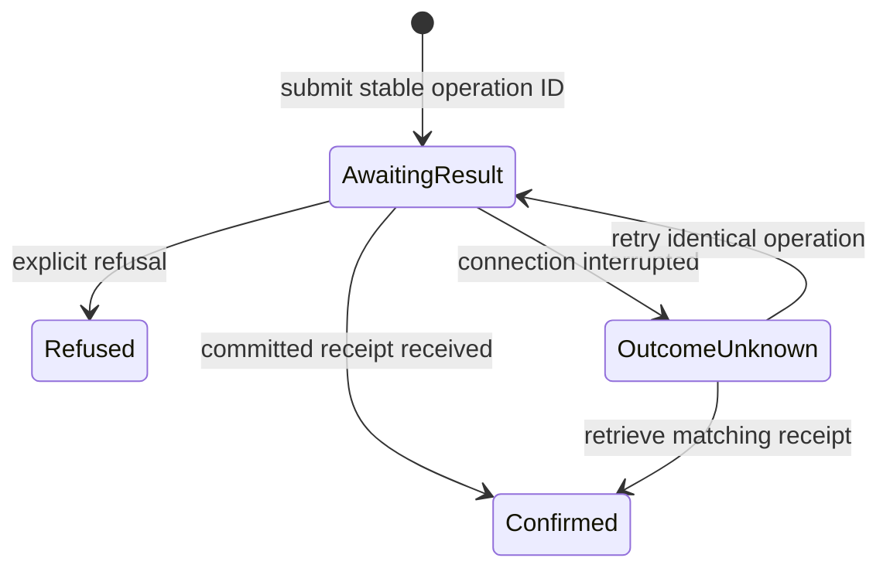

# Inventory command contract

The inventory core records physical possession separately from scientific
identity. A registered scientific record can have no physical stock or several
stocks. Storage locations hold named positions, vessels occupy positions, and
stock links a vessel to a scientific record. An empty vessel is valid.

The browser-safe domain owner is
`packages/core/domain-services/src/inventory.ts`. The native SQLite owner is
`apps/desktop/src/main/inventory-owner.ts`. Request parsing lives in
`apps/desktop/src/shared/inventory-command.ts`; the authenticated native command
server and desktop IPC invoke the same inventory owner.

The Inventory workspace and authenticated agent tool consume this same owner.
Layouts distinguish named positions, grids, removable-tube boxes, permanent-well
plates and ordered stacks. This version supports one stock per vessel and exact
volume accounting. Lots, internal preparations, exact-volume transfers, pooling,
tracked dilution, exact concentration facts and known container limits use the
same command owner. Quantity and item reservations and physical custody use that
owner too. Team synchronization and equipment qualification remain separate
work.

Permanent wells have stable identity and remain attached to their plate. A plate
moves with all its wells. Whole-plate disposal retains historical stock and
disposes every well. Stack order is derived from child placement alone. Explicit
push and pop commands enforce capacity and removal from the top.
`removal: 'top-only'` governs retrieval order; recording quantity does not prove
physical access to a buried plate.

Canonical state is v6. v1/v2/v3 composition facts upcast to explicit unknown
values. v1–v4 snapshots gain an empty reservation map and recorded clock floor
without a revision change. Reading v1 upcasts named layouts and movable vessels;
v1/v2 stocks receive distinct unattributed roots and unknown container limits.
Reads do not write or increment revision. Historical command shapes and request
digests stay unchanged for retry and replay.

## Independent states

These machines describe independent facts. They are not combined into a single
status field.

Disposal removes the vessel's current placement, retains its stock record and
last quantity, and prevents further use, movement, or quality changes. Known
zero does not dispose a vessel. Numerical consumption from unknown or
quarantined stock is refused.

Storage placement is either an explicit root or an immediate parent and named
slot. Vessel placement is explicitly unplaced or located. Each position is
exclusive across storage and vessels. Containment is acyclic. Moving a parent
changes its immediate placement and preserves descendant identities and local
positions.

Quantities use non-negative decimal strings in `L`, `mL`, `uL`, or `nL`, with
exact arithmetic and canonical `uL` readback. Unsupported units, negative
values, exponential notation and unrepresentable results are refused.
Consumption requires a positive amount. Reconciliation, quality changes,
consumption and disposal require a reason.

## Reservations and trusted time

Reservations record planned allocation independently of physical quantity and
placement. Each hold belongs to a stable local profile or verified agent. A
local profile represents an installation profile, not a verified person.

All terminal states are final. The clock passing a deadline changes eligibility
for fulfillment; it does not mutate the hold. An overdue hold remains allocated
until explicitly released, cancelled or expired. No timer owns business state.

Availability is derived, never stored as another status. Unknown quantity,
quarantine, disposed containers, conflicting item holds and allocation
shortfalls are explicit blockers. Reconciliation can reveal that promises exceed
stock; it retains both the truthful measurement and holds. An overdue hold does
not prevent using the unreserved remainder.

Ordinary withdrawals protect held quantity. Reserved withdrawals explicitly bind
claims to source debits through `fulfill-reservations`. Item holds respect
ancestor and descendant containment, including permanent wells. Movement cannot
introduce overlapping holds belonging to different principals.

The native owner derives the principal and samples time inside the same SQLite
transaction as the accepted state, receipt and journal. Accepted time is at
least the previous recorded floor. Exact operation retries return the original
receipt before sampling a new clock. New receipts carry versioned context
separately from the existing actor string. Replay uses saved context and time;
historical receipt bytes and request digests remain unchanged. This is a local
monotonic clock guarantee; shared authority belongs to team synchronization.

## Physical custody and observations

Custody is independent of quality, quantity, reservation and lifecycle. Each
storage aggregate or movable vessel has a direct custody state. Permanent wells
inherit their plate's custody. One shared projection finds the controlling
ancestor; checking out a box never rewrites every descendant. v1–v5 state
upcasts to available direct custody without writes or revision changes.

Available here means no outstanding custody record. It does not establish usable
quality or unreserved quantity. Checkout due dates are observation facts; they
never run a timer that returns an item or releases a reservation.

Departure frees the previous slot. Last-known observations retain immutable
names, positions and time separately from current placement. An inherited
subtree split preserves the original absolute observation and separately dates
its relative membership facts. An intended transfer destination is a plan, not
occupied or reserved space. Return and arrival revalidate the actual
destination.

Ordinary movement cannot erase direct or inherited custody. Explicit authorized
custody commands can split a movable subtree; permanent wells never split from
their plate. Missing and transit block physical material debits and credits.
Owned checked-out items remain subject to quality, quantity and reservation
rules. Reconciliation and quality observations remain separate commands.

Checkout and dispatch obey top-only stack retrieval and protect foreign holds. A
missing report records truth, retaining stock amounts, holds and the prior
responsible holder separately from the reporter. A middle-stack missing report
removes recorded occupancy and compacts the remaining ordinal metadata while
preserving relative order. It does not record physical retrieval of the others.

Locating a missing item is an explicit reason-bearing physical observation. It
restores available custody at the accepted destination; immutable history
retains prior responsibility. Reads and old-state upcasts never create custody
events.

## Material identity and conservation

A scientific record identifies a material. A lot identifies one supplier batch
or internal preparation. Stocks reference a lot or an explicit unattributed
root. An aliquot inherits that reference. Independent unattributed stocks are
not compatible merely because both lack batch metadata.

Lots retain immutable supplier/preparation/pool/dilution origins. Contribution
snapshots retain source stock, material, provenance and exact withdrawn volume.
Later attribution does not change earlier snapshots or aliquots. Creating a
preparation records source identity, not a volume withdrawal. Lot provenance is
acyclic and does not follow a root stock’s mutable current attribution.

Transfer debits equal destination credits. Existing destinations require the
same scientific identity and provenance. Pool and dilute require an empty
destination, explicit output material and a new lot. Pool credits equal summed
contributions; dilution debits both the sample and a tracked diluent. Every
source debit, output credit and lineage record commits in one revision.

Known capacity limits additions and measured quantities. Known dead volume
limits withdrawals. Unknown limits remain explicit. Reconciliation records a
measurement; it does not invent a transfer. Quantities use exact decimal
arithmetic, including mixed units. Composition distinguishes unknown from
homogeneous with explicit analyte facts. Known concentration is an exact reduced
rational in canonical mass/volume or amount/volume units. Compatible decimal
input units normalize exactly; mass and molar quantities are not converted
without molecular weight. Unlisted analytes are unmeasured, not zero.

Pool, dilution and transfer into existing stock require an explicit output
mixing choice before calculating weighted concentrations. Legacy request shapes
without mixing remain unchanged and produce unknown mixed composition. A new
aliquot inherits its source. Missing input measurements or incompatible units
remain explicit unknown results. Contribution snapshots deep-copy the facts used
at commitment. Later measurements do not rewrite them.

Measurement input accepts decimal values and strict canonical facts. This lets
an edit preserve an existing one-third concentration and unknown reason while
changing another analyte. Internal arithmetic supports bounded input sets;
canonical stored results have explicit size limits. Final results do not depend
on contribution order.

## Atomic commands and receipts

`inventory.execute` accepts a project reference, inventory ID, operation ID,
expected revision, and command batch. The first accepted batch binds the
inventory to the admitted project. The native owner checks scientific material
references against eligible records in that project. Inventory does not infer
that a design exists physically.

One accepted batch increments the inventory revision once. Its state, immutable
accepted-command history and receipt commit in one SQLite transaction. A refused
batch changes no inventory state and has no committed receipt. Reads do not
create inventories or tables.

These are outcomes of an attempt. An identity conflict does not change or
replace the original committed receipt. The owner looks up a receipt before
checking the expected revision, so an exact successful retry remains readable
after later operations.

The operation identity is scoped to its inventory. The canonical request
includes the admitted project identity, operation ID, expected revision and
commands. Trusted actor identity and commit time are recorded separately.
Current authorization is still required to replay or inspect an old operation.

A timeout describes the caller's knowledge. It does not establish failure or
permit another debit under a new operation ID. The synchronous local owner has
no durable running state that needs abandoned-job recovery. Hardware actions
require a separate reconciliation protocol.

## Native boundary

All routes use the existing loopback endpoint, native credential, owner instance
identity and registered project scope:

| Command               | Request and result                                                                          |
| --------------------- | ------------------------------------------------------------------------------------------- |
| `inventory.projects`  | List admitted projects and stable default inventory identities.                             |
| `inventory.materials` | Search eligible scientific material in one admitted project.                                |
| `inventory.execute`   | Apply an expected-revision command batch; return a committed receipt or explicit rejection. |
| `inventory.inspect`   | Read current state for an admitted project and inventory.                                   |
| `inventory.operation` | Read one original committed operation receipt.                                              |
| `inventory.history`   | Read accepted operations with revision pagination.                                          |

Agent requests recheck their exact current grant through the shared native
authorizer before read/write dispatch. Forwarded capability claims alone do not
authorize an operation. Native token and instance checks still bind the command
server, and the owner rechecks project authority at commitment. Desktop actor
records identify a trusted local window origin, not a verified human name.

The owner also verifies replay of accepted history against the persisted state.
This is a bounded local inventory recovery check, not a general migration or
cross-device synchronization protocol.

## Verification

Use
[the inventory verification skill](../skills/verify-inventory-core/SKILL.md). It
drives the real loopback command server, real registered-project authority and
real SQLite owner with synthetic material, then preserves state and receipt
readback after reopen. The bounded state exploration calls the production domain
transition function directly. The workspace map drives the genuine Electron
receive, move, use and history journey and checks exact state after application
restart. These checks do not establish a deployed service, real freezer fit,
cross-device behavior or robot execution.
