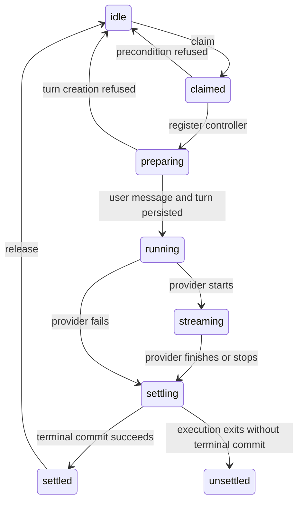

# Stop and settlement

## Sub-features

Stop before provider registration; stop during response; delayed completion after Stop; provider failure; terminal persistence failure; delete an active conversation.

## How to get to it (user POV)

Use Stop or Escape while an answer is pending. Delete a running conversation from its history menu. A failed durable terminal write must not admit another turn as though the first settled.

## Driving it with Vitest and native CDP

Run the skill's focused driver for `chat-stop.integration.test.ts`, `run-chat-turn.test.ts`, `chat-turn-lifecycle.test.ts` and `chat-execution.workflow.test.ts`. The native driver stops an in-flight provider HTTP request and reads the resulting persisted turn and messages. Retain original frames to show queue and Stop timing.

## Gotchas

Provider completion and durable terminal commitment are separate events. Terminal-write failure must retain active ownership; deletion forbids late callbacks from recreating transcript state. A stopped provider must not overwrite a newer execution. Native HTTP fixtures do not qualify CLI model behavior or hosted availability.

The execution owner distinguishes a provider preparing, running or streaming
from a turn being durably settled. A successful atomic terminal commit permits
release. A rejected commit leaves an unsettled active turn and blocks new
execution in that conversation. The existing restart recovery repairs persisted
running turns; this workflow does not claim an automatic retry of failed writes.

