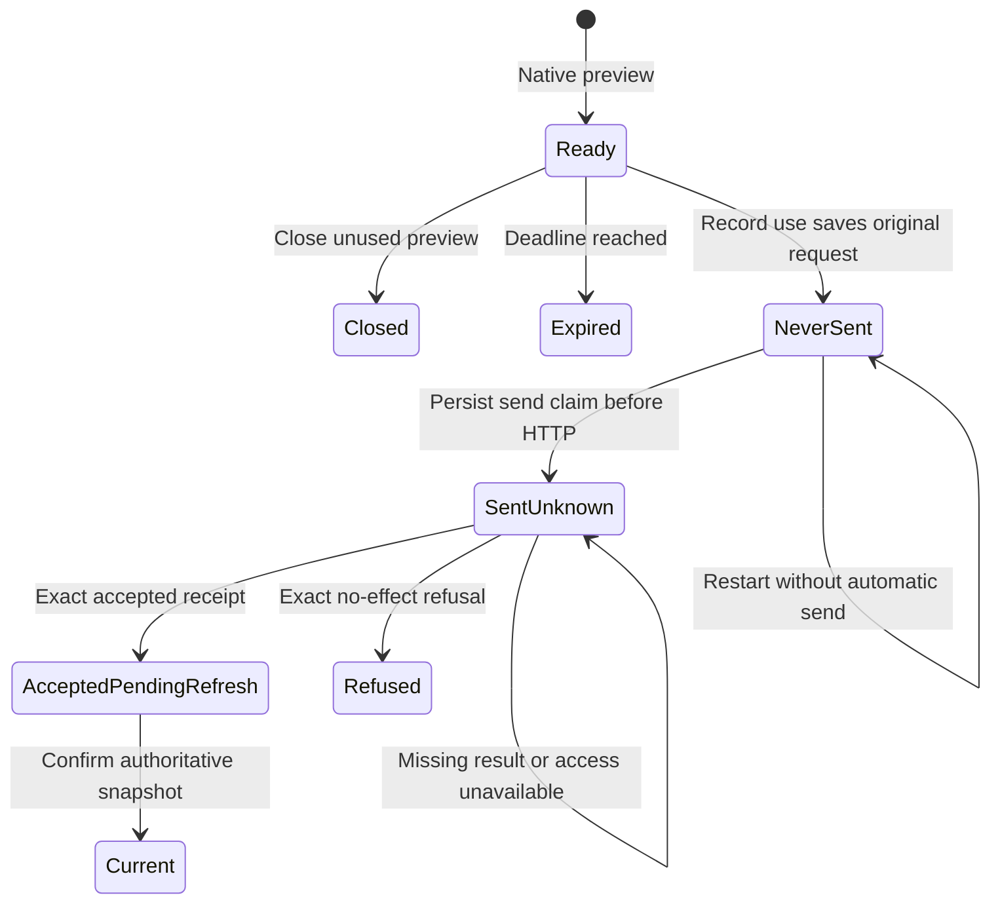

# Inventory workspace

## Sub-features

- Select an admitted project and inspect its durable inventory.
- Create a storage hierarchy and inspect its available positions.
- Receive a measured or unknown amount of a registered scientific material.
- Move, use, measure, quarantine, release and dispose physical stock.
- Read accepted operation history and recover an interrupted operation without
  creating another debit.
- Choose an organization inventory independently of an open project, inspect its
  confirmed stock and current permission, preview completed use, explicitly record
  it, and recover its original request without recording the use twice.

## How to get to it (user POV)

Open the **Inventory** activity button. Set **Inventory scope** to **Local
project**, then select a project. Use **Add location** to create storage, then
**Receive stock** to place a physical container in a vacant position. Select a
stock row to inspect its details, actions and history.

## Driving it with Playwright and Electron

Use an isolated background app with the task's configured renderer and debug
ports. Verify the runtime profile is `scenario-e2e` and its provenance names
this exact checkout before driving it. Keep captures outside the checkout.

The required first journey is a freezer containing a two-position box. Receive
100 µL into A1 through the form, move the container to A2, and use 20 µL with a
reason. Read 80 µL, the A2 placement and exactly one consumption in history.
Restart the owned application and confirm those values remain. Preserve original
screenshots and interaction video, together with native state, receipts and
history readback.

Use `inventory-button`, `inventory-panel`, `inventory-project-picker`,
`inventory-positions` and `inventory-stock-table` to find the surface. Location
and position cells expose `data-location-id` and `data-position-id`. Stock rows
expose `data-stock-id`. Forms have accessible names **Add location**, **Receive
stock**, **Move container** and **Use stock**.

The controller's focused checks cover lost acknowledgement, confirmed commit
followed by read failure, revision conflict, reload retention and a project
switch during a pending read. These are distinct from the genuine app journey.
The core skill's native HTTP workflow continues to cover receipt recovery
against real SQLite.

## Organization inventory: preview, submit and recover

This is separate from the local project path. Use two isolated desktop profiles,
each signed in through the normal authentication owner as a different account.
The local scenario journey is a separate harness; keep its profile guard intact.
Both accounts need current access to the same organization inventory. Prepare
its initial measured stock through the authoritative inventory API; a local
project or an organization role alone grants no inventory permission. Keep the
backend and desktop profile identities in the evidence. This procedure does not
establish that a particular run has passed.

1. Open **Inventory**, select the **Inventory scope** combobox and choose
   **Organization inventory**. This branch must work without an open project.
   The local project picker and local mutation toolbar must be absent.
2. Use **Inventory organization** to choose an organization, then **Organization
   inventory** to choose an available inventory. Options expose their canonical
   IDs through `data-value`; use those when names repeat.
3. Capture the visible account, inventory name, current permission, confirmed
   history revision, quantity and full location path. Compare both profiles'
   complete snapshots with the authoritative snapshot and state hash. A list
   entry, cached projection or proposed state is not a confirmed snapshot.
4. With an allowed account and ten microlitres of measured stock, select that
   stock using **Stock to preview**, enter **7** in **Amount to use (µL)** and
   enter **Reason for use**. Click **Preview use**. Capture the interaction and
   the separate **Proposed use · Not recorded** result showing three
   microlitres. Confirmed quantity and history revision must remain unchanged.
5. Edit the amount: the proposed result must disappear immediately. Preview
   again, then use **Close preview**. Preserve the original candidate capture;
   capture the remaining confirmed stock after Close. Read back authoritative
   state and events to prove no inventory mutation or event occurred. There is
   no use recorded by Close. Expired, cancelled or edited previews must not be
   usable for submission.
6. Preview seven microlitres again. **Record use** is the explicit submission
   action; use it only to report work the operator has completed. Capture the
   transition from **Proposed use · Not recorded** to **Use recorded**. Require
   the original operation ID, request hash and accepted receipt, then read the
   authoritative stock as three microlitres at the next history revision. Refresh
   the second profile and compare both complete snapshots with the server.
   Repeating Submit for the same Native preview handle must return the original
   operation and receipt, with no second debit or physical event.
7. Switch inventory or account/session while a read is pending. Previously
   selected names, forms and candidates must disappear, and the old response
   must not repopulate the new scope. A second login for the same account is a
   different desktop session. Read-only permission must prevent previews even
   when the organization's directory calls that person an administrator.
8. Let a ready preview expire and capture its expiry message with the candidate
   absent. A cached offline snapshot must say **Last confirmed inventory** and
   be read only. Restore connectivity and explicitly refresh before previewing.

Use `organization-inventory` and its `data-account-id`,
`organization-inventory-confirmation` and its `data-inventory-id`,
`article[data-stock-id]`, and `organization-inventory-proposed` to scope
captures. The proposed section exposes `data-preview-handle-id`. The retained
report section uses `organization-inventory-attempt` with `data-operation-id`
and `data-request-sha256`; expand **Original report details** to inspect the
original amount, reason and stock reference. **Refresh inventory** reloads the
selected inventory; **Refresh
organizations** reloads organization choices before selection. Capture the
visible rows and candidate in the viewport, not an offscreen assertion alone.
The focused UI tests cover late responses, edit/Close invalidation,
offline/read-only restrictions and the deadline timer; real two-profile captures
and native/server readback are separate acceptance evidence. Native HTTP
acceptance alone does not qualify the desktop submission controls.

### Retained report states

The Native owner saves the full original request before claiming it may have
been sent. Closing a preview removes only an unused handle. It cannot cancel or
delete a retained request, an uncertain submission or an accepted use.



Verify the recovery branches with retained attempts, not by creating a new
operation that happens to contain the same amount:

- **Original report saved on this desktop** means `never-sent`. A restart must
  not send it automatically. **Confirm original report** explicitly sends those
  original bytes; **Check status** does not authorize a first send.
- **Outcome not confirmed** means the request may have reached the server.
  **Check status** inspects the original operation. **Retry original request**
  resends the exact original request; it must keep its operation ID, device
  client ID, access generation, plan and request hash. A missing result or lost
  access is not a definitive refusal and must not enable replacement submission.
- **Use recorded** with **Inventory refresh pending** is already accepted.
  **Refresh inventory** confirms delivery of a complete authoritative snapshot;
  it must not debit stock again or promote the proposed preview into the cache.
- **Use was not recorded** requires an exact no-effect refusal. Only then may
  **Start a new preview** begin a deliberate new request against current stock.
- Recover a retained report after a normal application restart. Also sign in
  again as the same account with a new issued desktop session: each recovery
  flight must pin that current session while preserving the old request and its
  original session provenance. A different account must not see the report.
- Lose connectivity or revoke access while a report is uncertain. Keep the
  original report for recovery; never apply a local debit, automatically drain
  saved reports or fabricate a refusal. A late valid receipt may settle its
  original retained row without repopulating another account's visible state.

Use separate captures for saved-but-unsent, uncertain, accepted-with-refresh-
pending and confirmed outcomes. A receipt and the current projection are
independent facts. Preserve failed attempts and compare exact requests and
receipts after reopening each owned desktop database.

### Native command map

These are methods on the Native `inventory` client, not organization roles or
implicit project permissions. The Native owner derives active identity and
authority; renderer-supplied IDs do not grant access.

| User action | Native method | Required meaning |
| --- | --- | --- |
| Choose organization/inventory | `organizationDirectory`, `organizationSnapshot` | Current scoped directory and complete confirmed snapshot |
| Preview use | `organizationPreview` | Proposed state plus a live caller-bound handle; no physical effect |
| Close preview | `organizationCancelPreview` | Cancel unused handle only; preserve any retained attempt |
| Record use | `organizationSubmit` | Retain exact request before sending; reuse the operation for a consumed handle |
| Check status | `organizationAttempt`, `organizationRecover` with `inspect` | Scoped pending/exact lookup and original-operation inspection |
| Confirm original report | `organizationRecover` with `confirm-unsent` | Explicit first send of the saved original request |
| Retry original request | `organizationRecover` with `retry-exact` | Exact retry of a possibly sent request |
| Refresh accepted inventory | `organizationRecover` with `inspect` | Preserve receipt and confirm actual snapshot delivery |

### Opt-in real HTTP Native acceptance

The generic acceptance test uses two actual issued desktop sessions, the real
HTTP client and two owned temporary file-backed SQLite databases. Provide an
external private JSON fixture with `{baseUrl, orgId, materialId, admin,
operator}`. `admin` and `operator` are normal `StoredSession` values for distinct
accounts and sessions, with current tokens and at least five minutes remaining.
The selected material must be admitted by the real organization registry. The
test refuses expired authentication rather than manufacturing or silently
refreshing a fixture session. Keep credentials out of logs, source and captures.

From the repository root, explicitly opt in to the submission case:

```sh
DNAFORGE_INVENTORY_NATIVE_FIXTURE=/absolute/private-fixture.json \
DNAFORGE_INVENTORY_NATIVE_EVIDENCE_DIR=/absolute/external-evidence \
pnpm --dir apps/desktop exec vitest run \
  src/main/__tests__/organization-inventory-native.acceptance.test.ts \
  -t 'submits one actual shared use'
```

This creates its own inventory through normal create, grant and bootstrap APIs.
It saves every accepted prefix and the issued target, then verifies ten to three
microlitres through one Native submission, duplicate-handle recovery, exactly
two physical events including bootstrap, and exact request/receipt/cache rows
after file reopen. Inspect its original artifacts and the authoritative server
state rather than accepting a test exit code alone. The separately named
preview-only case proves no post-bootstrap effects; it does not substitute for
submission or real desktop interaction captures.

## Gotchas

- Unknown quantity differs from a measured zero. A disposed container's last
  recorded amount is historical, not available stock.
- A confirmed commit followed by a failed refresh is a read failure. Never
  submit that consumption again under a new identity.
- An interrupted submission keeps its exact operation ID and request. Check
  status or retry that same request.
- A revision conflict retains the draft but requires inspection of the latest
  inventory before deliberate resubmission.
- A change notification requests a refresh. It is not a receipt for a pending
  operation.
- The verification workspace and scientific material are synthetic. This journey
  does not establish physical freezer fit, barcode hardware or robot execution.
  The local journey does not establish organization synchronization.
  Preview-only evidence does not qualify shared submission or durable recovery.
  Native submission acceptance does not qualify desktop UI or device execution.
- Preview use currently accepts measured volumes in µL. Unknown amounts and
  other dimensions remain visible as confirmed facts but cannot be selected for
  this use form; never reinterpret a count or mass as a volume.
