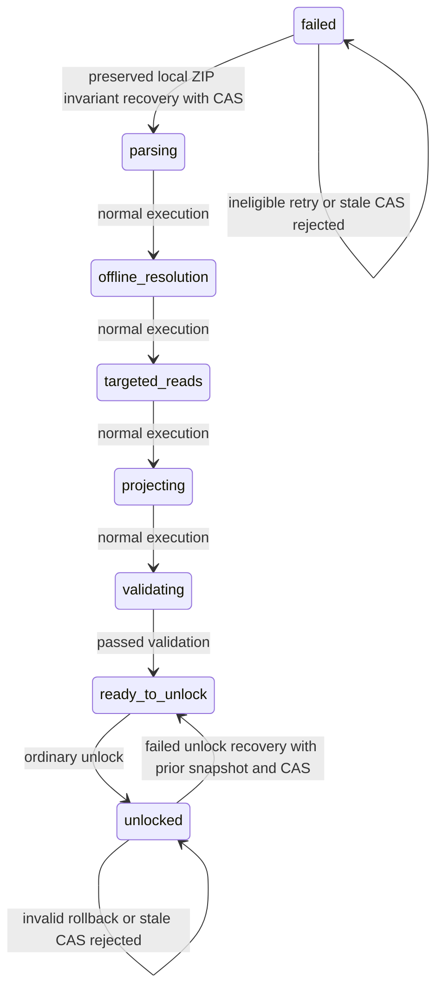

# Migration recovery

## Sub-features

- Retry only a failed local ZIP run with an internal invariant error.
- Clear its interruption/error fields and retain run, source and attempt
  identity.
- Restore the exact ready snapshot after a failed unlock transaction.
- Reject ineligible states, mismatched identity, changed source evidence and
  stale writes.
- Ordinary transitions continue to treat failed and unlocked runs as terminal.
- Resume the preserved ZIP through the coordinator and publish the completed
  workspace.

## How to get to it (user POV)

An interrupted local Benchling ZIP import retains its workspace and evidence.
The explicit Resume command reuses that evidence. If final workspace
registration fails after Git writes, the workspace stays locked and its next
unlock can retry. The harness drives these same application commands below the
Electron transport.

## Driving it with the recovery harness

Run the skill's `drive` command. It selects all cases in
`apps/desktop/src/main/benchling-migration/recovery.integration.test.ts` and
`rolls back a post-Git COMMIT failure and retries with a clean complete repository`
in `staging-workspace.test.ts`.

The store cases use real file-backed SQLite and reopen the persisted run. A
second connection updates the same state to prove the full expected snapshot,
rather than only its state name, protects a recovery write. Refused operations
must leave the stored value unchanged. The coordinator case imports a synthetic
notebook ZIP through production intake and execution, resumes the failed run and
observes one registered workspace with the original run/source identity. The
staging case injects a failure at SQLite COMMIT after Git publication, checks
restored locked state and unchanged global records, then repeats unlock
successfully.

## Gotchas

- Recovery is an explicit exception to ordinary terminal-state execution. A
  plain save must not reopen the run.
- Retry eligibility requires `localExportArtifact.format === 'zip'`. An external
  ZIP source alone is not an eligible preserved-artifact retry.
- Unlock rollback restores timestamps and metadata from the prior ready
  snapshot; it does not synthesize a fresh ready run.
- SQLite and Git are real. Electron IPC and renderer validation are test
  adapters. This workflow makes no claim about desktop layout or renderer
  fidelity.
