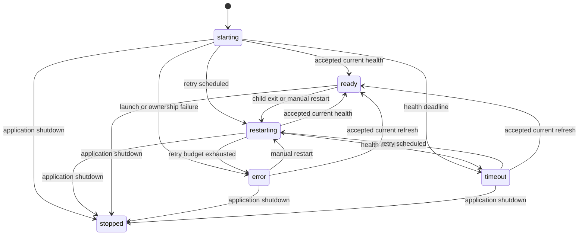

# Compute-service lifecycle

## Sub-features

- Failed startup retries stop at the existing limit; no phantom restart remains.
- Pending and new requests receive a typed unavailable result when retries end.
- Manual retry starts a new generation and restores authenticated health.
- A ready child crash automatically recovers without accepting old-generation readiness.
- Application shutdown rejects readiness requests, reports stopped and closes its owned port.

`SidecarSessionAuthority` owns these states. A spawn advances the generation; late results from older generations cannot update it. Process handles, timers and outstanding promises remain resources held by the supervisor.

## How to get to it (user POV)

Opening the desktop starts local compute. Compute-service restart invokes `restartSidecar`; exiting invokes `killSidecar`. Requests obtain credentials through the session authority. The status IPC and status refresh expose that same service lifecycle.

## Driving it with Vitest

Run the skill's drive command. It calls production `startSidecar`, `restartSidecar` and `killSidecar`, using actual spawned Node HTTP children at the executable boundary. Six failed children exhaust the initial attempt plus five retries. Assert matching error status/authority, immediate typed waiter rejection, no new generation after the retry window, successful manual HTTP recovery, a replacement PID after a crash, stale-generation rejection and an unavailable port after shutdown. Credential and header tests cover the request-facing boundary.

## Gotchas

Fake timers accelerate backoff; OS process and HTTP events remain asynchronous. The fixture authenticates the health request using the actual inherited session credential. Never log that credential. Failure before cleanup still runs `afterEach`. The Electron host and Python executable are substituted, so this map does not claim visual or packaged-runtime qualification.
