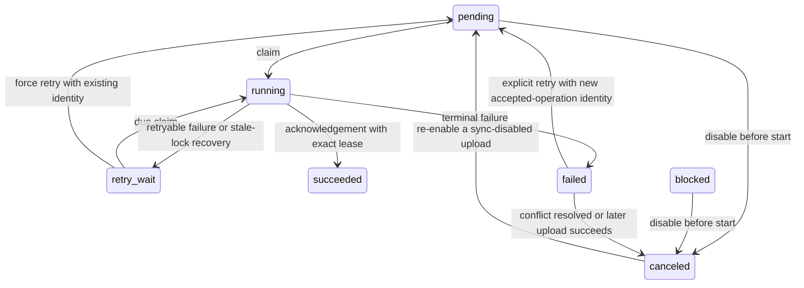

# Queue commands

## Sub-features

- Upload acceptance, claim, acknowledgement and superseded failures.
- Automatic retry keeps accepted-operation identity; explicit failed retry
  rotates it.
- A stale completion cannot take over a replacement lease, even with the same
  device and clock.
- Disable cancels work that has not started and preserves uncertain retries.
- Conflict resolution cancels the exact observed conflict and queues its
  replacement atomically.

## How to get to it (user POV)

Enable workspace sync, make a change, use Sync now, retry a failed upload, turn
sync off, or resolve a conflict with Keep local or Use remote. The harness calls
the production owners of these commands with synthetic cloud responses.

## Driving it with the sync harness

Run the skill's `drive` command. Selected cases come from
`workspace-sync-queue.test.ts`, `workspace-sync-upload-worker.test.ts`,
`workspace-sync-actions.test.ts` and `workspace-sync-conflicts.test.ts` under
`apps/desktop/src/main/__tests__`.

Observe the queue row, binding, version and retained snapshot assertions. The
rollback case injects a SQLite trigger failure after conflict cancellation and
compares all queue, binding and version rows to their original values. The stale
acknowledgement case preserves the successor's lease and records no version.

## Gotchas

- A replacement worker's running lease must survive an old callback; it is not
  an abandoned lease that the old worker may clear.
- Disable deliberately preserves `retry_wait` rows because remote acceptance may
  be uncertain. Do not broaden cancellation without a separate behavior change.
- The harness uses actual SQLite transactions and production command handlers.
  Remote services, clocks and watchers are adapters, so this is not a cloud
  test.
