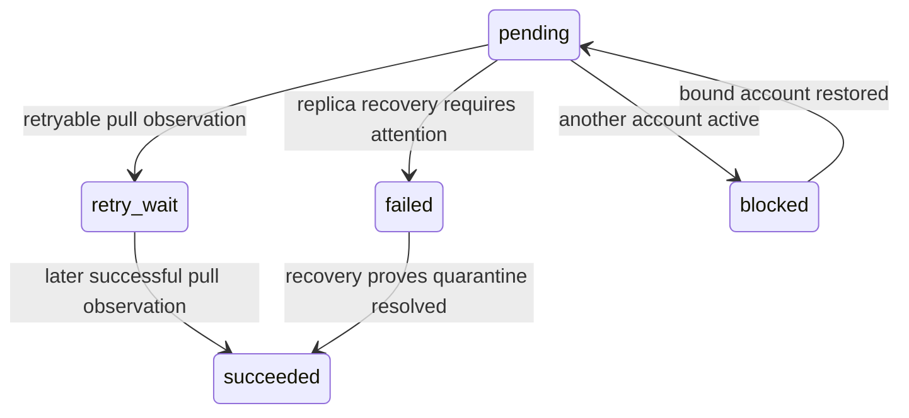

# Recovery observations

## Sub-features

- Persist a retryable remote-listing failure and clear it when the remote
  recovers.
- Reclaim stale execution locks and unblock the correct account.
- Preserve package quarantine and settle a resolved replica quarantine.

## How to get to it (user POV)

Open a synced workspace, lose the remote connection, then reconnect. Restart
after interrupted replica application. Failed recovery stays visible and blocks
uploads until recovery succeeds.

## Driving it with the sync harness

The `drive` command selects production runtime cases for a remote-list failure
followed by recovery, stale lock reclamation, account restoration, and resolved
versus persistent quarantines from `workspace-sync-runtime.test.ts`.

The assertions inspect durable `refresh` observation rows separately from upload
work. Successful recovery clears the observation and permits the mapped catch-up
upload; persistent package quarantine stays failed and prevents it.

## Gotchas

- Historical `refresh` rows record recovery observations. Their settlement may
  accept states that a leased upload acknowledgement must reject.
- The workflow injects cloud responses and watcher callbacks at existing
  dependency boundaries. It makes no live network or UI claim.
